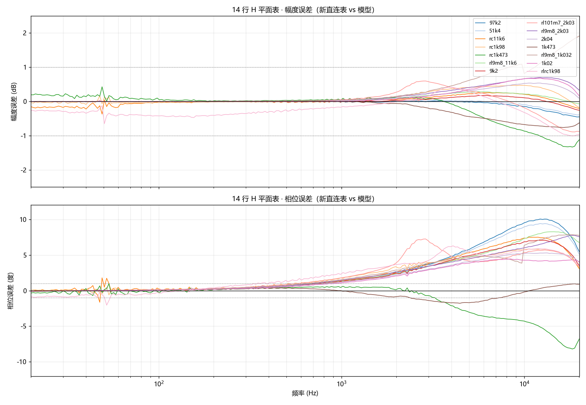
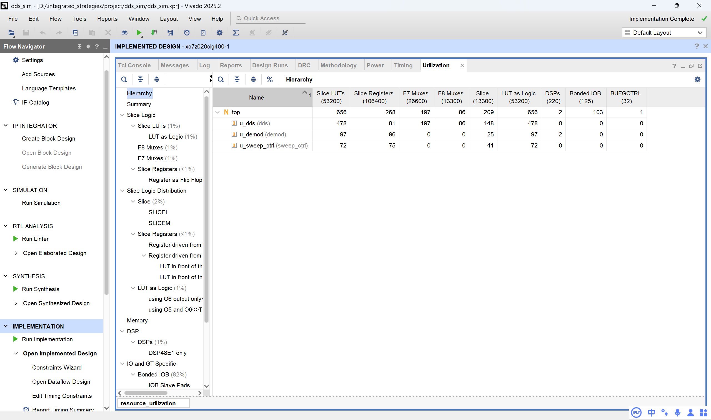
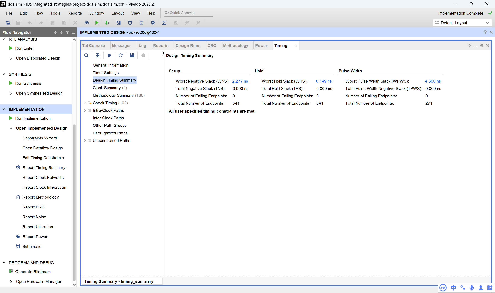

# 便携式电子电路智能诊断系统

**基于 PYNQ-Z2 的 20 Hz–20 kHz 扫频阻抗/传递函数测量与电路拓扑识别**

[GitHub 仓库](https://github.com/xchllll/intergrated_strategies) · PYNQ-Z2 / Zynq-7020 · Vivado 2025.2 · Python / Flask / Plotly

> 项目状态：测量链路、短接校准、输入网络去嵌入、机器学习拓扑识别与网页展示已经打通；仓库内保留了某次可用环境下的实测数据、校准表和验收记录，便于复现与对照。

> **最短复现路径**：板端部署 → `sudo bash board/start_pl_i2s.sh`（上电后一次性加载 PL/Codec 并常驻 I2S）→ `bash start_dashboard.sh` → 接 0 Ω 短接，点“一键短接校准”并输入轮次 → 换 DUT，点“开始扫频测量”。之后 dashboard 可以随意重启，不需要再加载 PL 或重新校准。完整步骤见第五节；没有板子可先看 5.2 的 PC 演示。

---

## 一、项目简介

### 1.1 一句话概括

用 PYNQ-Z2 板载的 ADAU1761 音频 Codec 作为激励与采集前端，在 PL 内完成 DDS 扫频和 I/Q 正交解调，测量被测电路（DUT）在 **20 Hz–20 kHz、240 个对数频点**上的幅频与相频响应；经过**短接复数校准 + 输入网络去嵌入**后，由轻量机器学习模型识别 RC / RL / RLC 拓扑，并通过 Flask 网页实时展示 Bode 曲线、校准状态和识别结果。

### 1.2 背景与目标

传统电路诊断通常需要信号发生器、示波器或阻抗分析仪，设备体积大、接线复杂，而且结果依赖人工判读。本项目希望把“激励—采集—解调—校准—识别—展示”收进一块 PYNQ-Z2：

- **便携**：只需要 PYNQ-Z2、3.5 mm 音频线/转接板和待测电路，不需要台式仪器；
- **相干测量**：PL 内用与激励同源的 DDS 本振做 I/Q 解调，避免“先采波形再做 FFT”的相位基准问题；
- **可校准**：短接表消掉 DDS、I2S、Codec、PL 解调、积分窗等整套环路响应；H 平面表再去掉输入端频变阻抗；
- **可解释**：网页显示校准后曲线、数据来源（演示/实测）和 AI 置信度；原始值与校准值都写入 `history.csv`，不把演示数据冒充硬件实测；
- **可复现**：采集、校准、训练、识别共用同一套频点和调度，仓库保留实测数据集与验收 JSON。

### 1.3 核心特性

| 特性 | 说明 |
|---|---|
| 全数字相干解调 | DDS 产生 16 位正弦/余弦本振，PL 内完成混频与 48 位有符号累加 |
| 自适应积分窗 | 按 `N = periods·fs/f` 覆盖整数个信号周期，高频自动增加周期数，低频受下限保护 |
| 帧边界对齐 | `top.v` 把 `ps_start` 锁存到 `rx_data_valid`，使每次测量的 DDS 相位从确定的 I2S 帧边界开始 |
| 三层校准 | 短接复数校准 → 16 行 H 平面输入网络去嵌入 → 以 `R_ref` 为参考重新嵌入 |
| 一键短接校准 | 网页弹窗输入轮次，多轮短接扫频做复数平均，原始数据交给 `calibrate_path.py` 写表；不写 `history.csv` |
| 跨进程相位锚定 | 上电后一次 `start_pl_i2s.sh` 让 PL/I2S/Codec 常驻；dashboard 重启只附着已有 PL，不再加载 bitstream，Codec 帧状态不被打断 |
| 双测量后端 | 自研 PL 解调链路（完整幅相）；PYNQ 官方音频闭环（幅值可用、相位无物理参考，用于最低档硬件自检） |
| 跨版本模型 | 训练在 PC 上完成，导出为 JSON；板端 JSON 前向推理只用 numpy，避免 sklearn 版本耦合 |
| 数据可追溯 | 网页扫频同时保存未校准与已校准值；`cal_applied`、`phase_valid`、`sweep_id` 等字段齐全 |
| 离线网页 | Plotly 静态文件随仓库提供，不依赖 CDN，适合局域网/无外网环境 |

### 1.4 测量与校准原理

DUT 串接在 Codec 的 HP 输出与 LINE IN 输入之间，测量的是分压比：

```text
H_meas(f) = V_LINE(f) / V_HP(f)
```

实际读到的 `raw(f)` 还包含 DDS、I2S、Codec DAC/ADC、PL 解调与积分窗的整套环路响应 `S(f)`：

```text
raw(f) = S(f) · H_true(f)
H_true(f) = Zin(f) / (Z_dut(f) + Zin(f))
```

**第一层：短接校准（消环路）**

短接时 `R_dut = 0`，理论上 `H_true = 1`，所以短接测量就是 `S(f)`。把它的倒数存成复数系数：

```text
H_cal(f) = raw(f) · H_short⁻¹(f)
```

代码中存为 `mag_gain` / `phase_offset_deg`，同时保留等价的 `h_re` / `h_im`，插值时幅值按对数、相位按增量处理，跨 ±180° 不会出错。

**第二层：输入网络去嵌入（消 Zin）**

`Zin(f)` 不是常数：低频约 10.99 kΩ，高频因并联电容和串联电感而下降并相移。仓库的 `data/input_network.json` 是当前 **16 行 H 平面表**，每行是一条标准件的 `(f, H, Zin)` 曲线。测量时在复平面 H 上做反距离加权，插值出当前 DUT 对应的 `Zin(f)`，再反解：

```text
Z_dut(f) = Zin(f) · (1 - H_cal(f)) / H_cal(f)
```

**第三层：显示参考（R_ref）**

最后把 DUT 重新嵌入到一个恒定的参考电阻 `R_ref ≈ 10.99 kΩ` 上：

```text
H_disp(f) = R_ref / (Z_dut(f) + R_ref)
```

这样纯电阻 DUT 显示为 0 dB / 0°，RC/RL/RLC 显示的是它们相对 `R_ref` 的真实衰减与相移。详细推导、标准件清单和局限性见 [`skill/DE_EMBED_METHOD.md`](skill/DE_EMBED_METHOD.md)。

> 注：`skill/DE_EMBED_METHOD.md` 的标准件表是早期 13 行版本；当前 `data/input_network.json` 是 **2026-11-02 的 16 行表**：14 行基础上增加 `rc0n956_9k9`（9.9 kΩ + 0.956 nF）和 `rl22m_6k86`（6.86 kΩ + 22 mH）。重建与校验见 [`report/hplane_16rows_20261102.md`](report/hplane_16rows_20261102.md)。

---

## 二、系统架构

### 2.1 总体信号链

```text
PS（PYNQ Linux / Flask / 校准 / ML 推理）
  │  4 × AXI GPIO：phase_inc / window_n / start / done / acc_I / acc_Q
  ▼
PL（100 MHz）
  DDS → I2S TX → ADAU1761 DAC → HP OUT ──[ DUT ]──► LINE IN → ADAU1761 ADC → I2S RX → I/Q 解调
                                                                                        │
                                                    48 位 acc_I / acc_Q ◄───────────────┘
                                                            │
                                                            └──► AXI GPIO → PS
```

### 2.2 FPGA 内部数据通路

1. **DDS**：32 位相位累加器，1024 点正弦表，同时输出 `sine` 与超前 90° 的 `cosine`；每次测量前装载 `-2046·phase_inc`，使第一个真正被 demod 消费的样本相位为 0。
2. **I2S TX**：首次 `ps_start` 才释放 `i2s_tx.enable`，输出从固定 LRCLK 状态开始，并等待 1024 个采样帧暖机；`bclk = 100 MHz / 32 = 3.125 MHz`，每帧 2048 个系统时钟，因此 `fs = 100 MHz / 2048 = 48828.125 Hz`。
3. **模拟环路**：HP 输出 → DUT → LINE IN → ADAU1761 ADC。`i2s_rx` 在右声道采样点用当前帧的 L+R 生成 `mix_data`，并同时给出 `data_valid`；夹具接 Tip 或 Ring 都能测。
4. **I/Q 解调**：`adc_in` 分别与 `cos`、`-sin` 相乘，乘积打一拍后进入 48 位累加器；整数个信号周期内 2f 分量平均为 0。
5. **测量状态机**：`IDLE → MEASURE → FLUSH → DONE`。`ps_window_max` 在启动前写入；窗满后先 FLUSH 一拍补上最后一个流水线样本，再把结果锁存到 `latched_acc_I/Q`，最后置起 `out_done`。
6. **PS 读取**：4 个 AXI GPIO 分别负责频率控制字、积分窗长/完成标志、I 路高低位、Q 路高低位；48 位有符号数按补码还原。

### 2.3 软件分层

| 层 | 主要文件 | 作用 |
|---|---|---|
| RTL | `src/top.v`、`dds.v`、`demod.v`、`i2s_tx.v`、`i2s_rx.v` | DDS、I2S、正交解调、测量 FSM、结果锁存 |
| PS 驱动 | `board/ps_ctrl.py`、`board/acceptance.py` | MMIO 读写、频率/窗长换算、48 位回读、Codec 与 bitstream 加载 |
| 校准与去嵌入 | `python_model/calibration.py`、`python_model/input_network.py` | 短接复数校准、H 平面插值、`Z_dut` 反解、`R_ref` 重嵌入 |
| 数据与采集 | `data/gen_dataset.py`、`tools/collect_dut.py` | 历史数据落盘、DUT 数据集采集 |
| 机器学习 | `diagnosis_system/common/features.py`、`diagnosis_system/ml/` | 13 维特征、DT/MLP 训练、JSON 导出与 numpy 推理 |
| 网页 | `diagnosis_system/dashboard/app.py`、`templates/index.html`、`static/dashboard.js` | Flask API、Plotly Bode 图、状态/校准/AI 展示 |
| 入口 | `board/start_pl_i2s.sh`、`run_dashboard.py`、`start_dashboard.sh` | 上电一次加载 Codec/PL 并常驻 I2S；dashboard 只启动 Flask |

### 2.4 关键参数

| 项目 | 值 |
|---|---|
| 板卡 / FPGA | PYNQ-Z2，Zynq-7020，`xc7z020clg400-1` |
| PL 系统时钟 | 100 MHz（`FCLK_CLK0`） |
| Codec | ADAU1761，I2C 7 位地址 `0x3B` |
| 音频采样率 | `100 MHz / 2048 = 48.828125 kHz` |
| I2S BCLK | 3.125 MHz（32 分频） |
| Codec MCLK | 25 MHz（100 MHz / 4，50% 占空比） |
| Codec 转换比 | `CONVERTER0(0x4017) = 0x06`，即 `CONVSR = 6` → 512 × fs |
| 扫频范围 / 点数 | 20 Hz–20 kHz，240 点对数等间隔 |
| 每点积分窗 | `N = periods · fs / f`，`periods = clamp(1000·f/fs, 10, 1000)`；20 Hz–20 kHz 实际约 10–410 个周期 |
| 解调输出 | 48 位有符号 `acc_I` / `acc_Q`，AXI GPIO 分低 32 位 + 高 16 位读取 |
| 校准表 | `data/calibration_table.json`，format 2，240 个 direct 频点 |
| 输入网络表 | `data/input_network.json`，format 3，16 行标准件，`R_ref ≈ 10989 Ω` |
| 识别类别 | 当前模型 5 类：RC 低通/高通、RL 低通/高通、RLC 带通 |
| 网页 | Flask + 本地 Plotly，默认端口 5000 |

> 说明：`src/top.v` 和 `board/acceptance.py` 中仍保留了一些“10 MHz / 50 MHz MCLK”的历史注释；当前 RTL 的 `mclk_div` 是 4 分频，即 **25 MHz**，配套 `CONVSR=6`（512×fs）。以当前代码与 XSA 为准。

### 2.5 音频引脚（PYNQ-Z2）

| 信号 | FPGA 引脚 | 方向 |
|---|---|---|
| `au_mclk` | U5 | FPGA → Codec |
| `i2s_bclk` | R18 | FPGA → Codec |
| `i2s_lrclk` | T17 | FPGA → Codec |
| `i2s_sdata`（放音） | G18 | FPGA → Codec |
| `i2s_sdata_in`（录音） | F17 | Codec → FPGA |
| `au_scl` / `au_sda` | U9 / T9 | PS I2C1 → Codec |

约束见 [`constraints/top.xdc`](constraints/top.xdc)。注意 `sdata_o` 与 `sdata_i` 的方向不能对调；对调后时钟可能正常，但数据会错位。

---

## 三、功能与实测结果

### 3.1 主要指标

| 指标 | 结果 |
|---|---|
| 单轮 240 点扫频 | 约 20 s（短接扫频实测 19.9 s） |
| 1 kHz 单点 | `periods=10`、`N=488`、理论积分 9.994 ms、实测约 12.1 ms |
| 短接重复性 | 20 kHz 0.00 dB / 0.00°；全频段相位约 −0.02…+0.07° |
| 9.8 mH + 11.6 kΩ @ 20 kHz | −6.28 dB / −3.14°，理论模型 −6.28 dB / −3.12° |
| 旧 14 行 H 平面误差（2026-10） | 幅度 rms 0.07–0.55 dB（max 1.91 dB）；相位 rms 0.69–4.14°（max 10.04°） |
| 新 16 行 H 平面 in-sample（2026-11-02） | 幅度 rms 均值 0.012 dB（max 0.070 dB）；相位 rms 均值 0.049°（max 0.177°） |
| 数据集 | 5 类 × 30 条 = 150 条真实扫频曲线，每条 240 点 |
| 分类 | 按类别分层抽 20% 测试；决策树 100.00%，MLP 100.00% |
| 资源占用 | 656 LUT（1%）、268 FF（<1%）、2 DSP（1%） |
| 时序 | WNS 2.277 ns、WHS 0.149 ns、WPWS 4.500 ns，约束全部满足 |
| 上板验收 | `data/acceptance_latest.json`：backend=rtl，1 kHz，`done=true`，100 MHz，`passed=true` |

> 分类准确率的限定：训练与测试都来自同一块板、同一套夹具下采集的 150 条真实曲线，只做了 80/20 分层划分，**没有做跨设备、跨夹具或域外测试**。100% 只说明这批数据在当前划分下完全可分，不代表任意环境的泛化能力。

### 3.2 H 平面误差



上图和 [`report/hplane_14rows_errors.md`](report/hplane_14rows_errors.md) 是 2026-10 的历史 14 行版本，仅用于对照，不代表当前 16 行表。当前 16 行表的建立与校验见 [`report/hplane_16rows_20261102.md`](report/hplane_16rows_20261102.md)。

> 当前 `data/input_network.json` 是 **2026-11-02 的 16 行表**：在 14 行基础上增加 `rc0n956_9k9`（9.9 kΩ + 0.956 nF）和 `rl22m_6k86`（6.86 kΩ + 22 mH），并用当前 1 轮短接表重建。旧 `hplane_14rows_errors` 图/报告保留为历史版本。

### 3.3 资源与时序报告

> 以下截图来自历史构建，用于说明资源/时序量级；当前 RTL 已加入 I2S 门控、RX valid 对齐和 DDS 相位预装，重新综合后应以新报告为准。

<details>
<summary>展开 Vivado 资源占用 / 时序截图</summary>





</details>

---

## 四、仓库结构

```text
intergrated_strategies/
├─ src/                        # RTL：top / dds / demod / i2s_tx / i2s_rx / sine.mem
├─ sim/                        # Testbench 与仿真波形截图
├─ constraints/top.xdc         # PYNQ-Z2 音频/I2C 引脚约束
├─ project/dds_sim/            # Vivado 2025.2 工程 + Block Design + XSA
├─ build/build.tcl             # 从原工程导出的重建脚本（见“重新生成 bitstream”）
├─ board/
│  ├─ ps_ctrl.py               # PS 侧 AXI GPIO 驱动、频率/窗长/测量
│  ├─ acceptance.py            # 最低档验收：Codec/bitstream 加载 + 单点测量
│  ├─ audio_loopback.py        # PYNQ 官方音频闭环驱动与分析
│  ├─ calibrate_path.py        # 纯数据建表：复数平均 + 写 calibration_table.json
│  ├─ start_pl_i2s.sh          # 上电后一次性加载 PL/Codec、启动常驻 I2S
│  ├─ start_pl_i2s.py          # start_pl_i2s.sh 的 Python 实现/健康检查
│  ├─ pynq_audio.py / i2c_probe.py
│  ├─ cal_toggle.sh            # 校准开关（direct / buffer / off / all / status）
│  ├─ design_1_wrapper.xsa     # 实际加载的硬件平台（内含 bitstream）
│  └─ design_1_wrapper.bit     # 兼容/备用 bitstream
├─ python_model/
│  ├─ calibration.py           # 幅相还原、短接校准、校准表读写
│  ├─ input_network.py         # H 平面输入网络去嵌入
│  └─ demod_sim.py             # 定点解调 Python 模型
├─ diagnosis_system/
│  ├─ common/features.py       # 13 维频响特征
│  ├─ ml/                      # train / infer / json_infer / export_model / 模型文件
│  └─ dashboard/               # Flask 后端、Plotly 前端、演示 CSV
├─ data/
│  ├─ calibration_table.json   # 某次实测短接校准表（环境相关快照）
│  ├─ input_network.json       # 16 行 H 平面表
│  ├─ history.csv              # 网页扫频历史（未校准 + 已校准）
│  ├─ real/                    # 5 类 × 30 条实测曲线
│  ├─ acceptance_latest.json   # 最近一次 RTL 验收记录
│  └─ dataset_rc_lpf.csv       # PC 演示用片段
├─ tools/
│  ├─ collect_dut.py            # 通过网页 API 采集 DUT 数据
│  ├─ build_hplane.py           # 短接表 + 标准件扫频 + 万用表参数 → H 平面表
│  └─ hplane_standards.example.json  # 14 只标准件的实测参数/sweep_id 模板
├─ tests/                       # 无硬件单测 / 资产检查 / 音频分析 / H 平面建表测试
├─ report/                      # 性能指标、资源/时序、H 平面误差、混淆矩阵
├─ docs/                       # 环境、寄存器映射、最低验收
├─ skill/                      # 开发过程中沉淀的可复用经验与去嵌入方法
├─ run_dashboard.py            # 只启动 Flask，附着常驻 PL/I2S
└─ start_dashboard.sh          # dashboard 后台启动脚本
```

> 仓库名沿用 `intergrated_strategies`（不是 `integrated`），clone 时请照抄。

---

## 五、复现步骤

### 5.1 准备清单

**硬件**

- PYNQ-Z2 开发板、官方配套电源、网线；
- 已烧录 PYNQ 3.0 (Carlisle) 镜像的 micro SD 卡；
- 3.5 mm 音频线/转接板（能分别接触 HP 与 LINE IN 的 Tip/Ring/Sleeve）；
- 待测无源电路（电阻、电容、电感、面包板/测试夹具）；
- 一台能访问板卡局域网的电脑（浏览器即可）。

**软件**

| 环境 | 要求 |
|---|---|
| 板端 | PYNQ Linux 3.0 (Carlisle)，Python 3.10.4，pynq 3.1.1，Flask 2.1.3，numpy 1.21.5，scipy 1.8.0，matplotlib 3.5.1，sklearn 0.23.2，joblib 0.17.0 |
| PC | Python 3.10+；运行网页演示/训练时安装 `diagnosis_system/requirements.txt` |
| FPGA（可选） | Vivado 2025.2，器件 `xc7z020clg400-1` |

> **板端不要执行 `pip install -r diagnosis_system/requirements.txt`**。PYNQ 镜像自带与 pynq 匹配的 numpy/Flask 版本，盲目升级可能破坏 pynq 依赖。该 requirements 主要给 PC 演示和模型训练用。

**网络与默认地址**

| 服务 | 地址 | 默认凭据 |
|---|---|---|
| Jupyter | `http://192.168.2.99:9090` | 用户 `xilinx`，密码 `xilinx` |
| Dashboard | `http://192.168.2.99:5000` | 无认证 |

如果板卡由路由器 DHCP 分配地址，以 `hostname -I` 或串口/Jupyter 显示的地址为准。

### 5.2 PC 端：无硬件快速验证

先在电脑上确认网页、演示数据和模型推理链路是通的。

```bash
git clone https://github.com/xchllll/intergrated_strategies.git
cd intergrated_strategies

# Windows（PowerShell）
python -m venv .venv
.venv\Scripts\Activate.ps1

# Windows（cmd）
# python -m venv .venv
# .venv\Scripts\activate.bat

# Linux / macOS
# python3 -m venv .venv
# source .venv/bin/activate

pip install -r diagnosis_system/requirements.txt
python -m diagnosis_system.dashboard.app
```

浏览器打开 `http://127.0.0.1:5000`，点击“开始扫频测量”。Windows 下后端会明确标注“Windows 演示数据”，不会假装是硬件实测。

> **注意**：`run_dashboard.py` 只负责启动板端 Flask，要求先执行 `board/start_pl_i2s.sh` 让 PL/I2S 常驻；它自己不会加载 Codec/PL，在 PC 上运行也会因缺少 `pynq` 失败。PC 演示请使用上面的 `python -m diagnosis_system.dashboard.app`。

> **演示数据说明**：`data/dataset_rc_lpf.csv` 是仓库保留的 20 点真机片段，所以 PC 页面只画 20 个点；完整的 240 点演示曲线在 `diagnosis_system/dashboard/data_rc_lpf.csv`。如果希望 PC 演示也显示 240 点，可在备份后把后者复制为前者：
>
> ```bash
> # 可选，会覆盖 data/dataset_rc_lpf.csv
> cp diagnosis_system/dashboard/data_rc_lpf.csv data/dataset_rc_lpf.csv
> ```

### 5.3 板端：部署与启动

> **本次实际板端状态（2026-11-02 SSH 实测）**
>
> - 目录：`/home/xilinx/jupyter_notebooks/project`；不是 git 仓库，而是平铺部署。
> - 根目录：`acceptance.py`、`ps_ctrl.py`、`audio_loopback.py`、`run_dashboard.py`、`start_dashboard.sh`、`data/`、`board/`、`python_model/`、`diagnosis_system/`、`tools/` 等并列；`acceptance.py`/`ps_ctrl.py`/`audio_loopback.py` 在根目录与 `board/` 下各有一份同源副本，实际 import 时 `board/` 副本在 `sys.path` 中更靠前。
> - `data/history.csv`：119,040 行 / 496 个 sweep，每个 240 点，全部 `pynq_rtl`。
> - `data/calibration_table.json`：240 个 `direct` 频点，`created=2026-10-29T06:22:18`，`repeat=1`，`dac_volume=16`。
> - `data/input_network.json`：16 行，`R_ref≈10989`，与仓库版本数值一致。
> - `data/real/`：5 类 × 30 条（板端是 2026-10-28 采集批次，数值与仓库后续快照可能略有差异）。
> - dashboard 正在运行；浏览器访问 `:5000`，Jupyter `9090` 独立运行。
>
> 因此当前板子**不要重新 clone 覆盖** `project`；更新时用 `scp` 只同步目标文件（例如 `tools/build_hplane.py` → `project/tools/`）。修改根目录与 `board/` 的同名驱动时请同步两份，避免“改了 `board/` 但根目录还是旧版”或反之。

#### 1）把仓库放到板端

两种方式二选一。下面是“从零部署”的流程；当前这块板子已经在运行，不要用 clone 覆盖，直接 `scp` 同步变更文件即可。

**方式 A：板端直接 clone**

```bash
ssh xilinx@192.168.2.99
# 默认密码：xilinx

cd /home/xilinx/jupyter_notebooks
# 如果 project 已存在，先备份，避免文件混在一起
mv project project.bak.$(date +%s) 2>/dev/null || true

git clone https://github.com/xchllll/intergrated_strategies.git project
cd project
```

**方式 B：PC 端 scp**

```bash
# 在 PC 的仓库父目录执行；确保板端目标目录不存在
scp -r intergrated_strategies xilinx@192.168.2.99:/home/xilinx/jupyter_notebooks/project
```

> 代码里默认项目路径是 `/home/xilinx/jupyter_notebooks/project`。如果你部署到其他目录，需要同步修改：
>
> - `run_dashboard.py` 的 `PROJECT`
> - `board/start_pl_i2s.py` 的 `PROJECT`
> - `start_dashboard.sh` / `board/start_pl_i2s.sh` 的 `cd`
>
> 也可以建一个同名软链接，避免改代码。

#### 2）确认板端依赖

```bash
sudo env XILINX_XRT=/usr /usr/local/share/pynq-venv/bin/python3 -c \
  "import pynq, flask, numpy; print(pynq.__version__, flask.__version__, numpy.__version__)"
```

应能看到 `3.1.1`、`2.1.3` 和 `1.21.5`（或镜像自带的相近版本）。

#### 3）上电后一次性拉起 PL/I2S

每次板子**断电重启后**执行一次：

```bash
cd /home/xilinx/jupyter_notebooks/project
sudo bash board/start_pl_i2s.sh
```

脚本会：

1. 配置 ADAU1761；
2. 加载 `board/design_1_wrapper.xsa`；
3. 做一次短 dummy 测量，释放 RTL 里的 I2S 门控；
4. 写 `/tmp/pl_i2s_ready.json`。

脚本退出后，PL 和 I2S 时钟继续运行，与 dashboard 进程无关。只有整板重启、bitstream 更新或手动 `--force` 时才需要重新执行。

#### 4）启动 Dashboard

```bash
bash start_dashboard.sh
```

`run_dashboard.py` 只启动 Flask，**不再加载 PL、不配置 Codec、不碰 I2S**；它只检查 `/tmp/pl_i2s_ready.json`。日志：

```text
[startup] dashboard only; PL/I2S must already be running
```

如果 marker 不存在或 XSA 哈希不匹配，页面仍能打开，但第一次扫频会提示先运行 `board/start_pl_i2s.sh`。

浏览器打开：

```text
http://192.168.2.99:5000
```

页面右上角应显示“自研 PL 解调实测”；如果显示“演示数据”，说明当前不是 PYNQ Linux 环境，或代码没有在板端运行。

### 5.4 接线与一键短接校准

#### 1）接线

```text
短接校准：  HP/MIC 耳机口  ───── 0 Ω ─────  LINE IN
测量 DUT：  HP/MIC 耳机口  ───[ DUT ]───  LINE IN
```

- **只接一个声道**（Tip 或 Ring），另一个声道保持悬空；`i2s_rx` 会把左右声道相加，如果两个声道同时接通，直通声道会混进 DUT 的测量结果；
- PYNQ-Z2 的 HP/MIC 是 4 极插座，建议用 3.5 mm 转接板引出 Tip/Ring/Sleeve，先确认实际出声的是哪个声道；
- Tip / Ring 走信号，Sleeve 共地；
- 建议用短线、固定夹具，减少寄生电容和接触电阻；
- **只测量断电、无源、信号级的电路**；不要接入市电、带电储能元件或高压电路，上电前先给电容放电。

#### 2）为什么现在只需要一次短接校准

ADAU1761 没有 RESET 引脚，只有 POR；一旦重新 `load_design`（例如验收、换 bitstream 或重新 bring-up），Codec 的帧状态就可能变化。现在把顺序固定为：

```text
上电 -> start_pl_i2s.sh（加载一次 PL/Codec + 启动 I2S）
     -> 之后 PL/I2S 一直运行
     -> dashboard 只读 marker，不加载 PL
```

因此 Codec 帧状态在整板断电前保持不变。只需要在 `start_pl_i2s.sh` 之后做一次“一键短接校准”，生成与这个常驻状态对应的 `data/calibration_table.json`。之后 dashboard 重启、换 DUT 都不需要再校准。

只有以下情况需要重新校准：

- 整板断电重启；
- 换了 XSA/bitstream；
- 重新执行了 `start_pl_i2s.sh --force`；
- 换了夹具/线缆或 DAC 音量。

#### 3）执行一键短接校准

1. 保持 0 Ω 短接，打开网页；
2. 点击右下角“一键短接校准”；
3. 弹窗确认当前是短接状态，输入扫频轮次（1~10，默认 3）；
4. 点击“确认校准”；
5. 后端按 240 点 × 轮次扫频，短接判据仍是前 5 点幅度比 0.98~1.02；
6. 所有轮次成功后，原始幅相交给 `calibrate_path.py` 做复数平均并原子替换 `data/calibration_table.json`；
7. 校准数据**不写入** `data/history.csv`。

如果当前接的是 DUT，前 5 点判据会报“检测到不是短接”，校准表不会被修改。

查看状态：

```bash
curl -s http://127.0.0.1:5000/api/status | python3 -m json.tool
```

查看校准表元数据：

```bash
python3 - <<'PY'
import json
d = json.load(open("data/calibration_table.json"))
print(d["meta"])
print("points:", len(d["rows"]))
PY
```

正常应看到 `freq_points: 240`、`state: "direct"`，以及本次的 `created` / `dac_volume`。

> `calibrate_path.py` 现在只做“原始数据 → 校准表”，不再 `load_design`、不再自己扫频，也不会写 `history.csv`。网页端“一键短接校准”负责测量，`calibrate_path.py` 负责建表。

### 5.5 测量 DUT

1. 断开短接，把 DUT 串入 HP/MIC 耳机口 → LINE IN；
2. 网页点击“开始扫频测量”；
3. 扫频过程中按钮显示当前进度 `x/240`；
4. 等待约 20 秒；
5. 查看幅频/相频曲线和右侧“AI 识别结果”。

后端流程：

```text
_run_rtl_hardware_sweep()
  → 240 点对数扫频，每点按 build_period_schedule() 设频/设窗/启动/回读
  → calibration.calc_mag_phase(acc_I, acc_Q, N)
  → calibration.apply_calibration(..., path="direct")
  → apply_calibration 内部调用 input_network.deembed_complex()（16 行 H 平面）
  → 返回 mag_db / phase_deg / AI 结果
```

每次网页扫频都会追加到 `data/history.csv`，同时保留未校准的 `mag_v_raw/phase_deg_raw` 和已校准的 `mag_db_cal/phase_deg_cal`，便于事后重标定。

### 5.6 上板验收

验收脚本会重新加载 Codec/PL，**请先停掉 dashboard**，避免两个进程争用 PL 和 AXI 寄存器；它还会删除 `/tmp/pl_i2s_ready.json`，因此验收结束后必须重新执行 `sudo bash board/start_pl_i2s.sh`，再启动 dashboard。

```bash
sudo pkill -f run_dashboard.py
sleep 1

# 1）官方音频闭环：先证明 HP/MIC → LINE IN 的物理通路存在
sudo env XILINX_XRT=/usr /usr/local/share/pynq-venv/bin/python3 \
  board/acceptance.py --backend audio_loopback --freq 1000 --repeats 3

# 2）自研 RTL 链路：证明 PL 解调、AXI 回读和 Codec 配置都正常
sudo env XILINX_XRT=/usr /usr/local/share/pynq-venv/bin/python3 \
  board/acceptance.py --backend rtl --freq 1000 --periods 10
```

检查结果：

```bash
python3 -c "import json; d=json.load(open('data/acceptance_latest.json')); print(d['passed'], d['checks'], d.get('warnings'))"
```

`backend=rtl` 时应看到 `passed=True`，`checks` 至少包含 `nonzero`、`clock_matches`、`magnitude_valid`；终端同时会打印 `acc_I`、`acc_Q`、`N`、`phase_raw_deg` 等证据。

验收通过后，重新拉起常驻 PL/I2S，再启动 dashboard：

```bash
sudo bash board/start_pl_i2s.sh
bash start_dashboard.sh
```

### 5.7 采集数据与重训模型（可选）

#### 1）采集 DUT 曲线

dashboard 必须在运行，PL/I2S 已由 `board/start_pl_i2s.sh` 常驻，且已完成一次“一键短接校准”生成固定短接表。`collect_dut.py` 走的是网页同一条 `/api/start_sweep` 链路，因此采集条件与标定、推理一致。

```bash
python3 tools/collect_dut.py --label rc_lowpass --count 30
```

标准标签：

```text
rc_lowpass  rc_highpass  rl_lowpass  rl_highpass  rlc_bandpass  opamp_lowpass
```

- 每条曲线 240 点，单条约 20 s；30 条约 10 分钟；
- 动态范围 < 3 dB 的曲线会被丢弃（防止没接电路/短路）；自检短接时可加 `--allow-flat`；
- 输出追加到 `data/real/<label>.csv`，带 `curve_id`、`timestamp`、`source`、`mag`/`phase`（校准后）和 `mag_raw`/`phase_raw`（未校准）。

#### 2）在 PC 上训练

```bash
python diagnosis_system/ml/train.py --real-dir data/real
```

会生成/更新：

```text
diagnosis_system/ml/model/topo_dt.joblib
diagnosis_system/ml/model/topo_mlp.joblib
diagnosis_system/ml/model/topo_mlp.json
report/ml_training_note.md
report/confusion_matrix.png
```

板端推理优先读取 `topo_mlp.json`（前向计算只依赖 numpy；`infer.py` 里的 joblib 仅用于没有 JSON 时回退到 joblib 模型），所以训练完只需要把 JSON 拷到板端：

```bash
scp diagnosis_system/ml/model/topo_mlp.json \
  xilinx@192.168.2.99:/home/xilinx/jupyter_notebooks/project/diagnosis_system/ml/model/
```

> 当前 `data/real/` 是 5 类 × 30 条；`opamp_lowpass` 只在 `gen_mock.py` 中保留为第 6 类占位，仓库没有对应实测数据。要识别运放电路，需要先补采该类数据再重训。

> 另注：`train.py` 导出的 `topo_mlp.json` 中 `meta.trained_on` 目前仍固定写 `synthetic`（历史遗留字段），实际训练来源以 `--real-dir` 和 `report/ml_training_note.md` 为准。

### 5.8 重建 H 平面表（可选）

`tools/build_hplane.py` 是通用建表 CLI：**短接表不需要作为参数传入**，脚本自动读取项目根目录的 `data/calibration_table.json`；你只需要提供扫频数据和每只标准件的万用表/LCR 实测参数。本次已把 `tools/build_hplane.py` 与 `tools/hplane_standards.example.json` 部署到板端 `/home/xilinx/jupyter_notebooks/project/tools/`，可直接按下面命令运行。

#### 1）脚本做什么

对每只标准件：

```text
H_row(f) = raw_row(f) * H_short^-1(f)
Zin(f)   = H_row(f) * Z_dut(f) / (1 - H_row(f))
Z_dut(f) = R + jwL + 1/(jwC)
```

其中 `raw_row` 是 history 里的未校准复数响应，`H_short` 是自动读取的短接表，`R/L/C` 来自 `--standards-json` 或 `--standard`。对三端 shunt 标准件：

```text
rc_lowpass  : H = Zp/(R+Zp)，Zp = Zc || Zin
rl_highpass : H = Zp/(R+Zp)，Zp = Zl || Zin
```

脚本先由 `H` 求 `Zp`，再由 `Zp = Zshunt || Zin` 反解 `Zin`；校验时使用标准件在 `R_ref` 负载下的真实分压传递函数，而不是 series 公式。输出与 `python_model/input_network.py` 兼容的 format 3 JSON。扫频数据必须保留未校准列（`mag_v_raw/phase_deg_raw`、`mag_raw/phase_raw` 或 `mag_db_raw/phase_deg_raw`）；只有已校准 `mag/phase` 的 CSV 会被拒绝，避免二次校准。

#### 2）准备标准件参数

模板见 [`tools/hplane_standards.example.json`](tools/hplane_standards.example.json)（历史 14 行），当前 16 行表使用 [`tools/hplane_standards.20261102.json`](tools/hplane_standards.20261102.json)。字段：

| 字段 | 说明 |
|---|---|
| `label` | 行名，建议与历史表一致（`97k2`、`rc11k6`…） |
| `topology` | `resistor` / `series_rc` / `series_rl` / `series_rlc` / `rc_lowpass` / `rl_highpass`；省略时按 L/C 自动推断为 series；shunt 必须显式写 |
| `R` | 串联电阻，单位 Ω；series RL 要填“电阻 + 电感 DCR”的总电阻；shunt 的 R 是串联电阻 |
| `L` / `C` | 电感 H、电容 F；支持 `9.8m`、`98.11n` 这类 SI 后缀 |
| `sweep` | `history.csv` 里的 `sweep_id`，或单条 CSV 的路径 |

不确定有哪些 sweep_id 时先列出来：

```bash
cd /home/xilinx/jupyter_notebooks/project
/usr/local/share/pynq-venv/bin/python3 tools/build_hplane.py \
  --history data/history.csv --list-sweeps | head
```

#### 3）建表

```bash
# 板端（项目根目录）
cd /home/xilinx/jupyter_notebooks/project
/usr/local/share/pynq-venv/bin/python3 tools/build_hplane.py \
  --history data/history.csv \
  --standards-json tools/hplane_standards.20261102.json \
  --base-table data/input_network.json \
  --output /tmp/input_network.built.json
```

> 2026-11-02 已用当前短接表 + 14 行基础 + 新 `rc0n956_9k9` + `rl22m_6k86` 重建为 16 行表；in-sample 均值 0.012 dB / 0.049°，校验见 `report/hplane_16rows_20261102.md`。

```bash
# PC（仓库根目录，numpy 即可）
python3 tools/build_hplane.py \
  --history data/history.csv \
  --standards-json tools/hplane_standards.20261102.json \
  --base-table data/input_network.json \
  --output data/input_network.built.json
```

也可以不用 JSON，在终端逐条传（适合少量标准件）：

```bash
python3 tools/build_hplane.py \
  --history data/history.csv \
  --standard "label=97k2,topology=resistor,R=97.2k,sweep=20261027-214036-429028" \
  --standard "label=rc11k6,topology=series_rc,R=11.6k,C=10.26n,sweep=20261028-034254-893800" \
  --output /tmp/input_network.built.json
```

`--base-table` 只用来继承旧表的 `rlc` / `L_re` / `L_im` 元数据；不传也能建表。`--r-ref auto` 会按 `97k2` 标准件的低频 `Zin` 中位数估计显示参考电阻；没有 `97k2` 时退回 10986 Ω，也可用 `--r-ref 10986` 显式指定。

#### 4）校验

脚本默认做一次 in-sample 自洽校验：用建好的表反解同一批标准件，与理论 `R_ref/(Z_dut+R_ref)` 对比，打印每行的 dB/相位 RMS/max。正常应看到大部分行 <0.1 dB、<1°；若最差超过 3 dB / 20°，脚本会提示“短接表与 sweep 可能不是同一次 session”。

```bash
# PC 仓库根目录
python3 -m unittest tests.test_build_hplane -v
```

#### 5）短接表与标准件 sweep 的 session 约束

H 平面表的每一行都依赖“当时的短接表 × 当时的原始扫频”。如果短接表与 sweep 来自不同 session，`H` 会出现 `|H| > 1`、`Zin` 实部为负或校验警告。

当前 16 行表的情况：

- `data/history.csv` 是多 session 汇总，当前板端 496 个 sweep；
- 当前短接表为 `created=2026-10-29T06:22:18`、`repeat=1`；
- 12 组原始标准件来自 10/27–10/28 旧 session；`rl41m_3k87`、`rlrc1k98`、`rc0n956_9k9`、`rl22m_6k86` 来自近期 session。

因此当前表是“混合 session 的在线表”，in-sample 校验只能说明建表链路自洽，不能证明对未知 DUT 的泛化误差。要做严格版本：

1. 保持当前常驻 PL/I2S；
2. 用“一键短接校准”生成当前短接表；
3. 在当前 session 下依次重扫全部标准件，更新 `tools/hplane_standards.20261102.json` 的 sweep_id；
4. 用 `tools/build_hplane.py` 重建，确认校验通过后再替换线上表。

不建议靠调参或手工修改 `H` 来掩盖 session 不一致。

#### 6）确认后再替换线上表

脚本默认输出 `data/input_network.built.json`，**不会自动覆盖** `data/input_network.json`。确认校验和曲线合理后：

```bash
cp data/input_network.json data/input_network.json.bak-$(date +%Y%m%d-%H%M%S)
cp data/input_network.built.json data/input_network.json
# 重启 dashboard，让 input_network 重新加载
sudo pkill -f run_dashboard.py
bash start_dashboard.sh
```

> `input_network.py` 在进程内会缓存表；替换 JSON 后必须重启 dashboard 才生效。

### 5.9 重新生成 bitstream（可选）

仓库已经包含可用的 `board/design_1_wrapper.xsa`，**正常复现不需要重新综合**。只有修改 RTL/BD 时才需要下面的步骤。

1. 用 Vivado 2025.2 打开 `project/dds_sim/dds_sim.xpr`；
2. 确认 `src/` 下的 RTL、`constraints/top.xdc` 和 Block Design 都在工程中；
3. 运行 Synthesis / Implementation；
4. Generate Bitstream；
5. 导出 XSA（勾选 include bitstream），覆盖 `board/design_1_wrapper.xsa`；
6. 同时更新 `board/design_1_wrapper.bit`（推荐；至少保证 XSA 正确，见下方说明）；
7. 停 dashboard，执行 `sudo bash board/start_pl_i2s.sh --force` 重新拉起 PL/I2S，再启动 dashboard；dashboard 本身不加载 bitstream。

注意事项：

- `project/dds_sim/dds_sim.xpr` 的 `write_bitstream` 前置 Tcl Hook 指向仓库根目录的 `bypass_drc.tcl`。该文件被 `.gitignore` 排除，仓库里没有；如果只是重建，可在仓库根目录建一个空的 `bypass_drc.tcl`，或移除该 PreStepTclHook。DRC 真有错误时仍应修复，不能靠空文件绕过。
- `build/build.tcl` 是从原工程导出的重建脚本，默认 `origin_dir` 为当前目录，且同样依赖 `bypass_drc.tcl`；它的路径/工程名与仓库现有 `project/dds_sim` 不完全一致，优先直接打开 `.xpr`，不要把 `build.tcl` 当作唯一入口。
- `acceptance.load_design()` 在检测到同名 `.xsa` 时会优先加载 **XSA**（其中含 bitstream）；`design_1_wrapper.bit` 是兼容/备用路径。重新导出时至少更新 XSA，最好两者一起更新。
- 不要只用 Vivado Hardware Manager 下载 bitstream：本设计还需要 PS 通过 I2C 配置 ADAU1761 的时钟、混音器、静音和音量；请通过 PYNQ Overlay 走 `configure_codec + load_design` 的完整流程。

RTL 仿真：

- 打开 `project/dds_sim/dds_sim.xpr`，在 `sim_1` 中选择 `tb_dds`、`tb_demod`、`tb_i2s_tx` 或 `tb_sweep` 运行；
- 波形截图在 `sim/dds_wave.png`、`sim/demod_result.png`、`sim/i2s_result.png`、`sim/sweep_fsm_wave.png`。

---

## 六、常见问题

| 现象 | 排查方向 |
|---|---|
| 板端页面显示“演示数据” | 确认代码在 PYNQ Linux 上运行，`platform.system()` 返回 `Linux`；PC 上运行只会走演示 CSV |
| `ModuleNotFoundError: No module named 'pynq'` | 用了系统 `python3` 而不是 PYNQ venv；用 `sudo env XILINX_XRT=/usr /usr/local/share/pynq-venv/bin/python3 ...` |
| `out_done` 超时 | 检查加载的是否为最新 XSA、`FCLK_CLK0` 是否为 100 MHz、AXI GPIO 基地址是否为 `0x4120_0000`–`0x4123_0000`、Codec MCLK 是否存在；可先用 PYNQ venv 跑 `board/ps_ctrl.py --freq 1000 --periods 10` 裸测 |
| I/Q 接近 0、耳机无声 | Codec 静音/混音器/电源管理没配好，或音频线没接好；先跑 `acceptance.py --backend audio_loopback` 验证物理回路，再检查 `configure_codec()` |
| 一键短接校准报“检测到不是短接” | 夹具上还接着 DUT；先换成 0 Ω 短接。若短接仍被拒，检查旧表 `dac_volume` 与当前音量，必要时先做一次 bring-up 再校准 |
| 建表时出现 abs(H)>1 / 校验误差大 | 短接表与标准件 sweep 不是同一次 session；换回当时的短接表，或按 5.8 重新采标准件，不要调参掩盖 |
| 重启后 20 kHz 相位整体偏移 | 先确认 `/tmp/pl_i2s_ready.json` 仍存在且 XSA 哈希一致；如果板子断过电，重新执行 `sudo bash board/start_pl_i2s.sh`，再做一次“一键短接校准”。另确认 XSA 中 MCLK=25 MHz、`CONVERTER0=0x06` |
| 扫频提示“常驻 PL/I2S 尚未初始化” | 板子启动后还没有运行 `board/start_pl_i2s.sh`，或 XSA 已更新但 marker 是旧的；停 dashboard，重新执行 bring-up |
| 5000 端口被占用 | 用 `sudo ss -ltnp` 查看监听进程；`start_dashboard.sh` 会清理旧进程，也可 `sudo pkill -f run_dashboard.py` |
| 校准表/历史写入失败 | dashboard 以 root 运行，生成文件可能属于 root；必要时 `sudo chown -R xilinx:xilinx data`，或统一用 root 跑板端脚本 |
| Windows 点“一键短接校准”报错 | 该按钮只适用于板端；PC 演示只需“开始扫频测量” |
| `tests/test_acceptance_assets.py` 的 bit/XSA 同源断言失败 | 仓库快照中 `design_1_wrapper.bit` 与 XSA 内成员不是同一次构建；上板以 XSA 为准。若要跑该测试，先从 XSA 重新导出 `.bit` |

### 校准开关

临时排查时可切换 `cal_mode.json` 关闭校准：

```bash
bash board/cal_toggle.sh status
bash board/cal_toggle.sh off      # 全部关闭，返回原始测量
bash board/cal_toggle.sh direct   # 直连校准 + H 平面表（默认）
bash board/cal_toggle.sh all      # 直连/缓冲都启用
```

修改后热生效，不需要重启 dashboard。

---

## 七、已知限制与仓库说明

1. **类别覆盖有限**：当前模型只有 5 类（RC/RL 低通/高通、RLC 带通）；`opamp_lowpass` 是代码中的第 6 类占位，没有实测数据。分类准确率 100% 只针对同环境 150 条曲线的 80/20 划分，不是跨设备泛化指标。
2. **校准表是环境快照**：`data/calibration_table.json` 和 `data/input_network.json` 依赖短接帧相位、线缆、标准件容差、DAC 音量和温度。换环境时先停 dashboard，执行 `sudo bash board/start_pl_i2s.sh --force`，再用网页做一次“一键短接校准”；H 平面表在夹具不变时可以复用，但更换夹具/线缆后需要重建。
3. **H 平面表是“短接表 + 标准件 sweep”的联合快照**：每一行都对应建表时使用的短接表。当前 16 行表混用了 14 组旧 session 标准件和 4 组近期标准件，因此 in-sample 校验只证明建表链路自洽；要做严格版本，应在当前 persistent session 下重扫全部标准件，不要用旧 raw + 当前短接表拼表。脚本会打印 `|H|>1`/session 警告，不要用调参掩盖配对问题。
4. **近短路病态**：`|H|` 接近 1 时 `Z_dut = Zin(1-H)/H` 会放大误差；代码在 `|H| > 0.999` 时直接返回原 H。纯电感等低阻 DUT 的短接判据也可能放行，需要更细的绝对门限。
5. **频率与拓扑限制**：20 Hz–20 kHz 覆盖音频范围内的 RC/RL/RLC，但不适合高频/射频或大功率电路；测量是单端两线方式，不是四线开尔文，夹具寄生会进入结果。
6. **演示数据只有 20 点**：`data/dataset_rc_lpf.csv` 是保留的真机片段，PC 页面只画 20 点；完整 240 点演示曲线在 `diagnosis_system/dashboard/data_rc_lpf.csv`，可按 5.2 的说明替换。相应地，`tests/test_dashboard_api.py` 的 240 点断言也要在替换后才通过。
7. **`.bit` 与 XSA 可能不同源**：`design_1_wrapper.xsa` 是当前实际加载的硬件平台；`.bit` 是兼容/备用。重新导出时请同时更新，避免资产检查失败或误用旧 bitstream。
8. **路径硬编码**：`run_dashboard.py`、`board/start_pl_i2s.py`、`start_dashboard.sh`、`board/start_pl_i2s.sh` 默认项目路径为 `/home/xilinx/jupyter_notebooks/project`；部署到其他目录时需要同步修改或建软链接。

---

## 八、文档索引

| 文档 | 内容 |
|---|---|
| [`docs/environment.md`](docs/environment.md) | 板端/PC 版本、bitstream/XSA 信息、复现命令 |
| [`docs/register_map.md`](docs/register_map.md) | 4 个 AXI GPIO 的基地址、通道与位宽 |
| [`docs/minimum_acceptance.md`](docs/minimum_acceptance.md) | 最低档验收标准、接线、音频引脚依据 |
| [`report/performance_metrics.md`](report/performance_metrics.md) | 扫频、重复性、校准、分类与验收指标汇总 |
| [`report/hplane_14rows_errors.md`](report/hplane_14rows_errors.md) | 14 行 H 平面逐行误差 |
| [`report/hplane_current_short_20261102.md`](report/hplane_current_short_20261102.md) | 当前短接表套 14 组标准件的幅相误差分析 |
| [`report/hplane_rebuild_20261102.md`](report/hplane_rebuild_20261102.md) | 新 RL/RLC 加入后的 H 平面表重建与校验 |
| [`report/hplane_16rows_20261102.md`](report/hplane_16rows_20261102.md) | 16 行 H 平面表（新增 9.9k+0.956nF RC、6.86k+22mH RL）与校验 |
| [`report/ml_training_note.md`](report/ml_training_note.md) | 实测数据训练报告与混淆矩阵 |
| [`tools/build_hplane.py`](tools/build_hplane.py) | H 平面建表 CLI（自动读 `data/calibration_table.json`） |
| [`tools/hplane_standards.example.json`](tools/hplane_standards.example.json) | 14 只标准件的实测参数/sweep_id 模板 |
| [`tests/test_build_hplane.py`](tests/test_build_hplane.py) | 建表脚本的无硬件单测 |
| [`skill/DE_EMBED_METHOD.md`](skill/DE_EMBED_METHOD.md) | 短接校准、H 平面、`R_ref` 重嵌入的完整推导 |
| [`skill/README.md`](skill/README.md) | 项目沉淀的 50 条 FPGA/PYNQ 工程技能 |
| [`skill/Universal_PYNQ_Skill.md`](skill/Universal_PYNQ_Skill.md) | 可迁移到其他 PYNQ 项目的通用技能 |
| [`prompts/`](prompts/) | 开发过程归档（可选阅读） |

---

## 附：复现检查清单

- [ ] 板端能 `import pynq`，Python 来自 `/usr/local/share/pynq-venv/bin/python3`
- [ ] 上电后 `sudo bash board/start_pl_i2s.sh` 成功，`/tmp/pl_i2s_ready.json` 的 XSA 哈希与 `board/design_1_wrapper.xsa` 一致
- [ ] `bash start_dashboard.sh` 后 `/tmp/dashboard.log` 出现 `dashboard only`，且启动时间不再包含 PL 加载
- [ ] 页面右上角显示“自研 PL 解调实测”，不是“演示数据”
- [ ] 接短接后“一键短接校准”完成，`data/calibration_table.json` 有 240 个 direct 频点，且 `meta.repeat` 等于网页输入轮次
- [ ] `board/acceptance.py --backend rtl` 输出 `passed=True`，并写入 `data/acceptance_latest.json`
- [ ] 短接扫频在 20 kHz 约为 0 dB / 0°，全频段相位平坦
- [ ] 重建 H 平面表时短接表与标准件 sweep 同 session，校验无 >3 dB / 20° 警告
- [ ] 换上 DUT 后，幅频/相频曲线符合预期，AI 返回拓扑与置信度
- [ ] dashboard 连续重启 3 次、不再做短接校准，短接 20 kHz 校准相位仍在 ±0.01° 内
