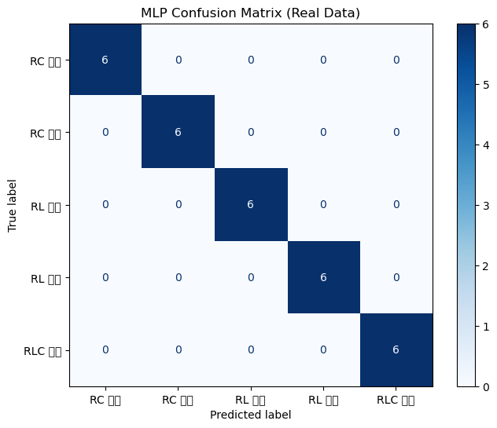
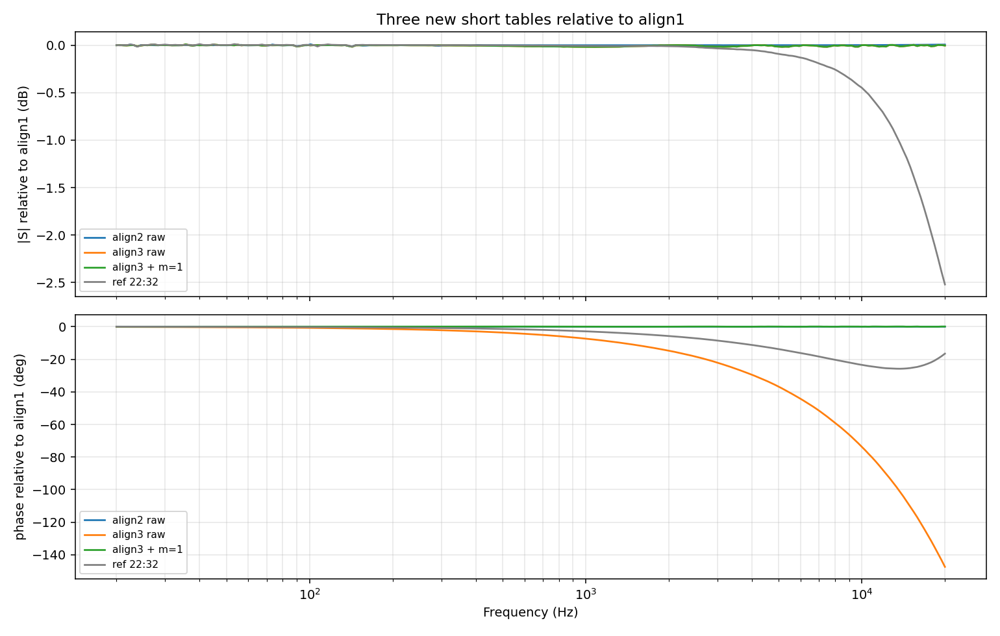
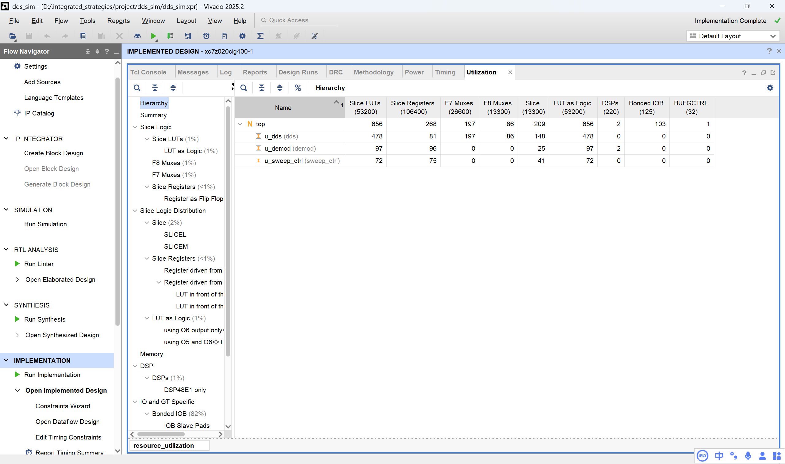
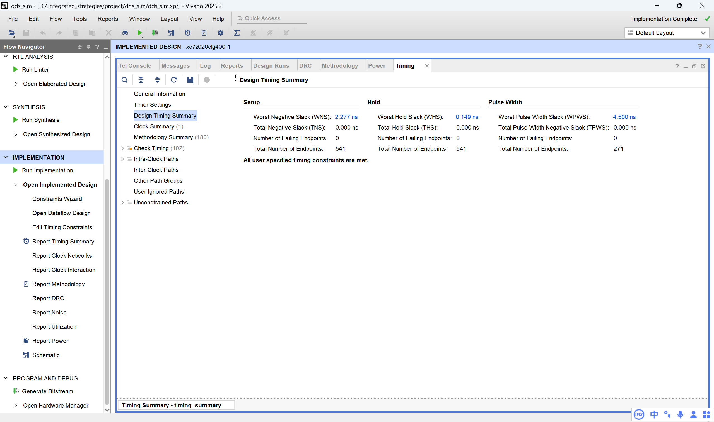
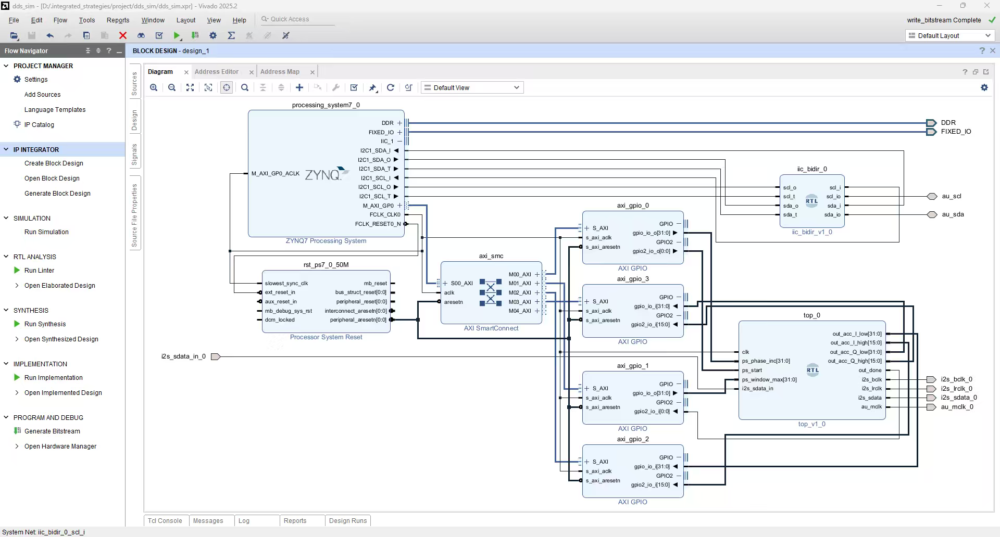
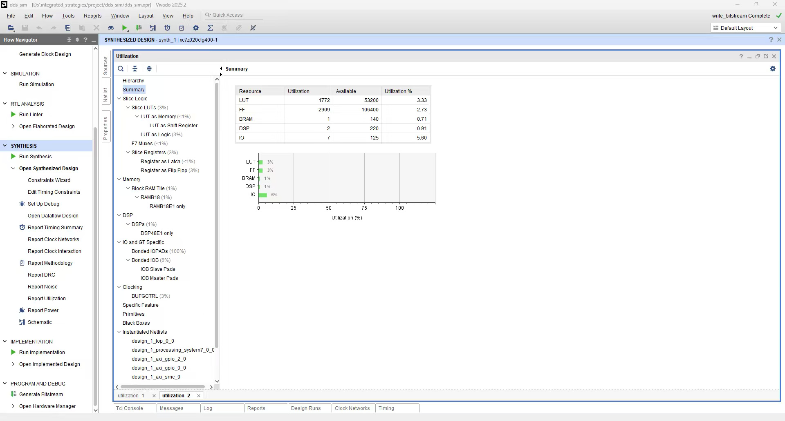
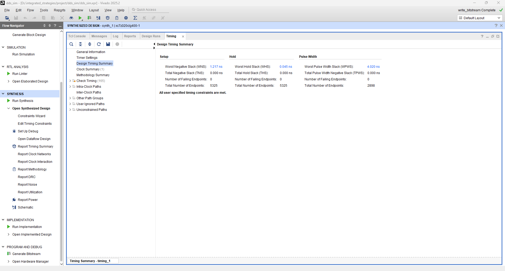

# 便携式电子电路智能诊断系统 设计报告

**基于 PYNQ-Z2 的 20 Hz–20 kHz 扫频阻抗/传递函数测量与电路拓扑识别**

| 项目 | 内容 |
|---|---|
| 报告版本 | v1.0 |
| 完成日期 | 2026-11-03 |
| 对应仓库 | <https://github.com/xchllll/intergrated_strategies> |
| 对应提交 | `da0be8f`（`feat: 网页端支持选择 series/shunt DUT`） |
| 硬件平台 | PYNQ-Z2，Zynq-7020，`xc7z020clg400-1` |
| 工具链 | Vivado 2025.2；PYNQ Linux 3.0；Python 3.10.4；PYNQ 3.1.1 |
| 报告位置 | `report/DESIGN_REPORT.md`；同目录包含历史实测图表 |

> **阅读约定（很重要）**
>
> 1. 本报告中的“**实测**”指 PYNQ-Z2 板端自研 RTL 链路采集到的数据，不是仿真数据，也不是 Windows 演示 CSV。
> 2. 本报告中的“**in-sample**”指用建表时同一批标准件回代自校验，只能证明建表链路自洽，**不是独立测试**。
> 3. 本报告中的“**100%**”仅指 150 条同板、同夹具、同环境曲线按类别分层 80/20 划分下的测试集准确率，**不表示跨设备、跨夹具或域外泛化能力**。
> 4. 校准表、H 平面表和误差数字都是某次可用环境下的快照，换线缆、换夹具、换 DAC 音量或整板断电后数值会变；方法可复现，数值不应当作固定真值。
> 5. `prompts/` 下的协作记录是事后按轮次整理的摘要，不是逐字 transcript；本报告引用时保留原措辞，并在第 5 章说明其边界。

---

## 摘要

本项目面向电子工程教学、实验室快速排查和爱好者现场诊断，设计并实现了一套基于 PYNQ-Z2 的便携式电子电路智能诊断系统。系统直接用板载 ADAU1761 音频 Codec 作为 20 Hz–20 kHz 的激励与采集前端，在 PL 内完成 DDS 扫频、I2S 收发和同源本振 I/Q 正交解调，在 PS 内完成 240 点对数扫频调度、三层去嵌入校准、轻量机器学习拓扑识别和 Flask/Plotly 网页展示。

测量链采用"短接复数校准 → 22 行 topology-aware H 平面输入网络去嵌入 → 以 `R_ref` 为参考重新嵌入"的三层校准框架；针对跨进程一个采样在 20 kHz 造成约 147° 相位偏差的问题，采用 RTL 帧边界对齐 + 常驻 PL/I2S + 一键短接校准的组合方案。系统在 20 Hz–20 kHz、240 个对数频点上完成一轮扫频约 20 s；短接重复性在 20 kHz 为 0.00 dB/0.00°，全频段相位约 −0.02°…+0.07°；22 行 H 平面在样本内幅度 RMS 均值 0.0096 dB、最大 0.0699 dB，相位 RMS 均值 0.0652°、最大 0.2458°。

在 5 类 × 30 条共 150 条实测曲线上，80/20 分层划分为 100%，5 折交叉验证 150/150。但本项目在末期的定量分析中得到两个负面结论，并据此收窄了系统结论：**（1）相同截止频率下 RC 与 RL 的传递函数几乎相同，实测曲线最大差异仅 1.3 dB，不可可靠区分；（2）夹具输入阻抗使观测拐点比元件本身截止频率高 26%–92%，不能反推元件参数。** 因此系统对外只输出"低通/高通/带通 + 观测拐点"，并把第二、三层去嵌入默认关闭（其在深衰减区对同一条曲线可过校正 12.4 dB）。这两点被写入局限与未来工作，而不是用调参掩盖。

资源方面，历史综合（含已移除的 `sweep_ctrl`）为 656 LUT（1%）、268 FF（<1%）、2 DSP（1%），WNS 2.277 ns、WHS 0.149 ns、WPWS 4.500 ns，约束全部满足；当前 RTL 已把逐点扫频调度移到 PS，删除了 PL 内的 `sweep_ctrl`，资源仍在同一量级。项目同时沉淀了 7 份大模型协作记录、50 条项目技能和 19 条通用 PYNQ 技能，并保留了可复现的校准表、H 平面表、实测数据集和验收 JSON。

**关键词**：PYNQ-Z2；阻抗测量；正交解调；去嵌入校准；电路拓扑识别；FPGA；大模型协作

---

## 目录

1. [选题背景与创新点](#1-选题背景与创新点)
2. [设计原理与功能框图](#2-设计原理与功能框图)
3. [软硬件划分依据与接口设计](#3-软硬件划分依据与接口设计)
4. [优化过程](#4-优化过程)
5. [大模型协作记录](#5-大模型协作记录)
6. [技能包的提炼过程](#6-技能包的提炼过程)
7. [复现说明](#7-复现说明)
8. [结论与局限](#8-结论与局限)
- [附录 A 关键参数](#附录-a-关键参数)
- [附录 B 文件地图](#附录-b-文件地图)
- [附录 C 数据与证据索引](#附录-c-数据与证据索引)
- [附录 D 术语表](#附录-d-术语表)
- [附录 E 参考文献](#附录-e-参考文献)

---

## 1. 选题背景与创新点

### 1.1 为什么选这个题目

电子电路诊断在实际工作中通常面临三个矛盾：

1. **仪器能力与便携性的矛盾**。要判断一个 RC/RL/RLC 网络、滤波器或放大器输入端是否正常，最直接的方法是测它的幅频/相频响应；但信号发生器、示波器、阻抗分析仪体积大、价格高、接线复杂，不适合现场或课桌场景。
2. **静态测量与动态行为的矛盾**。万用表只能测直流电阻、通断和静态电压，测不到“截止频率偏移”“高频容性塌陷”“电感 DCR 异常”这类频域特征；而这类特征恰恰是区分电路拓扑和定位故障的关键。
3. **测量数据与诊断结论的矛盾**。即使测到了 Bode 曲线，仍需要人工判读；不同人、不同经验会得出不同结论。把“测量—校准—特征—分类—展示”做成一条闭环，才能让非专家也得到可解释的初步结论。

本项目选择“便携式电子电路智能诊断系统”，目标不是替代实验室级阻抗分析仪，而是用一块 PYNQ-Z2、一根 3.5 mm 音频线和一套网页，把**20 Hz–20 kHz 的扫频测量、校准、拓扑识别和可视化**收进一个可携带、可复现的系统。它适合：

- 电子技术/电路分析课程的 Bode 图实验；
- 实验室搭建前的快速连通性与频响检查；
- 爱好者/维修人员对无源滤波、RL/RC 网络、RLC 谐振网络的初步判断；
- 作为一个把 DDS、I2S、正交解调、校准、机器学习、Web 和 FPGA/ARM 协同串起来的综合工程案例。

### 1.2 为什么是 PYNQ-Z2

PYNQ-Z2 的优势不是“算力最大”，而是**软硬件协同的边界刚好合适**：

- 板载 Zynq-7020 的 PS（双核 Cortex-A9）可以跑 Linux、Python、Flask、NumPy，适合做扫频调度、复数校准、机器学习推理和网页服务；
- PL（Artix-7 逻辑）可以以 100 MHz 确定性地产生 DDS、I2S 时钟和逐样本乘加，不受 Linux 调度抖动影响；
- 板载 ADAU1761 音频 Codec 自带 DAC/ADC、耳机放大器和 LINE IN，20 Hz–20 kHz 刚好覆盖音频范围内的 RC/RL/RLC 常用测试场景，不需要额外设计模拟前端 [9]；
- PYNQ 提供 Overlay、MMIO、AXI GPIO 和 Jupyter，能把“寄存器读写”快速变成 Python 调用，缩短从 RTL 到上板验证的周期。

因此，这块板子可以把“仪器前端”和“计算/展示后端”放在同一张卡上，形成真正的单板便携系统，而不是“FPGA 采集卡 + PC 软件”的两件套。

### 1.3 前人做过什么，差距在哪里

与本项目最接近的工作可以分成五类。

| 路线 | 代表工作 | 已经做到 | 仍存在的差距 | 本项目的差异 |
|---|---|---|---|---|
| 专用阻抗测量芯片 | ADI AD5933 [1] | 单芯片集成 DDS、12-bit ADC、DFT 和 I2C；最高 100 kHz；1 kΩ–10 MΩ；系统精度约 0.5%；可测相位 | 需要模拟前端/量程切换/校准；输出阻抗，不直接给电路拓扑；12-bit 量化 | 用板载 16-bit 音频 Codec，不增加专用芯片；输出 Bode 曲线 + 拓扑 + 置信度 |
| 高精度阻抗/电化学前端 | ADI AD5941 [2] | 高精度、低噪声，面向电化学/生物阻抗 | 前端复杂、成本高、偏专用 | 面向通用无源电路，强调便携和可解释 |
| 声卡式阻抗分析 | 利用 PC 声卡做阻抗测量的工作 [3] | 成本极低，PC 端可做 FFT/显示 | 依赖 PC；声卡帧/驱动带来相位基准不确定；通常离线处理；不便携 | 测量与显示都在 PYNQ 上；PL 内同源 I/Q，帧边界确定 |
| PYNQ 音频回环 | PYNQ 官方 `AudioADAU1761` [4][5] | 播放/录音、FFT、音频闭环 | 官方库面向音频，不提供阻抗去嵌入、短接校准、拓扑识别 | 自研 PL 解调 + 三层校准 + 网页诊断 |
| 机器学习电路诊断 | 基于仿真/故障注入数据的分类工作 [7][8] | 可用 DT/MLP/SVM 等做故障分类 | 很多工作用仿真数据，缺少真实测量链与校准；泛化性常被高估 | 用 150 条真实扫频曲线；明确标注同环境 80/20 的边界 |

数字锁相/正交解调本身并不是新算法，锁相放大器、阻抗分析仪和 Red Pitaya 等开源硬件都已有成熟实现 [6]。本项目的工程创新不在于“发明正交解调”，而在于**把同源 DDS 本振、整数周期积分窗、I2S 帧边界对齐、三层去嵌入和拓扑识别集成到一块 PYNQ-Z2 上，并把跨进程相位、校准表 session、数据诚实性这些工程问题处理成可复现的流程**。

### 1.4 创新点

1. **系统级集成创新**：直接用板载 ADAU1761 做 20 Hz–20 kHz 激励/采集，不额外增加信号发生器、ADC/DAC 模块或模拟前端；单板 + 网页即可完成测量、校准、识别和展示。
2. **测量方法创新（工程组合）**：PL 内 DDS 同时产生正弦/余弦本振，与激励同源；I/Q 在整数个信号周期内累加，2f 分量自然抵消；48 位累加器保证 20 Hz 长窗不溢出；`start_pending + rx_data_valid` 把每次测量对齐到 I2S 帧边界。
3. **校准方法创新（工程组合）**：短接复数校准消环路、22 行 topology-aware H 平面表消输入网络频变阻抗、`R_ref` 重嵌入统一显示口径；series/shunt 分组避免两类标准件互相污染；一键短接校准把多轮复数平均、弱信号过滤和原子写表串起来。
4. **跨进程相位问题的系统解法**：把“一个采样 = 20.48 µs = 20 kHz 约 147°”作为一等工程问题处理；RTL 解决进程内漂移，常驻 PL/I2S 解决 Codec 帧状态被反复重置的问题，一键短接校准解决跨进程残余相位。
5. **识别链路的可解释与可追溯**：13 维频响特征 + 决策树/MLP + JSON/numpy 前向推理；网页显示 top3、置信度、数据来源徽章、校准状态和原始/校准双列历史；对过平、NaN、点数不足的数据主动拦截，不强行给高置信度。
6. **工程方法创新**：把大模型协作、失败复盘、技能卡、单元测试、上板验收 JSON、sha256 取证和回退提交组织成一条证据链；技能卡强制写“适用场景 / 验证方法 / 失效条件”，避免把一次经验当成万能规则。

> **边界声明**：以上“创新”主要是系统集成、校准流程和工程方法层面的组合创新，不是单一算法或单一器件的首创。项目仍是一个 5 类、20 Hz–20 kHz、单端两线、无源信号级电路的原型系统。

### 1.5 项目边界与不做什么

- **频率**：20 Hz–20 kHz。受音频 Codec 抗混叠/高通特性和 48.828 kHz 采样率限制，不覆盖高频/射频。
- **对象**：断电、无源、信号级电路。不接市电、带电储能元件、高压或大功率电路。
- **拓扑**：当前 5 类（RC 低通/高通、RL 低通/高通、RLC 带通）；`opamp_lowpass` 只是代码中的第 6 类占位，没有实测数据。
- **接线**：单端两线（HP 输出 → DUT → LINE IN），不是四线开尔文；夹具寄生、接触电阻和线缆电容会进入结果。
- **校准**：短接表和 H 平面表是环境快照；换夹具/线缆/音量/断电后需要重新短接校准，H 平面表在夹具不变时可复用。
- **泛化**：分类准确率只对同板、同夹具、同环境的 150 条曲线负责；没有做跨设备、跨批次或域外测试。

---

## 2. 设计原理与功能框图

### 2.1 总体功能框图

系统由“激励—被测—采集—解调—校准—识别—展示”七段组成。控制流在 PS，样本级数据流在 PL。

```text
┌──────────────────────────── PYNQ-Z2 ────────────────────────────┐
│                                                                  │
│  PS（ARM Cortex-A9 / PYNQ Linux）                                │
│  ┌──────────────┐   ┌──────────────┐   ┌──────────────────────┐  │
│  │ 扫频调度      │   │ 三层校准      │   │ Flask + Plotly 网页  │  │
│  │ 240 点 log    │   │ 短接→H平面→Rref│   │ Bode / 状态 / AI     │  │
│  └──────┬───────┘   └──────┬───────┘   └──────────┬───────────┘  │
│         │ AXI GPIO          │ JSON/CSV             │ HTTP          │
│  ┌──────▼───────────────────▼──────────────────────▼───────────┐  │
│  │ 驱动层：ps_ctrl / calibration / input_network / ml.infer    │  │
│  └──────┬──────────────────────────────────────────────────────┘  │
│         │ 4 × AXI GPIO（phase_inc / window / start / done / I,Q）  │
│  ┌──────▼──────────────────────────────────────────────────────┐  │
│  │ PL（100 MHz）                                                │  │
│  │  DDS ──► I2S TX ──► Codec DAC ──► HP OUT ──[DUT]──► LINE IN  │  │
│  │   │         │                                         │      │  │
│  │   │         └─────────────── I2S RX ◄── Codec ADC ◄───┘      │  │
│  │   │                              │                           │  │
│  │   └── cos / -sin ──► 正交解调 ◄──┘                           │  │
│  │                          │                                   │  │
│  │                    48-bit acc_I/Q ──► 锁存 ──► AXI GPIO       │  │
│  └──────────────────────────────────────────────────────────────┘  │
│                                                                  │
│  I2C1 ──► ADAU1761 寄存器（时钟/混音/静音/音量）                  │
└──────────────────────────────────────────────────────────────────┘
```

对应的信号链可以写成：

```text
PS 设频/设窗 → PL DDS → I2S TX → ADAU1761 DAC → HP OUT
    → DUT → LINE IN → ADAU1761 ADC → I2S RX → PL I/Q 解调
    → 48-bit acc_I/Q → 锁存 → AXI GPIO → PS 校准/识别/网页
```

### 2.2 测量拓扑与传递函数

DUT 串接在 Codec 的 HP 输出与 LINE IN 输入之间；LINE IN 节点对地存在输入网络阻抗 `Zin(f)`。测量的是分压比：

```text
HP out ──► Z_dut(f) ──► LINE IN 节点 ──► ADC
                              │
                           Zin(f)
                              │
                             GND
```

```text
H_true(f) = V_line(f) / V_src(f) = Zin(f) / (Z_dut(f) + Zin(f))
```

反解 DUT 阻抗：

```text
Z_dut(f) = Zin(f) · (1 − H_true(f)) / H_true(f)
```

但实际读到的是 `raw(f)`，它还包含 DDS、I2S、Codec DAC/ADC、PL 解调、积分窗等整套环路响应 `S(f)`：

```text
raw(f) = S(f) · H_true(f)
```

所以不能直接拿 `raw` 当 `H_true`；必须先消 `S`，再消 `Zin`，最后换到统一的显示参考。这就是三层校准的由来。

### 2.3 PL 内部数据通路

PL 由 5 个核心模块和 1 个顶层状态机组成：

| 模块 | 文件 | 作用 | 关键实现 |
|---|---|---|---|
| DDS | [`src/dds.v`](../src/dds.v) | 产生正弦/余弦本振 | 32 位相位累加器；1024 点正弦表；`cos` 地址比 `sin` 超前 256 点（90°）；测量前预装 `-2046·phase_inc` |
| I2S TX | [`src/i2s_tx.v`](../src/i2s_tx.v) | 把 16-bit 样本送到 Codec | 32 分频 BCLK；32 bit/声道；`enable` 门控；未使能时输出钉在确定状态 |
| I2S RX | [`src/i2s_rx.v`](../src/i2s_rx.v) | 收回 ADC 数据 | 以 LRCLK 变化对齐 bit 计数；右声道采样点同时给出当前帧 L+R 和 `data_valid` |
| 解调 | [`src/demod.v`](../src/demod.v) | 混频 + 积分 | `mix` 打一拍、`acc` 打一拍；16×16→32 位乘积；48 位有符号累加；`clear` 同时清 `mix` 和 `acc` |
| 顶层 | [`src/top.v`](../src/top.v) | 测量 FSM、锁存、复位、MCLK | 内部上电复位；`IDLE→MEASURE→FLUSH→DONE`；结果锁存；I2S 暖机/启动对齐 |
| 旧扫频 FSM | [`src/sweep_ctrl.v`](../src/sweep_ctrl.v) | 早期 PL 内自动扫频 | 当前 `top.v` **不再实例化**；逐点调度已移到 PS，保留作历史/仿真参考 |

#### 2.3.1 DDS 频率关系

32 位相位累加器，系统时钟 `f_clk = 100 MHz`：

```text
phase_inc = round(f_out · 2^32 / f_clk)
f_out     = phase_inc · f_clk / 2^32
```

频率分辨率：

```text
Δf = 100 MHz / 2^32 ≈ 0.0233 Hz
```

1 kHz 时 `phase_inc = round(1000·2^32/1e8) = 42950`，与 `data/acceptance_latest.json` 中的 `phase_inc=42950` 一致。正弦表 1024 点，地址取相位累加器高 10 位；余弦地址加 256，等价于超前 90°。

每次测量前，`top.v` 把 DDS 相位预装为：

```text
phase_init = −2046 · phase_inc
```

从 `start_here` 到第一个被解调消费的 `rx_data_valid` 之间是 2048 个时钟，DDS 输出寄存器又晚一拍，所以第一个有效样本对应 `phase_init + 2046·phase_inc = 0`。这样每次测量的相位基准都是确定的，不依赖 `ps_start` 落在 2048 拍帧内的哪个位置。

#### 2.3.2 I2S 时序与采样率

I2S TX 用 32 个系统时钟构成一个 BCLK 周期（16 低 + 16 高），每个声道 32 bit，左右两个声道构成一帧：

```text
BCLK   = 100 MHz / 32      = 3.125 MHz
LRCLK  = BCLK / 64         = 48.828125 kHz
fs     = 100 MHz / 2048    = 48.828125 kHz
```

一帧 2048 个 100 MHz 时钟；`fs = 48.828125 kHz`，奈奎斯特频率 24.414 kHz，覆盖 20 kHz 上限。一个采样周期：

```text
1/fs = 20.48 µs
```

这就是后文“一个采样在 20 kHz 约 147°”的来源。

#### 2.3.3 正交解调与归一化

设 ADC 输入为：

```text
x[n] = A · cos(2π f n/fs + φ)
```

DDS 本振为 `cos(2π f n/fs)` 和 `−sin(2π f n/fs)`，在整数个信号周期内累加：

```text
I = Σ x[n]·cos(2π f n/fs) ≈ (A·N/2)·cos φ
Q = Σ x[n]·(−sin(2π f n/fs)) ≈ (A·N/2)·sin φ
```

因此：

```text
mag   = 2·sqrt(I² + Q²) / (N · LO_GAIN · ADC_GAIN)
phase = atan2(Q, I)
```

代码中 `LO_GAIN=32767`、`ADC_GAIN=1.0`、`ADC_FULL_SCALE_V=1.0`（默认按满量程比例归一化；若需要伏特，应把 `ADC_FULL_SCALE_V` 改成实际满量程电压）。`N` 是本次实际积分点数，必须由 `ps_ctrl.measure_once()` 原样传给 `calibration.calc_mag_phase()`，不能用固定 `DEFAULT_INTEGRATION_N` 兜底。

整数周期积分的作用：混频后产生直流项（携带幅相）和 2f 项；当积分窗覆盖整数个信号周期时，2f 项的平均为 0，只剩直流项。窗越长，残余 2f 泄漏越小，但测量越慢。

#### 2.3.4 自适应积分窗

固定周期数在不同频率下意味着不同的积分样本数 `N`，而决定稳定度的是 `N`，不是周期数本身。项目最终采用“每点积分样本数近似恒定”的调度：

```text
periods(f) = clamp(1000·f/fs, 10, 1000)
N(f)       = round(periods(f) · fs / f)
```

- 高频（`f ≥ ~488 Hz`）：`N ≈ 1000`，积分时间约 20.5 ms；
- 低频：`periods` 被下限 10 保护，`N` 随 `1/f` 增大；20 Hz 时 `periods=10`、`N≈24414`、积分约 0.5 s；
- 20 kHz 时 `periods≈410`、`N≈1001`。

240 点总时长约为：

```text
T_sweep ≈ Σ periods(f_i)/f_i ≈ 19.9 s
```

与实测“单轮约 20 s”一致。验收单点 `--periods 10` 是另一条路径：1 kHz、`N=488`、理论积分 9.994 ms、实测约 12.1 ms（含 MMIO 轮询/启动开销）。

#### 2.3.5 48 位累加器的位宽依据

最坏情况下，ADC 和本振都接近满量程 32767，单点乘积约 `32767² ≈ 1.07×10⁹`。20 Hz 时 `N≈24414`，累加上限约：

```text
|acc| ≤ N · 32767² ≈ 2.62×10¹³
2^47 ≈ 1.407×10¹⁴
```

仍有约 5.4 倍裕量，所以 48 位有符号累加器足够覆盖当前 20 Hz–20 kHz 调度。`ps_ctrl.py` 还加了 `SAFE_MAX_N` 防护：低频自动压低 `periods`，避免满量程输入溢出；若连 1 个周期都超限，则打印告警，要求前端衰减或硬件扩位宽。

#### 2.3.6 测量状态机与结果锁存

`top.v` 的状态机：

```text
IDLE ──start_here──► MEASURE ──N 个 rx_data_valid──► FLUSH ──1 clk──► DONE
  ▲                                                                      │
  └──────────────────────────── ps_start 拉低 ───────────────────────────┘
```

关键点：

1. `ps_start` 来自 AXI GPIO，可能落在 2048 拍帧内任意位置。`top.v` 先把它锁存为 `start_pending`，等 `rx_data_valid && i2s_ready && state==IDLE` 才真正启动；这样 DDS 总在采样边界释放，第一个积分样本固定在其后的下一个采样边界。
2. `I2S TX` 上电后保持关闭，直到第一次 `ps_start` 才释放；释放后先等 1024 个完整采样帧暖机，再允许状态机启动。这样每次进程/每次上电，Codec 看到的第一个 BCLK/LRCLK 沿和第一个有效帧都相同。
3. `MEASURE` 数满 `ps_window_max` 个 `rx_data_valid` 后进入 `FLUSH`；`FLUSH` 多停一拍，让 demod 流水线把最后一个乘积加进 `acc`；然后进入 `DONE`。
4. 进入 `DONE` 的第一拍把 `acc_I/Q` 搬到 `latched_acc_I/Q`，`out_done` 只在锁存有效后置起。此后即使 `ps_start` 被拉低、状态机回 `IDLE`、demod 的 `acc` 被清零，对外输出仍是稳定快照。
5. `ps_window_max` 必须在 `ps_start` 拉高前写入；`MEASURE` 中途改窗长会破坏本次积分。

#### 2.3.7 复位与时钟

- 不依赖外部 `rst_n` 引脚：`top.v` 内部 8 位计数器数到 255 后释放 `sys_rst_n`，避免“外部复位悬空导致永远复位”的问题。
- `au_mclk` 由 100 MHz 四分频得到 25 MHz，50% 占空比；Codec `CONVERTER0=0x06` 选择 `CONVSR=512`，`25 MHz / 512 = 48.828125 kHz`，与 LRCLK 严格相等。
- `i2s_rx` 用 BCLK 同步/边沿检测和 LRCLK 变化对齐 bit 计数；在右声道采样点同时锁存 `left_data/right_data`、更新 `mix_sum` 并拉高 `data_valid`，保证 `top` 读到的 L+R 与 `data_valid` 属于同一帧。

### 2.4 三层校准与去嵌入

#### 2.4.1 第一层：短接校准（消环路）

短接时 `Z_dut=0`，理论上 `H_true=1`，所以短接测量就是环路响应 `S(f)`：

```text
H_cal(f) = raw(f) · H_short⁻¹(f)
```

代码把校准系数存成复数 `h_re/h_im`（同时保留 `mag_gain/phase_offset_deg` 便于人读）：

```text
H_cal = raw · mag_gain · e^{j·phase_offset}
```

插值时幅值按对数、相位按增量（`wrap(p1−p0)`）处理，跨 ±180° 不会错位；去嵌入在复数域相乘，而不是“幅值、相位各修各的”。短接表还记录 `dac_volume`、`ref_amp`、`created`、`repeat` 等元数据，驱动电平变化时告警。

#### 2.4.2 第二层：输入网络去嵌入（消 Zin）

`Zin(f)` 不是常数：低频约 10.99 kΩ，高频因并联电容和串联电感下降并相移。只做短接校准消不掉 `Zin`，所以需要 H 平面表。

建表时，对每只已知标准件：

```text
H_row(f) = raw_row(f) · H_short⁻¹(f)
Z_dut(f) = R + jωL + 1/(jωC)          # series 标准件
Zin(f)   = H_row(f) · Z_dut(f) / (1 − H_row(f))
```

对三端 shunt 标准件（RC 低通 / RL 高通）：

```text
Zp = H · R / (1 − H)                  # 并联节点阻抗
Zp = Z_shunt || Zin
Zin = Zp · Z_shunt / (Z_shunt − Zp)
```

建好的表每行存 `(f, H_row, Zin_row, topology)`。测量时：

1. 对每条标准行在 `log f` 上插值出该频点的复数 `H_row` 和 `Zin_row`；
2. 在当前测量的复数 `H_cal` 与各 `H_row` 之间算复平面距离；
3. 反距离权重 `w = 1/(|H_cal − H_row|² + 1e-6)`，加权平均得到 `Zin(f)`；
4. 反解 `Z_dut = Zin(1−H_cal)/H_cal`。

用复平面而不是只看 `|H|`，是因为同一幅度下纯电阻和容性 RC 的相位不同；只按幅度插值会在 6.6–6.9 kHz 附近插出“假陷波”，中值滤波又会把真实谐振削掉。

当前 `data/input_network.json` 是 **22 行 topology-aware 表**：16 行 series（电阻、RC、RL、RLC 串联） + 6 行 shunt（`rc_lp_1k98n1`、`rl_hp_1k100m`、`rc_lp_3k2_9n56`、`rc_lp_10k_1n`、`rl_hp_2k2_63m`、`rl_hp_4k7_43m`）。默认 series 去嵌入只使用 16 行 series 子表，避免 shunt 标准件的 `H→Zin` 样本污染 series 插值；shunt 模式单独使用 6 行 shunt 子表。

#### 2.4.3 第三层：显示参考（R_ref）

最后把 DUT 重新嵌入到一个恒定的参考电阻 `R_ref` 上：

```text
H_disp(f) = R_ref / (Z_dut(f) + R_ref)
```

`R_ref` 由 97.2 kΩ 标准件的低频 `Zin` 中位数估计，当前 `R_ref = 10989.125 Ω`。这样纯电阻 DUT 显示为 `R_ref/(R+R_ref)` 的理论分压：1 kΩ 约 −0.8 dB、10 kΩ 约 −5.6 dB、97.2 kΩ 约 −19.8 dB（`R=R_ref` 时约 −6.0 dB）；只有短接（R=0）才是 0 dB/0°。RC/RL/RLC 显示的是它们相对 `R_ref` 的真实衰减与相移，网页曲线有统一的物理含义。`97k2` 标准件在 20 Hz 的实测校准值为 −19.77 dB，与公式 −19.8 dB 一致，说明显示口径确实是 `R_ref/(R+R_ref)`，而不是“纯电阻一律 0 dB”。`README.md`/`DE_EMBED_METHOD.md` 里“纯电阻 0 dB”的旧说法不准确，已在 6.7 的文档债中列出。

#### 2.4.4 三层校准的数据流

```text
raw(f)
  │  ① 短接表：H_cal = raw · gain · e^{jφ}
  ▼
H_cal(f)
  │  ② H 平面：zin_at(f, H_cal) → Zin(f)
  ▼
Z_dut(f) = Zin · (1 − H_cal) / H_cal
  │  ③ 显示参考：H_disp = R_ref / (Z_dut + R_ref)
  ▼
H_disp(f) → 网页 mag_db_cal / phase_deg_cal
```

#### 2.4.5 近短路与 shunt 的边界

- `|H| > 0.999` 时直接返回原 `H`，避免 `Z = Zin(1−H)/H` 在近短路时放大噪声；这也意味着“纯电感”等低阻 DUT 的去嵌入误差会变大。
- shunt 模式当前是**明确的等效 series 显示**：用 shunt 子表估计 `Zin`，再按 series 等效阻抗重嵌入 `R_ref`；严格的三端口 `H_disp` 需要已知 DUT 的 R/L/C，网页会在 warnings 中提示这一点。
- 输入网络表只对 direct（短接）路径生效；buffer 路径由缓冲器隔离，不套用 H 平面。

#### 2.4.6 现状：第二、三层默认关闭（2026-11-03）

`data/cal_mode.json` 现为 `{"direct": true, "buffer": false, "hplane": false}`，即**只做第一层短接校准**，`input_network` 不再参与在线计算。

关闭的依据是一次可复现的对比实验：同一条 RC 低通曲线（5.3 kΩ + 10 nF），用两种口径计算同一次扫描的 240 个点：

| 频率 | 纯短接校准 | 去嵌入后 | 去嵌入的修正量 |
|---|---|---|---|
| 20 Hz | −2.97 dB | −2.88 dB | +0.09 |
| 642 Hz | −3.20 dB | −3.12 dB | +0.08 dB |
| 2.04 kHz | −4.36 dB | −4.00 dB | +0.36 dB |
| 6.48 kHz | −9.38 dB | −6.20 dB | **+3.18 dB** |
| 20 kHz | −15.59 dB | −3.16 dB | **+12.44 dB** |

纯短接校准给出的是一条物理正确的 RC 低通（−2.97 dB 平台、20 kHz 处 −15.6 dB）；去嵌入在深衰减区把曲线抬高了 12.4 dB，滚降几乎被抹平。原因在于 `zin_at()` 是按 `|H|` 电平查表的，而当前表的电平覆盖范围（0.040–0.915）在高衰减端靠外推，且 `Z_dut = Zin(1−H)/H` 在 `H` 很小时对 `Zin` 的误差极其敏感。

关闭后数据集重算（不重新测量）的效果：

| 类别 | 关闭前去嵌入的动态范围 | 关闭后 |
|---|---|---|
| `rc_lowpass` | 22.2 dB | **34.0 dB** |
| `rl_highpass` | 6.2 dB | **16.7 dB** |
| `rl_lowpass` | 12.5 dB | **23.3 dB** |

### 2.5 拓扑识别

#### 2.5.1 特征

`diagnosis_system/common/features.py` 从 240 点 Bode 曲线提取 13 维特征：

| 类别 | 特征 |
|---|---|
| 增益 | `gain_low`、`gain_high`、`slope_db_dec` |
| 截止/峰值 | `f3db_hz`、`peak_freq_hz`、`peak_gain_db`、`peak_prominence` |
| 谐振 | `q_factor` |
| 相位 | `phase_low`、`phase_high`、`phase_mid`、`phase_span` |
| 平滑度 | `smoothness`（二阶差分 RMS） |

关键修复：

- `f3db` 不再假设“低频是通带”，而是取两端/峰值中的最大值为参考，再找下降 3 dB 的穿越点；低通、高通、带通共用一套逻辑。
- 相位先 `np.unwrap()` 再取统计量，避免 −180°/+180° 跳变把均值拉错。
- 边缘取点动态化：12 点时取 1 个，240 点时取 5 个，防止小数据被“边缘平均”吃光。

#### 2.5.2 模型与推理

- 决策树：`StandardScaler + DecisionTreeClassifier(max_depth=6)`；
- MLP：`StandardScaler + MLPClassifier(hidden_layer_sizes=(32,16), max_iter=2000)`；
- 训练：5 类 × 30 条 = 150 条真实曲线，按类别分层抽 20% 测试；
- **输出层做了"五类 → 三类"的聚合**：`infer.py` 把 `rc_lowpass/rl_lowpass` 的概率相加为"低通"，`rc_highpass/rl_highpass` 相加为"高通"，`rlc_bandpass` 为"带通"。这是一个完备划分，概率可以直接相加，不需要重新训练；
- 对外标签形如 `低通（观测拐点 312 Hz）`，同时返回 `shape` / `fc_hz` / `fc_name` / `top3`；
- 导出：`topo_mlp.json`（约 23.3 KB），板端用 numpy 做前向推理，不依赖 sklearn 版本；没有 JSON 时才回退 joblib。

板端推理前有"进门校验"：

1. 点数 < 10 → 拒绝；
2. 含 NaN/Inf → 拒绝；
3. 动态范围 < 1 dB → 拒绝（可能没接电路/短路/削顶）；
4. **最强点 < −30 dB → 拒绝**（2026-11-03 新增：实测发现只剩 84/240 有效点时模型仍会输出"带通 100%"，属于典型的弱信号高置信度误判）。

拒绝时返回"数据无效"并给出原因，不强行给高置信度。

#### 2.5.3 为什么对外只输出"形状 + 观测拐点"

这是本项目在 2026-11-03 做出的一次**收窄结论**，原因是定量分析证明了更细的结论不成立。

**（1）相同 fc 下 RC 与 RL 不可辨识**

RC 低通（R 串、C 并）与 RL 低通（L 串、R 并）的传递函数同为

$$H(f)=\frac{1}{1+jf/f_c}$$

在夹具模型（源阻抗 1 kΩ、输入阻抗 10.9 kΩ）下逐点计算两条曲线，最大差异只有 **1.3 dB**，而且这个差异随着元件取值变化而漂移（下表用 R=3.3k/C=16nF 与 L=100mH/R=1.885k 对齐到同一 fc）：

| 频率 | RC 低通 | RL 低通 | 差 |
|---|---|---|---|
| 20 Hz | −2.89 dB | −4.20 dB | 1.31 dB |
| 1 kHz | −3.29 dB | −4.45 dB | 1.16 dB |
| 2 kHz | −4.31 dB | −5.11 dB | 0.80 dB |
| 5 kHz | −8.24 dB | −8.10 dB | −0.14 dB |
| 20 kHz | −18.89 dB | −18.05 dB | −0.84 dB |

早期训练集里 RC 类刻意落在 159–339 Hz、RL 类落在 1.6–7.5 kHz，模型实际学到的是"形状 + fc 区间"，而不是元件的物理类型。继续对外宣称"识别 RC/RL"是不诚实的，因此收窄为形状 + 拐点。

**（2）观测拐点 ≠ 元件截止频率**

夹具的输入阻抗并联在输出端，使 −3 dB 点整体右移：

| 元件 | 元件本身 fc | 实测观测拐点 | 偏差 |
|---|---|---|---|
| 10k + 100nF | 159 Hz | 291 Hz | +82.7% |
| 10k + 66nF | 241 Hz | 441 Hz | +82.7% |
| 4.7k + 100nF | 339 Hz | 425 Hz | +25.6% |
| 100mH + 1k | 1592 Hz | 3049 Hz | +91.6% |
| 100mH + 2.2k | 3501 Hz | 4505 Hz | +28.7% |

所以系统输出的是"观测拐点"，不能当作 R、C、L 的估计值。若要反演元件参数，需要完整夹具模型 + 两点标定（短接 + 已知电阻），属于后续工作。

#### 2.5.4 准确率的正确读法

150 条曲线、同板、同夹具、同环境、按类别分层 80/20，决策树和 MLP 都是 100%；5 折交叉验证 150/150；按形状聚合后 150 条回放全部正确，置信度均值 0.988、最低 0.967。这说明**这批数据在当前划分下完全可分**，不说明：

- 换一块板、换一套夹具、换一批元件仍然 100%；
- 对未见过的 R/L/C 组合、噪声、接触不良仍然 100%；
- 对 `opamp_lowpass` 有效（没有实测数据）；
- 能区分相同 fc 下的 RC 与 RL（见 2.5.3）。

因此网页和报告都把"AI 识别结果"定位为"初步频率选择特性判断 + 置信度"，不是"故障诊断结论"，也不是"元件类型鉴定"。



> 混淆矩阵来自 `report/confusion_matrix.png`；测试集只有 30 条（150 条的 20%），对角线满格不代表跨设备泛化。

### 2.6 软件与网页

```text
Browser（Plotly 离线）
   │ HTTP JSON
Flask app（端口 5000）
   ├─ GET  /                 页面
   ├─ GET  /api/status       来源/校准/短接校准/扫频进度
   ├─ POST /api/start_sweep  240 点扫频 + 校准 + AI
   ├─ POST /api/start_short_calibration  一键短接校准
   └─ GET  /api/iq           官方音频闭环单点验收（仅 audio 模式）
        │
        ├─ ps_ctrl.py         AXI GPIO / 48-bit 回读 / 周期调度
        ├─ calibration.py     短接表、复数去嵌入、热重载
        ├─ input_network.py   H 平面插值 / R_ref 重嵌入
        ├─ ml/infer.py        13 特征 + JSON numpy 推理
        └─ data/history.csv   原始 + 校准双列历史
```

网页功能：

- 幅频/相频双图，扫频时显示 `x/240` 进度；
- 右上角来源徽章：`自研 PL 解调实测` / `PYNQ 官方音频闭环实测` / `Windows 演示数据`；
- 校准状态：已加载/未校准/被 `cal_mode.json` 禁用；
- DUT 接线方式：二端口 series / 三端口 shunt；
- 一键短接校准：点击后按钮依次显示 `检测中 → 校准中 n% → 校准完毕 ✓ / 电路未短接`；后台 3 轮扫频（复数平均），完成后原子替换校准表；
- AI 结果：top3 + 置信度 + 模型说明；audio 模式强制拦截，不用 12 个声卡点跑 240 点模型；
- 扫频历史：`data/history.csv` 同时保存 `mag_v_raw/phase_deg_raw` 与 `mag_db_cal/phase_deg_cal`，以及 `cal_applied`、`phase_valid`、`sweep_id`。

### 2.7 关键参数

| 项目 | 值 |
|---|---|
| 板卡 / FPGA | PYNQ-Z2，Zynq-7020，`xc7z020clg400-1` |
| PL 系统时钟 | 100 MHz（`FCLK_CLK0`） |
| Codec | ADAU1761，I2C 7 位地址 `0x3B` |
| 音频采样率 | `100 MHz / 2048 = 48.828125 kHz` |
| I2S BCLK | 3.125 MHz（32 分频） |
| Codec MCLK | 25 MHz（100 MHz / 4） |
| Codec 转换比 | `CONVERTER0(0x4017)=0x06`，`CONVSR=512` |
| 扫频范围 / 点数 | 20 Hz–20 kHz，240 点对数等间隔（约 24 点/倍频程） |
| 每点积分窗 | `periods = clamp(1000·f/fs, 10, 1000)`；`N = round(periods·fs/f)` |
| 20 Hz 积分 | `periods=10`，`N≈24414`，约 0.5 s |
| 1 kHz 验收单点 | `periods=10`，`N=488`，理论 9.994 ms，实测 12.1 ms |
| 20 kHz 积分 | `periods≈410`，`N≈1001`，约 20.5 ms |
| 解调输出 | 48 位有符号 `acc_I/acc_Q`，AXI GPIO 低 32 + 高 16 读取 |
| 短接校准表 | `data/calibration_table.json`，format 2，240 个 direct 频点 |
| 输入网络表 | `data/input_network.json`，format 3，22 行（16 series + 6 shunt），`R_ref≈10989.125 Ω` |
| 识别类别 | 5 类：RC 低通/高通、RL 低通/高通、RLC 带通 |
| 网页 | Flask + 本地 Plotly，默认端口 5000 |

---

## 3. 软硬件划分依据与接口设计

### 3.1 划分原则

软硬件划分不是“PL 越多越好”，而是按四个判据：

1. **确定性**：样本级操作（DDS、I2S 时钟、混频、累加、帧对齐）必须与 100 MHz 时钟严格同步，放在 PL；Linux 的调度抖动是毫秒级，无法保证 48.828 kHz 的样本节拍。
2. **数据率**：单次扫频只有 240 点 × 2 个 48-bit 累加值 ≈ 2.8 KB，20 s 内平均约 144 B/s；不需要 DMA、BRAM 或高速接口，AXI GPIO 轮询足够。
3. **灵活性**：频率表、积分窗、校准表、H 平面插值、机器学习、网页和文件读写需要频繁修改/调试，放在 PS 的 Python 层。
4. **可验证性**：每个边界都要能独立观测。PL 侧用仿真波形/`out_done`/`acc` 验证；PS 侧用单测、校准表回代、网页 API 验证；模拟侧用耳机单音、音频闭环和万用表验证。

### 3.2 划分结果

| 功能 | 放在 | 理由 | 关键实现 |
|---|---|---|---|
| DDS 正弦/余弦 | PL | 32 位相位累加、1024 点查表，需每时钟更新 | `dds.v` |
| I2S TX/RX | PL | BCLK/LRCLK 必须由硬件分频，样本节拍确定 | `i2s_tx.v`、`i2s_rx.v` |
| 正交混频/累加 | PL | 48.828 kSa/s × 16×16 乘加，PS 无法逐样本保证 | `demod.v` |
| 测量 FSM/锁存 | PL | `done` 与 `acc` 的时序必须原子 | `top.v` |
| 内部复位/MCLK | PL | 上电确定状态；25 MHz 分频 | `top.v` |
| 逐点频率/窗长调度 | PS | 240 点对数表、`periods(f)`、超时/预算可调 | `ps_ctrl.build_period_schedule()` |
| 短接校准/去嵌入 | PS | 复数平均、插值、H 平面、文件格式 | `calibration.py`、`input_network.py` |
| 拓扑识别 | PS | 13 维特征、DT/MLP、JSON/numpy | `features.py`、`ml/` |
| 网页/API/历史 | PS | Flask、Plotly、CSV/JSON | `dashboard/app.py` |
| Codec 配置 | PS | I2C 寄存器、PLL/静音/混音/音量 | `acceptance.configure_codec()` |
| 数据持久化 | PS | 校准表、H 平面表、history.csv | `data/` |

一个容易被忽略的点：**逐点扫频 FSM 从 PL 移到了 PS**。早期 `sweep_ctrl.v` 在 PL 内用固定 `TIME_MAX=5`、`phase_inc += 10000` 的方式自动扫频；这种方式无法做 240 点对数频率、无法按频率给不同积分窗，也无法在扫频中途插入校准/超时/进度。最终 `top.v` 只保留“单点测量”FSM，PS 负责“下一频点是什么、窗长多少、是否超时”。这既提高了灵活性，也把 PL 资源让了出来（旧综合中 `sweep_ctrl` 占 72 LUT/75 FF）。

### 3.3 量化依据

#### 3.3.1 为什么不需要 DMA

| 项目 | 数值 |
|---|---|
| 单点数据 | `acc_I` 48 bit + `acc_Q` 48 bit = 12 B |
| 单轮 240 点 | 2.88 KB |
| 单轮时间 | 约 20 s |
| 平均数据率 | 约 144 B/s |
| 单点积分时间 | 10 ms–500 ms |
| MMIO 单次读写 | 微秒量级 |
| 轮询间隔 | 2 ms |

即使把 `done` 轮询、48 位拼接和 Python 开销都算进去，单点开销也远小于积分时间；DMA 和中断只会增加复杂度，不会提升测量质量。因此选择 4 个 AXI GPIO + 轮询。

#### 3.3.2 为什么是 48 位而不是 32 位

32 位有符号上限约 2.15×10⁹；20 Hz、`N≈24414`、满量程乘积约 1.07×10⁹，累加会超过 32 位。48 位上限 1.407×10¹⁴，有约 5.4 倍裕量；64 位则浪费 GPIO 位宽和拼接开销。48 位是“够用 + 好拆成 32+16”的折中。

#### 3.3.3 为什么是 16-bit I2S 样本

ADAU1761 本身是 24-bit Codec，但本设计 I2S 每声道取 16-bit 样本（32-bit slot 中左对齐/补零）。16-bit 理论量化 SNR 约 98 dB，对本项目的模拟前端、夹具和标准件容差来说已经足够；24-bit 会增加 PL 位宽、GPIO 拼接和 Python 处理复杂度，收益有限。若未来要做高阻/低电平测量，可以把 I2S 和 demod 扩展到 24-bit。

#### 3.3.4 为什么是 100 MHz / 2048 分频

`FCLK_CLK0=100 MHz` 是 PYNQ 默认时钟，PL 逻辑在 100 MHz 下时序余量充足（旧综合 WNS 2.277 ns）。I2S 一帧 2048 个时钟，刚好得到 48.828 kHz；BCLK 3.125 MHz、MCLK 25 MHz 都能从 100 MHz 整数分频得到，不需要额外 MMCM/PLL。对 20 kHz 上限，48.828 kHz 采样仍有 2.44 倍过采样。

### 3.4 接口设计

#### 3.4.1 AXI GPIO 地址与通道

| 硬件模块 | 基地址 | 通道 1（32-bit） | 通道 2 |
|---|---|---|---|
| `axi_gpio_0` | `0x4120_0000` | 写 `ps_phase_inc`（频率控制字） | 写 1-bit `ps_start` |
| `axi_gpio_1` | `0x4121_0000` | 写 32-bit `ps_window_max`（积分窗长） | 读 1-bit `out_done` |
| `axi_gpio_2` | `0x4122_0000` | 读 32-bit `out_acc_I_low` | 读 16-bit `out_acc_I_high` |
| `axi_gpio_3` | `0x4123_0000` | 读 32-bit `out_acc_Q_low` | 读 16-bit `out_acc_Q_high` |

寄存器偏移：通道 1 数据 `0x00`，通道 2 数据 `0x08`；方向寄存器 `0x04/0x0C`（由 PYNQ GPIO 驱动管理）。48 位有符号数拼接：

```python
raw = ((high & 0xFFFF) << 32) | (low & 0xFFFFFFFF)
value = raw - (1 << 48) if raw >= (1 << 47) else raw
```

#### 3.4.2 单点测量时序

```text
PS:  write phase_inc        (GPIO0 ch1)
     write window_n         (GPIO1 ch1)
     write start = 1        (GPIO0 ch2)
PL:  latch start_pending
     wait i2s_ready && rx_data_valid && state == IDLE
     release DDS reset (phase_init = -2046*phase_inc)
     MEASURE: count N rx_data_valid
     FLUSH: 1 clk
     DONE: latch acc_I/Q, assert out_done
PS:  poll out_done every 2 ms
     read acc_I low/high, acc_Q low/high
     write start = 0
PL:  DONE -> IDLE (acc cleared on next start)
```

约束：

- `ps_window_max` 必须在 `ps_start` 之前写入；
- `ps_start` 至少保持 1 ms（`MIN_HOLD_S`），给状态机/同步留裕量；
- `done` 超时时间 = `N/fs + 50 ms`，不能用 1 ms 裕量（Python `sleep` 和 MMIO 开销会吃掉）；
- `out_done` 只在锁存后有效；`start` 拉低后结果仍保持到下一次启动；
- 换 bitstream/XSA 后必须重新 bring-up，不能只换 `.bit` 而继续用旧 marker。

#### 3.4.3 音频与 I2C 引脚

| 信号 | FPGA 引脚 | 方向 |
|---|---|---|
| `au_mclk` | U5 | FPGA → Codec |
| `i2s_bclk` | R18 | FPGA → Codec |
| `i2s_lrclk` | T17 | FPGA → Codec |
| `i2s_sdata`（放音） | G18 | FPGA → Codec |
| `i2s_sdata_in`（录音） | F17 | Codec → FPGA |
| `au_scl` / `au_sda` | U9 / T9 | PS I2C1 → Codec |

注意：

- **`sdata_o` 与 `sdata_i` 的方向不能对调**。对调后时钟可能正常，但数据错位；本项目曾因此读到“贴着满量程的直流”，误以为是相位回绕。
- `U5` 是 Codec MCLK，不是 I2C；Arduino 扩展口的 `P16/P15` 不是板载 ADAU1761 的 I2C。ADAU1761 的 I2C 是 `U9/T9`。
- I2C 读回必须用 `I2C_RDWR` 组合消息（写寄存器地址 + repeated start + 读数据）；分两次 `os.write/os.read` 可能读到写入缓冲区的“回声”，不能作为 PLL 锁定/静音生效的证据。状态类字段要用行为验证（数据在变、耳机有声、时钟存在）。

#### 3.4.4 文件与 HTTP 接口

| 接口 | 方向 | 格式 | 说明 |
|---|---|---|---|
| `data/calibration_table.json` | PS 读/写 | format 2：`{format, meta, rows}` | 240 个 `direct` 频点；`meta` 含 `created/repeat/dac_volume/freq_points`；原子写 |
| `data/input_network.json` | PS 读 | format 3：`freqs/levels/level_f/h_re/h_im/zin_re/zin_im/R_ref/meta` | 22 行 topology-aware；`meta.standards[*].topology` 决定 series/shunt 分组 |
| `data/history.csv` | PS 追加 | 11 列 | `timestamp,sweep_id,mode,freq_hz,mag_v_raw,mag_db_raw,phase_deg_raw,phase_valid,mag_db_cal,phase_deg_cal,cal_applied` |
| `/tmp/pl_i2s_ready.json` | PS 读/写 | JSON | `start_pl_i2s.sh` 写；dashboard 只校验 `ok + xsa_sha256 + bit_sha256`，不加载 PL |
| `data/cal_mode.json` | PS 读 | JSON | `direct/buffer/hplane` 开关；热生效，不需要重启 |
| `POST /api/start_sweep` | HTTP | `{mode, cal_path, dut_type}` | 返回 `data`（240 点）、`calibration`、`ai`、`warnings` |
| `POST /api/start_short_calibration` | HTTP | `{repeat}` | 1–10 轮；后台扫频；完成后原子替换校准表 |
| `GET /api/status` | HTTP | JSON | 来源/校准/短接校准/扫频进度 |

#### 3.4.5 时钟、复位与启动顺序

```text
上电
  → PYNQ boot.py 加载 BaseOverlay（base.bit）并配置 Codec 的 10 MHz PLL 路径
  → sudo bash board/start_pl_i2s.sh
       ├─ 加载自定义 XSA（替换 PL，FCLK0=100 MHz）
       ├─ configure_codec_direct()：25 MHz MCLK / 48.828 kHz
       ├─ 一次 dummy 测量：释放 i2s_tx.enable，启动常驻 I2S
       └─ 写 /tmp/pl_i2s_ready.json（含 XSA/BIT sha256）
  → ./start_dashboard.sh --no-ref
       └─ run_dashboard.py 只启动 Flask，校验 marker，不碰 PL/Codec/I2S，也不重新标定
```

为什么要把 PL/I2S 常驻：

- ADAU1761 没有 RESET 引脚，只有 POR；每次 `load_design` 都会让 Codec 帧状态变化，跨进程相位可能差一个采样（20 kHz 约 147°）。
- 常驻后，dashboard 重启只影响 Flask 进程，不影响 Codec 帧状态；一次上电只做一次短接校准，之后换 DUT/重启网页都不需要再校准。
- 只有整板断电、换 XSA/bitstream、`start_pl_i2s.sh --force`、换夹具/线缆/音量时才需要重新校准。

#### 3.4.6 接口契约的版本化

- 校准表 `format 2`；加载器兼容旧格式 `[freq, mag_gain, phase_offset]`。
- H 平面表 `format 3`；`meta.table_kind` 为 `series` 或 `topology_aware`；没有 `meta.standards` 时按全 series 处理。
- 模型 JSON 带 `feature_order`、`classes`、`mean/scale`、权重；板端 `json_infer.py` 只依赖 numpy。
- 任何格式变更都要同时更新：加载器、单测、`docs/register_map.md` 或 `skill/DE_EMBED_METHOD.md`、以及 `data/` 快照。否则会出现“代码能跑、旧表读错”的静默错误。

---

## 4. 优化过程

### 4.1 项目时间线

| 时间 | 阶段 | 关键动作 | 结果 |
|---|---|---|---|
| 2026-09-22 | 仓库初始化 | 建立目录、约束、早期 RTL | 项目骨架 |
| 2026-10-19 | DDS | 32 位相位累加 + 1024 点表；`tb_dds` 仿真 | 正弦/余弦波形正确 |
| 2026-10-20 | 解调 | Python 浮点/定点模型 → `demod.v`；`tb_demod` | `acc_I` 与 Python 理论值一致 |
| 2026-10-26 | 上板验收 | Codec/bitstream/XSA + 1 kHz 单点 | `acceptance_latest.json` `passed=true` |
| 2026-10-27 | 输入网络 | 标准件扫频、H 平面表、`R_ref` | 大电阻 20 kHz 相位从 −35° 拉回 −3° 量级 |
| 2026-10-29 | 一键短接校准 | 多轮复数平均、原子写表 | `calibration_table.json` 240 点 |
| 2026-11-01 | 数据集 | 5 类 × 30 条实测曲线 | `data/real/` 150 条 |
| 2026-11-02 | 常驻 PL/topology-aware | `start_pl_i2s.sh`、22 行 H 平面、series/shunt 分组 | 重启不再重载 PL；去嵌入覆盖更全 |
| 2026-11-03 | 网页 DUT 选择 | series/shunt 选择、shunt 等效显示提示 | 当前 HEAD `da0be8f` |

### 4.2 优化方法：先分“随机/系统”，再分“硬件/软件”

这个项目的优化不是“调参把曲线调平”，而是反复做四类对照：

1. **分层定位**：数字数据流（`acc` 是否在变）→ 时钟（MCLK/CONVSR/LRCLK 是否自洽）→ 模拟开关（静音/混音/电源）→ 引脚映射（数据线方向/I2C）。先证明哪一层坏了，再改代码。
2. **同点重复性 vs 参数扫描**：同点重复测得到随机噪声 `cv`；改变积分窗/频率/音量得到系统偏差。两者混在一起时，先做同点重复性，再做参数扫描。
3. **一次只改一个变量**：换短接表、换 H 平面表、换 bitstream 不同时做；每次保留原始 `raw` 数据，避免“改完不知道是哪一处生效”。
4. **独立证据交叉验证**：万用表/LCR 表核对标准件；理论 `R_ref/(Z+R_ref)` 核对曲线；第二进程/第二条路径核对相位；耳机单音核对模拟通路；sha256 核对部署文件。

这套方法后来被提炼成技能 42（“测量排错的总原则”）：**任何“看起来像噪声”的现象，都要先用同点重复性和参数扫描把它拆成随机成分和系统成分；任何“整体平移”的相位，先算等效延迟，再看是不是整数采样。**

### 4.3 阶段一：把音频通路真正打通

起点是“扫频相位在相邻频点来回跳 ±180°”。最初的假设是噪声/算法问题，但实测 `acc_I/acc_Q` 几乎不动、换算后贴着满量程直流，说明 ADC 根本没采到信号；继续查，发现是多个独立问题叠加。

| 问题 | 初始假设 | 根因 | 修正 | 验证 |
|---|---|---|---|---|
| 相位 ±180° 跳变 | 读数抖动/算法 | ADC 采到的是直流死值；数据线方向对调 | `sdata_o=G18`、`sdata_i=F17` 重新约束/综合 | 幅值随频率正常变化，跳点消失 |
| Codec PLL 锁不上 | 配置值不对 | 回读“已锁定”是写缓冲区的回声，不是真实状态 | 改用 MCLK 直通（`0x4000=0x01`）旁路 PLL | 时钟存在、数据在变 |
| 耳机无声 | Codec 主从模式错 | HP 音量 bit1 静音（`0xE5`）+ DAC→混音器开关未开（`0x401C/0x401E=0x00`） | HP 音量 `0xE7`、混音器 `0x21/0x41` | 耳机听到持续 1 kHz |
| 5 kHz 以上重复性骤降 | Codec 滤波器特性 | MCLK=10 MHz、CONVSR=1024 → fs=9.77 kHz，与 LRCLK 48.83 kHz 差 5 倍 | MCLK 25 MHz（100/4）+ CONVSR=512 | 5 kHz 重复性从约 64% 降到约 1% 量级 |

这一阶段最重要的认知是：**“相位跳变”不一定是相位问题**。当 `acc` 不动时，所有后续的幅相分析都没有意义；先用最底层的累加器判断“有没有信号”，比在算法层猜要快得多。

### 4.4 阶段二：提高信噪比与积分窗调度

通路打通后，新的问题是高频幅度小、低频曲线抖、扫频时间不可控。

#### 4.4.1 DAC 数字音量

把 DAC 数字音量 `0x402B/0x402C` 从 `0x20`（−12 dB）改为 `0x10`（−6 dB）：

| 指标 | `0x20` | `0x10` | 变化 |
|---|---:|---:|---:|
| 15 kHz 幅值（code） | 5733 | 13105 | +7.2 dB |
| 20 kHz 幅值（code） | 3596 | 9088 | +8.0 dB |
| 1 kHz 重复性 cv | 0.41% | 0.21% | 改善约 2× |
| 3 kHz 重复性 cv | 0.78% | 0.60% | 改善 |
| 5 kHz 重复性 cv | 0.93% | 0.67% | 改善 |
| 最大码值 | — | 24642 | 未削顶 |

这一步的边界是：不能为了信噪比无限提高音量，否则大信号 DUT/低阻 DUT 会削顶；`24642` 已接近但未达到 32767，留了约 2.4 dB 裕量。

#### 4.4.2 固定周期数 → 自适应积分窗

早期所有频点都用 `periods=10`。这在高频意味着 `N` 很小（20 kHz 时 `N=244`），短窗会系统性低估高频幅度；在低频意味着 `N` 很大但周期数不一定够，20 Hz 的 `periods=3` 会有约 −0.48 dB 的系统下坠。

实测参数扫描（20–200 Hz 小扫频，40 点）：

| 周期数 `p` | 低频抖动（dB） | 20 Hz 系统下坠 |
|---:|---:|---:|
| 3 | 0.0481 | −0.48 dB |
| 6 | 0.0316 | — |
| 10 | 0.0176 | — |
| 16 | 0.0121 | −0.26 dB |

高频也有类似现象：20 kHz 处 `periods=10` 只读到 9088，随积分窗加长单调收敛到约 19000；原来看到的“6 dB 滚降”里，约 4 dB 是短窗偏差，真实滚降约 2 dB。

最终采用：

```text
periods(f) = clamp(1000·f/fs, 10, 1000)
```

- 高频 `N≈1000`，稳定度足够；
- 低频 `p_min=10`，避免 20 Hz 的短窗下坠；
- 一轮 240 点约 19.9 s。

#### 4.4.3 时间预算的取舍

中间版本曾用 15 s 预算压缩低频周期数，把 17.9 s 降到 14.1 s，但低频抖动变差（`p_min` 被压到 3–4）。后来决定**质量优先**：

- `SWEEP_TIME_BUDGET_S = 0`（不限制）；
- 保留 `calibrate_path.py` 的单轮 120 s 超时保护；
- 最终 19.9 s，换来 ≤8 kHz 幅频起伏 2.63 dB → 2.33 dB、15 kHz 重复性 6.81% → 0.11%。

这是一个明确的“用时间换质量”的优化，不是所有指标都单调变好。

### 4.5 阶段三：相位、短接校准与 H 平面

#### 4.5.1 一个采样 = 20 kHz 约 147°

`fs=48.828125 kHz`，一个采样 20.48 µs；在 20 kHz 对应：

```text
360° × 20000 × 20.48e-6 ≈ 147.5°
```

跨进程重启后，I2S 帧起点可能差一个采样，表现为 20 kHz 相位整体旋转 100°–147°，而低频几乎正常。这个问题不能用“多测几次平均”解决，因为常数相位不会被平均掉。

解决分两层：

1. **进程内**：`top.v` 用 `start_pending + rx_data_valid` 把启动对齐到帧边界；DDS 预装 `-2046·phase_inc`；I2S 首次启动门控 + 1024 帧暖机。改完后同进程 20 kHz 重复性约 0.08°。
2. **跨进程**：`start_pl_i2s.sh` 上电一次加载 PL/Codec 并常驻 I2S；dashboard 重启只启动 Flask，不重载 PL；上电后做一次“一键短接校准”，把当前进程的短接响应写进表。这样跨进程残余相位被当前短接表吸收。

> 早期曾尝试“每次 dashboard 启动自动跑一轮短接参考”，确实能把 20 kHz 拉回 −86° 附近，但带来 20 s 启动等待、短接误判和状态机复杂度；常驻 PL + 一键校准是更简单、更稳定的最终方案。相关提交经历过“自动参考 → 网页按钮 → 自动参考 → 再退回网页按钮 → 常驻 PL + 一键校准”的反复，见 `prompts/collaboration_log_debug3.md` 与 git 历史中的 `Revert` 提交。

#### 4.5.2 短接表的跨 session 迁移误差

短接表与标准件扫频必须来自同一 session/同一进程上下文。把新短接表套到旧标准件 `raw` 上，会残留 `S_old/S_new` 的复比例；频率越高，相位误差越大。

| 短接表状态 | 幅度 RMS | 相位 RMS | 10–20 kHz 相位 RMS | 说明 |
|---|---:|---:|---:|---|
| `orig`（差一个采样） | 2.383 dB | 25.551° | 69.009° | 跨进程帧相位差 |
| `iter1/2`（不同高频状态） | 0.660 dB | 6.780° | 15.129° | 系统性状态差，不是随机噪声 |
| `iter3`（与建表短接接近） | **0.176 dB** | **0.459°** | **0.709°** | 可用于对照 |
| `cal_board`（建表短接） | 0.177 dB | 0.456° | 0.719° | 基准 |

结论：

- 低频（20 Hz–1 kHz）三组新表都只有约 0.1 dB/0.3° 的差别；
- 差异集中在 1 kHz 以上，10–20 kHz 最明显；
- **低频短接检测通过，不代表高频短接状态正确**；
- 旧标准件 `raw` 不能跨 session 复用；要严格验证/重建 H 平面表，必须在当前 session 重扫标准件，或换回当时的短接表。

#### 4.5.3 软件对齐：把“一个采样”量出来

`python_model/short_alignment.py` 用 `S_new(f)·exp(+j2πfm/fs) ≈ S_ref(f)` 估计整数/分数采样偏移 `m`；`tools/short_compare.py` 输出 Markdown/CSV/JSON。

| 对比 | `m_int` | 原始相位 RMS | 整数校正后相位 RMS | 结论 |
|---|---:|---:|---:|---|
| `align1` vs `align2` | 0 | 0.007° | 0.007° | 同状态 |
| `align1` vs `align3` | 1 | 40.156° | **0.034°** | 纯整数采样延迟 |
| `align3` vs `align1`（校正后） | 0 | 0.034° | 0.034° | 对齐有效，未引入幅度变化 |

这说明“差一个采样”可以被软件精确量出来并压到 0.03° 量级；但软件对齐只适合离线诊断/legacy 数据，**不应把 `m` 硬编码进 live 测量**。当前 live 路径靠 RTL 帧对齐 + 常驻 PL + 当前短接表，不依赖这个工具。



#### 4.5.4 H 平面从 14 行到 22 行

| 版本 | 行数 | 幅度 RMS（逐行范围 / 均值） | 幅度 max | 相位 RMS（逐行范围 / 均值） | 相位 max | 说明 |
|---|---:|---:|---:|---:|---:|---|
| 2026-10 历史 14 行 | 14 | 0.07–0.55 dB（逐行） | 1.91 dB | 0.69–4.14°（逐行） | 10.04° | 早期表，仅对照 |
| 2026-11-02 16 行 | 16 | 0.0117 dB（均值） | 0.0699 dB | 0.0490°（均值） | 0.1768° | 新增 9.9k+0.956nF、6.86k+22mH |
| 2026-11-02 22 行 | 22 | 0.0096 dB（均值） | 0.0699 dB | 0.0652°（均值） | 0.2458° | 16 series + 6 shunt，topology-aware |

新增标准件对旧表的改善（in-sample）：

| 标准件 | 旧表 dB RMS / max | 旧表相位 RMS / max | 新表 dB RMS / max | 新表相位 RMS / max |
|---|---:|---:|---:|---:|
| `rc0n956_9k9`（9.9 kΩ + 0.956 nF） | 0.647 / 3.815 | 4.770° / 34.991° | 0.017 / 0.261 | 0.122° / 1.859° |
| `rl22m_6k86`（6.86 kΩ + 22 mH） | 0.128 / 0.389 | 1.437° / 4.221° | 0.000 / 0.002 | 0.003° / 0.019° |

注意：这是**同一批标准件的 in-sample 自校验**；新标准件误差接近 0 是预期结果，不能代替独立验证。22 行表的相位 max 比 16 行略大（0.2458° vs 0.1768°），原因是 shunt 行的加入扩大了覆盖但也引入了新的拟合点；整体仍在 0.25° 以内。

#### 4.5.5 短接校准从 1 轮 to 3 轮

一键短接校准固定 3 轮（原 UI 允许 1–10 轮，为降低误操作已简化为单击触发）。多轮做复数平均，并输出 `coherence` 与幅值离散度：

- `--repeat 3` 的 coherence 中位数 1.0000、最小 0.9931；
- 校准数据不写入 `history.csv`；
- 所有轮次成功后，`calibrate_path.build_calibration_table()` 才原子替换 `data/calibration_table.json`；中途失败旧表不变。

2026-11-03 增加两道"非短接"拦截（此前只有前 5 点幅度比，实测中曾放过接着 DUT 的情况）：

1. **前 5 点幅度比**：与旧表的 `mag_gain` 归一化后必须在 0.98–1.02，否则立即中止（约 1.5 s 返回）；
2. **全频段平坦度**：每轮扫完计算 `|H|` 相对短接基准的 P90 偏差，> 1 dB 即判定未短接并中止（真短接应 < 0.2 dB）。

拦截结果通过 `/api/status` 的 `short_calibration.error` 返回，前端据此把按钮显示为红色的 `电路未短接`。

### 4.6 阶段四：部署与工程化

| 项目 | 优化前 | 优化后 | 效果 |
|---|---|---|---|
| Dashboard 启动 | 每次加载 PL/Codec + 启动参考，约 23/31/36 s | 只启动 Flask，校验 marker；`start_pl_i2s.sh` 上电一次 | 重启不再改变 Codec 帧状态；启动路径不再包含 PL 加载 |
| 短接校准 | 每次启动/每次测量前可能重做 | 上电后一键校准一次；换 DUT/重启网页不重做 | 操作步骤从“每次”降到“每电” |
| 校准表写入 | 直接覆盖，崩溃可能 0 字节 | `.tmp + fsync + os.replace` 原子写 | 失败不污染旧表 |
| 校准表加载 | 进程启动读一次 | `(mtime,size)` 热重载；删除清空；失败沿用旧表 | 重建表无需重启网页 |
| 模型部署 | joblib/sklearn 版本耦合 | `topo_mlp.json` + numpy 前向 | 板端不依赖 sklearn 版本 |
| 数据诚实性 | 演示/实测可能混淆 | 来源徽章 + `platform.system()` + `--real` + audio 模式拦截 AI | 不把演示 CSV 冒充硬件实测 |
| 并发/状态 | 扫频中可再次点按钮 | `_SWEEP_LOCK`/`_SHORT_CAL_LOCK`；忙时 409 | 避免 MMIO 争用和重复校准 |
| DUT 拓扑 | 只有 series | 网页可选 series/shunt；shunt 明确提示等效显示 | 覆盖 RC 低通/RLC 等三端接法 |

### 4.7 失败方案与回退

| 失败方案 | 现象 | 为什么错 | 替代方案 |
|---|---|---|---|
| 在 Block Design 里拆 48-bit / 加 Slice IP | 连线混乱、位宽 DRC | 把位宽问题放在 BD 层解决，复杂度高 | 在 `top.v` 拆成 low 32 + high 16，BD 只连 GPIO |
| 用 `H_new = H_old·S_new/S_old` 重建 H 平面 | 20 kHz 被推到 −2.50 dB/−79°、−2.69 dB/−116° | 短接在 `H_row = raw·S` 里已经抵消；再乘比例反而转错 | 旧表 + 当前进程的短接参考 |
| `apply_short_change()` 旋转表 | 同上 | 同一类错误 | 删除旋转调用，保留当前短接 |
| 20 kHz 形状判据 / 20 Hz 相位判据做短接检测 | 短接被误拦（形状比 0.769、相位漂 3.48°） | Codec 高频/低频在进程间会漂 | 只用前 5 点绝对幅度比 0.98–1.02（按 DAC 音量归一化） |
| 按 `\|H\|` 插值 + 中值滤波 | 6.6–6.9 kHz 假陷波 | 同幅度下纯电阻与 RC 相位不同；中值滤波削真实谐振 | 复平面 H 反距离加权，删除中值滤波 |
| 每次 dashboard 启动自动参考扫频 | 启动多 20 s；短接误判；复杂度高 | 没有解决“Codec 帧状态被重载”这个根因 | 常驻 PL/I2S + 上电一次一键校准 |
| 固定 `periods=10` | 高频低估、低频抖动 | `N` 随频率变化，稳定度由 `N` 决定 | `periods=clamp(1000f/fs,10,1000)` |
| MCLK=10 MHz + CONVSR=1024 | 5 kHz 以上混叠 | fs=9.77 kHz ≠ LRCLK 48.83 kHz | MCLK=25 MHz + CONVSR=512 |
| 用标称值/读错一位的电阻建表 | 15.5 kΩ 被记成 1.55 kΩ；10 nF 拟合出错误 `R_s` | 标准件参数错，表必错 | 万用表/LCR 实测；RL 的 R 含 DCR |
| 用仿真数据训练却标“实测检验” | 学术不端风险 | 数据来源与声明不一致 | `--real` 显式开关；来源徽章；训练报告写清数据来源 |

### 4.8 优化前后的性能对比

> 下表把“优化前/后”按同一夹具、同一频点、同一指标对齐；不同阶段的“前”不是同一个版本，具体见“证据”列。带“in-sample”的行只证明建表链路自洽，不是独立精度。

| 指标 | 优化前 | 优化后 | 变化 | 证据 |
|---|---:|---:|---:|---|
| 音频采样率 | 9.77 kHz（MCLK 10 MHz / 1024） | **48.828 kHz**（25 MHz / 512） | 5× | `docs/environment.md`、`top.v`、`report/performance_metrics.md` |
| 5 kHz 重复性 cv | 约 64% | 约 1% 量级 | 显著改善 | `prompts/collaboration_log_debug1.md` |
| 15 kHz 重复性 cv | 6.81% | 0.11% | 约 62× | `prompts/collaboration_log_debug2.md` |
| 20 kHz 幅值（code） | 3596（DAC −12 dB） | 9088（DAC −6 dB）；长窗约 19000 | +8 dB / 收敛 | `debug2` |
| 20 Hz 系统下坠 | −0.48 dB（p=3） | −0.26 dB（p=16）；最终 p_min=10 | 改善 | `debug2` |
| 低频抖动（20–200 Hz） | 0.0481 dB（p=3） | 0.0121 dB（p=16）；p=10 为 0.0176 dB | 约 4× | `debug2` |
| 20 kHz 相位（同进程） | 可能差一个采样 | 约 0.08° 重复性 | 显著改善 | `skill/README.md` 技能 35 |
| 20 kHz 相位（跨进程） | 100°–147° 整体旋转 | 常驻 PL + 一键校准后 ±0.01° 量级（验收清单目标） | 显著改善 | `README.md` 复现检查清单 |
| 14 行 H 平面 max | 1.91 dB / 10.04° | — | — | `report/hplane_14rows_errors.md` |
| 22 行 H 平面 max（in-sample） | — | **0.0699 dB / 0.2458°** | — | `report/hplane_topology_aware_20261102.md` |
| 新增 `rc0n956_9k9` 误差 | 0.647 dB / 4.770° | 0.017 dB / 0.122° | 显著改善 | `report/hplane_16rows_20261102.md` |
| 新增 `rl22m_6k86` 误差 | 0.128 dB / 1.437° | 0.000 dB / 0.003° | 显著改善 | 同上 |
| 跨 session 短接迁移误差 | 2.383 dB / 25.551° | 0.176 dB / 0.459° | 显著改善 | `report/short_repeatability_20261102.md` |
| 一个采样软件对齐 | 40.156° RMS | 0.034° RMS | 约 1180× | `report/short_alignment_test_20261102.md` |
| 单轮 240 点扫频 | 17.9 s（固定 p=10） | 19.9 s（质量优先）；中间 14.1 s（15 s 预算） | 变慢，但曲线更稳 | `debug2`、`performance_metrics.md` |
| Dashboard 启动 | 23/31/36 s + 可能重校准 | 只启动 Flask，不再加载 PL | 启动路径大幅简化 | `short_repeatability_20261102.md`、`run_dashboard.py` |
| 合成数据分类准确率 | 约 71% | — | — | `collaboration_log2.md` |
| 实测数据分类准确率（80/20） | — | 100.00%（DT/MLP） | — | `report/ml_training_note.md` |
| 逻辑资源（`top` 层级） | 656 LUT / 268 FF / 2 DSP（含 `sweep_ctrl`） | 同一量级；`sweep_ctrl` 已移除 | 资源不是瓶颈；wrapper 层级见 4.9.1 | `report/resource_utilization.png` |

### 4.9 资源与时序对比

> 这张表是“优化前”的 `top` 层级实测综合结果（截图中包含 `u_sweep_ctrl`）。当前 `top.v` 已不再实例化 `sweep_ctrl`；2026-11-03 新增的 `vivado_design_1_wrapper_*` 截图是 `design_1_wrapper` 层级（含 PS/AXI/BD）的综合/实现结果，见 4.9.1。两个层级不能直接相减比较。

| 资源/时序 | 旧综合（含 `sweep_ctrl`） | 当前源码变化 | 说明 |
|---|---:|---|---|
| Slice LUT | 656（1%） | 删除 `sweep_ctrl`（72 LUT）；新增门控/锁存少量组合逻辑 | 预计略降，需重综合确认 |
| Slice FF | 268（<1%） | 删除 `sweep_ctrl`（75 FF）；新增 96-bit 结果锁存、10-bit 暖机计数、`start_pending` 等 | 预计略升，需重综合确认 |
| DSP | 2（1%） | 不变 | 16×16 乘加 |
| Bonded IOB | 103（82%） | 不变 | 板级音频/I2C/GPIO 引脚占主导 |
| BUFGCTRL | 1 | 不变 | 100 MHz 主时钟 |
| WNS | 2.277 ns | 新增逻辑为计数器/锁存，无长组合路径 | 预计仍满足 100 MHz，需重综合确认 |
| WHS | 0.149 ns | 同上 | 满足 |
| WPWS | 4.500 ns | 同上 | 满足 |
| 粗略 Fmax | 约 129 MHz（按 WNS 折算） | — | 仅量级参考，不是正式 Fmax 报告 |

资源结论：

- 旧 `top` 层级逻辑占用 < 1.5%，DSP 2 个，IOB 82% 主要是板级引脚；`design_1_wrapper` 层级（含 PS/AXI/BD）LUT 3.33%、FF 2.73%，仍远低于器件容量；**资源不是瓶颈**，没有必要为了省 LUT 牺牲测量质量。
- 旧综合里 DDS 占 478 LUT/81 FF/2 DSP，demod 占 97 LUT/96 FF，`sweep_ctrl` 占 72 LUT/75 FF；当前把逐点调度移到 PS，PL 只保留单点测量，逻辑更“窄”，但新增了结果锁存和启动对齐，FF 略增。
- 真正的“资源优化”不是把 LUT 从 656 降到 600，而是**把不需要硬件确定性的扫频调度移到 PS**，换来 240 点任意对数频率、每点不同窗长、进度/超时/校准插入能力。





> 两张截图来自历史 `top` 层级综合（Vivado 2025.2，`xc7z020clg400-1`），用于说明资源/时序量级；当前 RTL 已删除 `u_sweep_ctrl` 并新增启动对齐/锁存。

#### 4.9.1 `design_1_wrapper` 层级的新截图（2026-11-03 补充）

| 指标 | `design_1_wrapper`（synth_1） | 说明 |
|---|---:|---|
| LUT | 1772（3.33%） | 含 Zynq PS、AXI SmartConnect、4 个 AXI GPIO、BD |
| FF | 2909（2.73%） | 同上 |
| BRAM | 1（0.71%） | RAMB18 |
| DSP | 2（0.91%） | 16×16 乘加 |
| IO | 7（5.60%） | 板级音频/I2C 等 |
| WNS / WHS / WPWS | 1.217 / 0.045 / 4.020 ns | 综合时序，约束满足 |
| 功耗 | 1.686 W（动态 1.547 W，静态 0.140 W） | implemented，25°C 环境，结温 44.4°C |

这几张截图回答的是“**wrapper 层级整体占多少**”，而 4.9 上表回答的是“**top 模块自身占多少**”，不是同一口径。wrapper 层级包含 PS/AXI/BD，所以 LUT/FF 必然更大；不能拿 1772 和 656 直接算“优化前后变化”。







其余截图：`vivado_design_1_wrapper_elaborated.png`（wrapper 顶层 I/O）、`vivado_design_1_wrapper_utilization_hierarchy.png`（资源层级）、`vivado_design_1_wrapper_implemented_device.png`（实现后器件视图）、`vivado_design_1_wrapper_power.png`（功耗分析）。

### 4.10 代价与权衡

1. **时间换质量**：最终 19.9 s 比固定 `p=10` 的 17.9 s 慢约 11%，但 15 kHz 重复性从 6.81% 降到 0.11%，低频抖动从 0.0481 dB 降到 0.0176 dB。
2. **单板换便携**：用板载 Codec 而不是专用阻抗芯片，省了模拟前端和成本，但频率上限、量程和精度受 Codec/夹具限制。
3. **校准换精度**：三层校准显著改善大电阻/高频，但引入标准件容差、session 依赖和 `|H|→1` 病态；校准表是环境快照，不是“一次校准永远准”。
4. **常驻 PL 换稳定性**：dashboard 不再负责加载 PL，启动更简单、相位更稳；但上电后必须先跑 `start_pl_i2s.sh`，且换 XSA/断电后要重新校准。
5. **小样本换可解释**：150 条真实曲线 + 13 维手工特征 + DT/MLP，模型小、可解释、板端 numpy 可跑；但类别少、泛化未验证。

### 4.11 优化结论

项目的主要瓶颈不是 FPGA 资源，而是**模拟前端的确定性、跨进程相位、校准表 session 和测量窗口**。优化的正确顺序是：

```text
先证明有信号（acc 在变）
→ 再证明时钟自洽（MCLK/CONVSR/LRCLK）
→ 再证明模拟开关/引脚正确（静音/混音/数据线方向）
→ 再优化信噪比（音量/窗长）
→ 再解决相位（帧对齐/常驻 PL/短接）
→ 最后才是模型和网页
```

如果顺序反过来（先调算法/模型），就会把“没有信号”“采样率不匹配”“短接表不匹配”误判成“算法不收敛”，浪费大量时间。

---

## 5. 大模型协作记录

### 5.1 记录范围与诚实说明

仓库 `prompts/` 下保留了 7 份协作记录，约 97 轮：

| 文件 | 主题 | 轮次（约） |
|---|---|---:|
| [`collaboration_log.md`](../prompts/collaboration_log.md) | 环境、DDS、状态机、AXI、48-bit | 28 |
| [`collaboration_log2.md`](../prompts/collaboration_log2.md) | 环境、网页、AI 框架、诚实性 | 18 |
| [`collaboration_log3.md`](../prompts/collaboration_log3.md) | PS 驱动、AXI 地址、定标口径 | 3 |
| [`collaboration_log4.md`](../prompts/collaboration_log4.md) | P0 前置自检 | 1 |
| [`collaboration_log_debug1.md`](../prompts/collaboration_log_debug1.md) | 音频通路、I2S 方向、PLL、采样率 | 14 |
| [`collaboration_log_debug2.md`](../prompts/collaboration_log_debug2.md) | 数据异常、窗长、校准表、热重载 | 13 |
| [`collaboration_log_debug3.md`](../prompts/collaboration_log_debug3.md) | 去嵌入、启动参考、采样平移 | 20 |

这些记录有三个特点：

1. **按“现象—提示词—模型回答—自我纠错/验证”组织**，不是聊天截图；
2. **保留失败和回退**，包括 `Revert` 提交、误判、读错电阻、短接误拦；
3. **是事后整理稿**，不是逐字 transcript；模型回答是摘要，不是全文。

因此，本章的重点不是“证明模型多强”，而是**记录人机如何分工、模型在哪里有用、在哪里必须被实测推翻**。

### 5.2 角色分工与工作流

| 角色 | 主要职责 | 输入 | 输出 | 验收 |
|---|---|---|---|---|
| 人类项目负责人 | 硬件接线、上板操作、最终判断、取舍 | 现象、截图、日志 | 决策、实验记录、提交 | 板端现象/验收 JSON |
| 架构/契约智能体 | 拆任务、定接口、写目录/格式 | README、寄存器表、需求 | 任务卡、接口契约、目录结构 | 契约与代码一致 |
| RTL 智能体 | DDS/I2S/demod/FSM/testbench | 时序图、位宽、接口 | RTL、TB、仿真波形 | 仿真 PASS/波形 |
| PS/驱动智能体 | `ps_ctrl`、Flask、部署脚本 | 寄存器表、API 格式 | Python 驱动、API | 单测/上板读数 |
| 校准/算法智能体 | 短接表、H 平面、插值、ML | 原始数据、标准件参数 | 校准表、H 平面、模型 | 回代/误差/in-sample |
| 独立交叉验证智能体（助手 B） | 对失败模块独立重写/写 self-checking TB | 接口/时序/失败现象 | 第二实现、断言 TB | 仿真 PASS、波形一致 |
| 审查智能体（Harness） | 找诚实性/可复现性/状态漏洞 | 代码、页面、报告 | 问题清单、修复建议 | 逐条修复/回归 |
| 部署/运维智能体 | scp/Jupyter/sha256/重启/验收 | 目标文件、板端路径 | 部署记录、哈希 | 远端/本地一致 |

工作流：

```text
[现象/需求]
   │
   ├─ 任务卡：目标 / 上下文文件 / 约束 / 验收 / 禁止项
   ▼
[架构/契约智能体] ──► docs/register_map.md、JSON 格式、API 契约
   │
   ├────────────┬────────────┬────────────┐
   ▼            ▼            ▼            ▼
[RTL]        [PS/驱动]     [校准/算法]   [审查/交叉验证]
   │            │            │            │
   └────────────┴─────┬──────┴────────────┘
                      ▼
             [集成：仿真/单测/静态检查]
                      ▼
             [上板：acceptance / 重复性 / 曲线]
                      ▼
             [证据归档：JSON/PNG/CSV/commit]
                      ▼
             [复盘：技能卡 / 报告 / 下一轮任务]
```

这个工作流的关键不是“多智能体”，而是**契约 + 证据 + 回退**：

- **契约**：寄存器地址、位宽、`done/start` 时序、校准表/H 平面格式、API JSON 字段先定，再并行实现；
- **证据**：每个阶段都有可检查的产物（仿真波形、单测、`acceptance_latest.json`、sha256、误差表），不是“模型说对了”；
- **回退**：发现方向错了就 `git revert`，保留失败记录；项目里确实发生过多次回退（启动参考、网页按钮触发等）；
- **人类闸门**：模型不直接接板卡；所有接线、上电、换件、示波器/耳机判断由人完成，人把现象/截图回传给模型。

### 5.3 典型协作片段

#### 5.3.1 DDS 波形“断崖”：有符号数被当无符号显示

**提示词（节选）**：

> “`dds.v` 代码在 Vivado 里跑仿真，为什么 `sine` 波形上面有断崖，变成了一个个‘驼峰’？”

**模型回答**：正弦是 16 位补码有符号数，Vivado 波形默认按无符号显示，负数被当成很大的正数翻到上面；把 Radix 改成 `Signed Decimal`、波形样式改成 `Analog`。

**验证**：按提示修改后看到平滑正弦。这个回答没有改 RTL，只改了观察方式，属于“工具认知”而不是“设计错误”。

**沉淀**：技能 7（Vivado 波形显示排错）。

#### 5.3.2 “Verilog 能不能直接写浮点乘法？”

**提示词（节选）**：

> “解调模块能不能直接在 Verilog 里写浮点乘法？”

**模型回答**：明确拒绝，指出 FPGA 综合工具无法高效生成浮点乘法器，资源消耗大；要求先用 Python 做定点仿真，确定位宽和截断误差。

**自我纠错**：团队原本想直接写 RTL，意识到位宽溢出/截断误差会让数据错乱，采纳“先 Python 建模，后 RTL 实现”。

**验证**：`python_model/demod_sim.py` 的浮点/定点结果与 `demod.v` 的 `acc_I` 对齐；后续 `calibration.calc_mag_phase()` 以该模型为唯一口径。

**沉淀**：技能 13（正交解调定点化设计规范）。

#### 5.3.3 I2S TX 竞争：助手 A 失败，助手 B 用 self-checking TB 通过

**现象**：I2S 发送模块仿真波形数据严重错位/重叠；助手 A 多次修改（移位寄存器、穷举）仍出现“一个 BCLK 周期内数据变两次”的竞争冒险。

**处理**：团队提取核心需求（I2S 时序、声道切换、数据保持），交给另一个独立 AI（助手 B）重写。助手 B 用 `bclk_fall_d` 延迟一拍 + `active_audio` 动态选择，并提供带 `Self-Checking` 的 testbench：在 `posedge bclk` 按 `slot_index` 计算 `expected_sdata`，不匹配立即报错。

**验证**：Vivado 仿真控制台输出 `PASS`，波形符合 I2S 时序。

**启示**：

- 同一个模型在同一个错误方向上反复改，容易“越修越复杂”；换一个独立会话/独立实现，反而能跳出局部最优；
- **self-checking testbench 比人工看波形/导出 txt 高效得多**；后来这条被收入技能包；
- 多智能体不是“投票”，而是“独立实现 + 可执行断言”的交叉验证。

#### 5.3.4 AXI 地址不能猜：从 XSA 的 `.hwh/.bda` 取证

**提示词（节选）**：

> “写 PS 侧驱动 `ps_ctrl.py` 时，怎么确定 `axi_gpio_0` 的基地址和通道分配？”

**模型回答**：没有按“常见 0x40000000”猜，而是把 `.xsa` 当 zip 解压，读 `design_1.hwh`（IP 端口连接表）和 `design_1.bda`（地址段映射），查到 `C_BASEADDR=0x41200000`，channel1 32 位 → `ps_phase_inc`，channel2 1 位 → `ps_start`。

**验证**：按解析结果写 `set_freq/start_measure/read_IQ`，`py_compile` 通过；上板回读与预期一致；`docs/register_map.md` 固化。

**沉淀**：技能 23（AXI GPIO 硬件映射取证）。

#### 5.3.5 20 kHz 相位 147°：从“重建表”到“旧表 + 当前短接”

**提示词（节选）**：

> “接 9.8 mH+11.6 k，跑一轮看与加参考模块前的区别，H 平面表还能不能用。”

**模型回答（第一版）**：怀疑短接表与 H 平面表不匹配，建议按 `H_new = H_old·S_new/S_old` 重建，或调用 `apply_short_change()` 旋转。

**实测推翻**：重建后 20 kHz 仍 −2.69 dB/−116°；旋转后 −3.25 dB/−2.02°；都不对。进一步对照发现：**短接在 `H_row = raw·S` 里已经抵消**，H 平面表是进程无关的；表崩的真正原因是测量时用的短接表不是当前进程的短接。恢复旧 13 行表 + 当前短接参考后，9.8 mH+11.6 k 的 20 kHz 回到 **−6.28 dB/−3.14°**（理论 −6.28/−3.12°）。

**自我纠错**：模型的第一版建议是“重建/旋转”，被实测数据否定；最终规则是“不要重建/旋转，只保证当前短接”。这条后来成为技能 38。

**启示**：

- 模型的“看起来合理”的公式推演，必须用一组对照实验验证；
- 当同时换了短接表和 H 平面表时，无法判断是哪一处生效；先固定一个变量；
- “一个采样”要用等效延迟来算，不要用“相位漂移”这种模糊描述。

#### 5.3.6 诚实性审查：把“演示数据”与“实测数据”分开

**提示词（节选）**：

> “Harness 审查出了 5 个‘诚实性’漏洞（如状态位残留、模式乱传、每次扫频都重烧 FPGA 等），怎么修？”

**模型回答**：逐条拆解——严格白名单校验 `mode/cal_path/dut_type`；`_RTL_DESIGN_LOADED` 防止每次扫频重烧；切 audio 模式强制 `_RTL_DESIGN_LOADED=False` 并重置 UIO；audio 模式拦截 AI 推理；网页来源 Badge 动态显示。

**后续**：又加了 `--real` 显式开关，没有 `--real` 时训练报告一律标“dry-run 仿真”；`platform.system()` 在 Windows 下只读演示 CSV，不冒充硬件。

**验证**：接口传非白名单参数自动降级为 `rtl`；切换模式不再卡死；页面徽章与数据来源一致；训练报告不再把仿真写成实测。

**沉淀**：技能 49（AI 训练报告的诚实性声明）、技能 48（防数据泄漏/域外测试）。

#### 5.3.7 标准件读数：1.55 kΩ 实际是 15.5 kΩ

**现象**：1.55 kΩ 标准件扫频高频 −14.8 dB/−34.9°，怀疑残留并联电容。

**模型回答/复核**：先按“大电阻 + 输入网络”解释，建议核对标准件本身。团队用万用表复测，发现实际是 **15.5 kΩ**（读错一位），异常是正常表现，不是寄生电容。

**修正**：按 15.5 kΩ 重算；随后用 1.473 kΩ 替换该行并重建表。

**沉淀**：技能 40（标准件用万用表值，不要用标称值）。

### 5.4 自我纠错轨迹

| # | 现象 | 初始假设 | 推翻假设的证据 | 修正 | 沉淀 |
|---:|---|---|---|---|---|
| 1 | DDS 波形“断崖” | RTL 溢出/查表错 | 改 Signed/Analog 后波形正常 | 显示设置问题，不改 RTL | 技能 7 |
| 2 | Verilog 浮点乘法 | 可以直接写 | 综合资源/精度不可控 | Python 定点建模 → RTL | 技能 13 |
| 3 | I2S TX 数据一个 BCLK 变两次 | 移位寄存器写法 | 助手 A 多次修改仍失败；助手 B + 断言 TB PASS | `bclk_fall_d` + `active_audio` + self-checking TB | 技能 11 |
| 4 | `out_done` 一直 0 | 状态机卡死 | 裸写 MMIO 仍 0；`rst_n` 绑到未接按键 | 内部上电复位计数器 | 技能 1/25 |
| 5 | 48-bit 负数变几百万亿 | Python 拼接错 | 高 16 位为 1 时按无符号解释 | 补码符号扩展 | 技能 1/2 |
| 6 | 5 kHz 以上重复性 64% | Codec 滤波器特性 | `MCLK/CONVSR/LRCLK` 算账：9.77 k vs 48.83 k | MCLK 25 MHz + CONVSR 512 | 技能 18 |
| 7 | 20 kHz 相位跳 ±180° | 噪声/算法 | `acc` 几乎不动，ADC 是直流死值 | 数据线方向/静音/混音逐层修 | 技能 14/16/17 |
| 8 | 高频“6 dB 滚降” | 真实滚降 | 随积分窗加长收敛到约 2 dB | 自适应窗长 | 技能 26/32 |
| 9 | 重启后 20 kHz 相位偏 147° | 漂移/表需要重建 | 三条路径原始相位一致；差一个采样 | RTL 帧对齐 + 常驻 PL + 当前短接 | 技能 35/36/38 |
| 10 | H 平面重建后更差 | 表必须和短接配套 | 重建 −2.69 dB/−116°，旧表+当前短接 −6.28/−3.14° | 不重建/不旋转 | 技能 38 |
| 11 | 6.6–6.9 kHz 假陷波 | 噪声/需要中值滤波 | 按复平面 H 插值后陷波消失 | 复平面 IDW | 技能 39 |
| 12 | 1.55 kΩ 高频异常 | 残留并联电容 | 万用表实测 15.5 kΩ | 标准件读数修正 | 技能 40 |
| 13 | “已校准”但表为空 | 页面文案问题 | `calibration_status()` 检查表；`phase_valid` 从未写入 | 如实状态 + `phase_valid` + 告警 | 技能 27/49 |
| 14 | 演示 CSV 被当成实测 | 环境判断缺失 | Windows/PYNQ 同代码；audio 模式混入 | 来源徽章 + 白名单 + `--real` + AI 拦截 | 技能 48/49 |

### 5.5 模型建议的采纳与拒绝

| 模型建议 | 是否采纳 | 结果/原因 |
|---|---|---|
| 波形改 Signed/Analog | 采纳 | 立即看到正确正弦 |
| 先 Python 定点、再 RTL | 采纳 | 位宽/归一化口径统一 |
| 在 BD 里拆 48-bit / 加 Slice IP | 拒绝 | 连线复杂、DRC 多；改在 `top.v` 拆 low/high |
| 用启动参考解决跨进程相位 | 采纳（阶段性） | 能把 20 kHz 拉回；后来被常驻 PL + 一键校准取代 |
| 重建/旋转 H 平面表 | 拒绝 | 实测更差；短接在表里已抵消 |
| 20 kHz 形状判据做短接检测 | 拒绝 | 短接被误拦（0.769 < 0.80） |
| 20 Hz 相位判据做短接检测 | 拒绝 | 20 Hz 短接自身漂 3.48° |
| 按 `\|H\|` 插值 + 中值滤波 | 拒绝 | 6.6–6.9 kHz 假陷波 |
| PLL“回读已锁定” | 拒绝作为证据 | 回读是写缓冲回声；改看行为/时钟 |
| 直接猜 AXI 基地址 0x4000_0000 | 拒绝 | 从 `.hwh/.bda` 取证到 0x4120_0000 |
| 用标称值建表 | 拒绝 | 1.55 k/15.5 k、10 nF 串 1.02 k 的教训 |
| 用仿真数据宣称实测 | 拒绝 | `--real` 开关 + 来源徽章 |

### 5.6 智能体工作流设计

#### 5.6.1 任务卡

每个任务先写一张“任务卡”，至少包含：

```text
目标：一句话，可验收
上下文：相关文件/寄存器/格式/已知现象
约束：不能改什么、必须保持什么接口
验收：仿真 PASS / 单测 / acceptance JSON / 曲线指标
禁止：不要猜地址、不要同时改两个变量、不要用演示数据冒充实测
回传：日志/截图/commit/失败复现步骤
```

任务卡的作用是**把“聊天”变成“可执行合同”**。没有任务卡时，模型容易在无关文件上发散，或者给出“看起来对但无法验收”的建议。

#### 5.6.2 契约先行

在并行实现前，先固定：

- `docs/register_map.md`：4 个 AXI GPIO 的基地址、通道、位宽、方向；
- `data/calibration_table.json`：format 2、`meta` 字段、`direct/buffer` 结构；
- `data/input_network.json`：format 3、`freqs/levels/h_re/h_im/zin_re/zin_im/R_ref/meta`；
- `history.csv`：11 列，raw/cal 双列；
- `/api/start_sweep`：请求/响应 JSON 字段；
- `start_pl_i2s.sh` 与 `/tmp/pl_i2s_ready.json`：启动顺序与哈希校验。

契约稳定后，RTL/PS/校准/网页可以并行；否则会出现“RTL 改了位宽、PS 还在读旧拼接”的集成灾难。

#### 5.6.3 验证闸门

| 闸门 | 检查 | 不通过的处理 |
|---|---|---|
| G0 语法/编译 | `py_compile`、Vivado 综合/仿真无错 | 不进入下一阶段 |
| G1 仿真 | TB PASS、波形/断言 | 修 RTL/TB，不猜 |
| G2 单测 | `python -m unittest discover -s tests` | 修代码/测试，保留失败记录 |
| G3 上板 | `acceptance.py` `passed=true`、`out_done`、非零 `acc` | 查 XSA/时钟/GPIO/Codec |
| G4 指标 | 短接重复性、H 平面误差、分类报告 | 标“in-sample/未验证”，不夸大 |
| G5 证据 | sha256、commit、JSON/PNG/CSV 归档 | 不合并/不宣称完成 |

#### 5.6.4 证据链

每次修改至少留下：

- 修改前/后的现象或数据（截图、CSV、`acc` 值）；
- 改动文件与 commit；
- 验证命令与输出（单测、仿真、验收 JSON）；
- 失败方案（如果有）和回退原因；
- 对应的技能卡/报告更新。

这条证据链让“模型说修好了”变成“仓库里有证据”。例如 `data/acceptance_latest.json` 记录了 `acc_i=-28613`、`acc_q=29952`、`N=488`、`elapsed=12.1 ms`、`passed=true`；`report/short_repeatability_20261102.md` 记录了三张短接表的逐项误差；`report/hplane_topology_aware_20261102.md` 记录了 22 行分组校验。

#### 5.6.5 回退是一等操作

项目 git 历史里有多条 `Revert`：

- `5dd4b2c` 回退“启动自动参考并校验 session”；
- `57b4d25` 把“网页按钮触发”改回“启动自动”，`e6f781d` 又 revert 了 `57b4d25`（回到网页按钮）；
- 后续 `45d1531` 常驻 PL、`9b321f1` 一键短接校准，把“自动参考/按钮参考”整体取代。

这些回退不是失败，而是**把错误方案的成本控制在一次提交内**。智能体工作流要允许“提出方案—实测—回退”，而不是要求一次做对。

#### 5.6.6 记忆与上下文

- `prompts/`：协作轨迹，保留提示词和纠错；
- `skill/`：可复用规则，强制写“失效条件”；
- `report/`：指标、误差、资源/时序；
- `data/`：校准表、H 平面、history、真实数据集；
- `docs/`：环境、寄存器、最低验收。

模型会话是有窗口的，仓库文件是长期记忆。每次新会话先读 `README.md` + `docs/register_map.md` + 相关 `report/`，比让模型“回忆”可靠。

#### 5.6.7 工作流的局限

- 模型不接触硬件，无法自己判断“耳机有没有声音”“板子有没有发烫”；这些必须由人回传。
- 模型容易把“相关”当“因果”（看到相位跳就猜算法），必须用对照实验。
- 模型会受训练数据影响给出“常见但错误”的地址/API/寄存器值；必须以 `.xsa/.hwh/.bda`、数据手册、实测为准。
- 多智能体增加成本；只在“难 bug/独立验证/审查”时使用，不要为了“多”而多。

### 5.7 可复用的提示词模板

#### 模板 A：上板 bring-up

```text
这是 PYNQ-Z2 + <Codec/外设> 的 bring-up。已知：
- 平台/镜像/时钟：
- 已加载的 XSA/bit：
- 现象（数据/时钟/声音/报错）：
- 已排除项：
请按“数据在不在动 → 时钟是否自洽 → 模拟开关 → 引脚映射”分层给验证步骤，
每步给命令、判据、失败回退；不要先改代码，不要猜寄存器地址。
```

#### 模板 B：RTL 调试

```text
模块 <name> 的接口/时序如下：<贴端口和时序图>。
现象：<波形/仿真错误>。
请先给出最小 testbench/断言和预期波形，证明问题在哪一拍；
再给 RTL 修改。不要同时改多个 always 块；不要用不可综合的构造。
```

#### 模板 C：校准/测量异常

```text
测量链路：<拓扑/频点/窗长/校准表>。
现象：<幅相曲线/残差/重复性>。
请先判断是随机还是系统：
1) 同点重复性实验；2) 参数扫描（窗长/频率/音量）。
给出对照实验矩阵和判据，不要先调参；不要用“平均多次”掩盖常数相位。
```

#### 模板 D：审查/诚实性

```text
以审稿人/审查智能体的角度，检查这份代码/报告/网页：
- 有没有把演示数据当实测？
- 有没有“已校准”但表为空/路径缺失？
- 有没有状态位残留、模式乱传、重复加载 PL？
- 有没有 in-sample 冒充独立测试？
每条给证据、影响和最小修复；不要泛泛而谈。
```

### 5.8 协作效果与不足

**有效的部分**：

- 工具链/语法/报错解释（Vivado 波形、全角字符、venv、Git 代理）；
- 寄存器语义、AXI 地址取证、48-bit 补码、PYNQ API 变化；
- 脚本/网页/测试脚手架；
- 独立交叉验证（助手 B）和审查（Harness）能发现“自己写自己验”看不到的问题；
- 把失败整理成技能卡，减少重复踩坑。

**不足的部分**：

- 模型会给出“常见但错误”的地址/API/寄存器值；
- 模型倾向给出“重建/旋转/调参”这类听起来合理的方案，必须用实测否定；
- 模型对硬件时序/模拟非线性的直觉有限，需要人给波形/数据；
- 记录是事后整理，缺少逐字 token 级日志，无法做严格的“模型贡献度”统计；
- 多智能体带来上下文切换和重复劳动，必须有任务卡和验收，否则会发散。

**人的作用**：

- 决定“测什么、怎么对照、什么算通过”；
- 接线、上电、换件、听声音、看波形；
- 判断“这个 100% 是不是过拟合”“这个误差是不是 in-sample”；
- 在模型给出错误方向时，用一条关键数据把它拉回来。

---

## 6. 技能包的提炼过程

### 6.1 从协作记录到技能卡

技能包不是“把聊天记录复制一遍”，而是经过五步提炼：

```text
原始现象/失败
  │ ① 记录：提示词、模型回答、人的验证、截图/数据
  ▼
一次修复
  │ ② 复盘：把“这次怎么修好的”拆成“现象→根因→最小实验→规则”
  ▼
项目规则
  │ ③ 卡片化：适用场景 / 使用方法 / 验证方法 / 失效条件
  ▼
可复用技能
  │ ④ 去项目化：去掉具体路径/器件名，保留判据和边界
  ▼
通用技能（Universal）
  │ ⑤ 验证：单测、上板、A/B、交叉复用
  ▼
维护：版本/失效/替代
```

关键在②和③：**不写“我改了哪里”，而写“下次遇到什么现象、按什么顺序验证、什么情况下这条不成立”**。这也是技能卡和普通教程的区别。

### 6.2 技能卡的格式

`skill/README.md` 的每条技能基本采用：

```markdown
## 技能N：一句话结论

- **适用场景**：出现什么现象/在什么任务下用。
- **使用方法 / 踩坑清单**：
  1. 先做什么，判据是什么；
  2. 再做什么，常见错误是什么；
  3. 验证方法。
- **失效条件**：什么情况下这条不成立/会误导。
```

其中“**失效条件**”是强制项。没有失效条件的技能，很容易被当成万能规则；本项目多次因为“把 A 场景的经验套到 B 场景”而返工，所以后来要求每条都写边界。

### 6.3 来源与分类

`skill/README.md` 汇总了 **50 条**技能，分为 7 类；`skill/Universal_PYNQ_Skill.md` 从中提炼 **19 条**不绑定本项目的通用技能。

| 分类 | 条数 | 主要内容 | 典型技能 |
|---|---:|---|---|
| 工程环境与工具链 | 9 | Git 代理/凭据、venv、路径锚定、Vivado 波形/仿真、中文显示 | 1–9 |
| RTL / FPGA 设计 | 4 | 三段式 FSM、I2S TX/RX、正交解调定点化 | 10–13 |
| 音频 Codec 与链路 | 7 | 数据线方向、I2C repeated start、静音三连查、分层验证、MCLK/CONVSR/LRCLK、PLL 直通 | 14–20 |
| PS-PL 联调与 PYNQ | 5 | 轮询时间、双后端验收、AXI 地址取证、48-bit 补码、状态位复位 | 21–25 |
| 测量与校准 | 18 | 窗长、复数校准表、热重载、采样平移、启动参考、短接判据、H 平面、标准件、排错总则 | 26–43 |
| 上位机、部署与可视化 | 4 | Flask+Plotly、局域网、部署取证、PL 主线程加载 | 44–47 |
| 数据与机器学习 | 3 | 防泄漏/域外测试、诚实性声明、相位解卷绕 | 48–50 |

通用技能（Universal）优先保留“Overlay/寄存器映射/`register_map`”相关条目，因为这类知识跨项目复用价值最高；其余按可复用性排序，例如 Git/venv 排后，I2S 方向、MCLK 自洽、I2C 回读、分层验证排前。

### 6.4 典型案例：从哪次失败/观察中总结

| # | 失败/观察 | 初始错误假设 | 关键实验 | 技能 | 如何验证 | 边界 |
|---:|---|---|---|---|---|---|
| 1 | I2S 数据线方向对调，ADC 读到直流 | 相位回绕/算法 | 直接读 `acc`，看是否随频率变化 | 14 | 改正 G18/F17 后幅值随频率变化 | 仅适用于 FPGA 为 I2S Master；Codec Master 需 CDC |
| 2 | PLL 回读“已锁定”但实际没锁 | 回读可信 | 改看时钟/数据行为；MCLK 直通 | 15/19 | 耳机有声、数据在变 | 外部 MCLK 时“可调 MCLK”不成立 |
| 3 | 5 kHz 以上重复性 64% | Codec 滤波器 | 算 `MCLK/CONVSR/LRCLK`，发现 fs 差 5 倍 | 18 | 改 25 MHz/512 后 cv 约 1% | 外部晶振/固定 MCLK 时只能改 CONVSR/LRCLK |
| 4 | 高频“6 dB 滚降” | 真实滚降 | 扫 `periods`，看读数是否收敛 | 26/32 | 长窗收敛到约 2 dB | `N` 不够时仍会低估；低频受 p_min 限制 |
| 5 | 重启后 20 kHz 相位偏 147° | 漂移/表要重建 | 三路径原始相位对比；算等效延迟 | 35/36 | 同进程 0.08°；跨进程靠当前短接 | 非线性相位残差不是采样平移 |
| 6 | 重建/旋转 H 平面后更差 | 表必须和短接配套 | 旧表+当前短接 vs 重建/旋转 | 38 | −6.28/−3.14° vs 理论 −6.28/−3.12° | 参考必须是短接；shunt 需单独重建 |
| 7 | 6.6–6.9 kHz 假陷波 | 噪声/中值滤波 | 改复平面 IDW，删除中值滤波 | 39 | 陷波消失，纯电阻/RC 各取匹配行 | 标准行覆盖不到的区域只能近似 |
| 8 | 15.5 kΩ 被记成 1.55 kΩ，高频“异常” | 残留并联电容 | 万用表复测，实际 15.5 kΩ | 40 | 按 15.5 k 重算后模型一致 | 万用表精度/电容容差限制标准行 |
| 9 | 校准表更新后网页仍用旧表 | 相位漂移 | 三路径原始相位一致；查 `ensure_calibration_loaded` | 34 | 文件指纹热重载；重建表不重启 | 多进程同时写需要锁/分文件 |
| 10 | 后台线程加载 PL 报 no event loop | 线程问题 | 主线程先初始化 PYNQ，再起后台线程 | 47 | 不再报错；扫频正常 | PYNQ 3.1/asyncio 特定；其他版本需复核 |
| 11 | 48-bit 负数变巨正数 | Python 拼接 | 高 16 位为 1 时补码扩展 | 1/2 | 回读值与理论负数一致 | 位宽/拆分方式变化时要重算 |
| 12 | “已校准”但表为空/相位无效 | 页面文案 | 检查 `CAL_TABLE`、`phase_valid` 写入 | 27/49 | 状态如实显示；无效点标记 | 表存在但路径缺失仍可能误判 |

这些案例的共同结构是：**现象 → 一个可证伪的假设 → 一个最小实验 → 一条带边界的规则**。没有“最小实验”的经验，通常只能写成“注意 XX”，无法复用。

### 6.5 如何验证技能有效

| 验证方式 | 做法 | 例子 | 局限 |
|---|---|---|---|
| 单元测试 | 不依赖硬件的纯函数/格式/边界 | `test_ps_ctrl.py` 的 48-bit 边界、`test_short_alignment.py` 的整数/分数延迟、`test_build_hplane.py` 的 SI 后缀/拓扑推断 | 不能证明上板正确 |
| 上板验收 | `acceptance.py --backend rtl` + JSON | `passed=true`、`nonzero/clock_matches/magnitude_valid` | 只覆盖单点 1 kHz |
| A/B 对照 | 同一夹具、同一频点、只改一个变量 | DAC 音量、`periods`、MCLK/CONVSR | 需要稳定夹具 |
| 跨 session | 重复重启/重测短接表 | `short_repeatability_20261102.md` | 不能区分“表错”与“环境变” |
| 理论模型 | `R_ref/(Z_dut+R_ref)` 对比 | 9.8 mH+11.6 k 的 20 kHz −6.28/−3.14° | 依赖标准件参数 |
| 独立实现 | 第二智能体/第二脚本重写 | I2S TX 助手 B + self-checking TB | 成本高 |
| 复用 | 把技能用到新问题 | Universal 技能用于 bring-up/审查 | 尚未做跨板卡盲测 |

本报告在 PC 上复跑 `python -m unittest discover -s tests -v` 的结果是：**31 项，29 通过；1 项因环境缺 Flask 无法导入（`test_dashboard_api`）；1 项为已知 `.bit` 与 XSA 不同源失败（`test_acceptance_assets`，README 已记录）**。这说明测试资产本身是“可失败”的，不是只挑能过的跑；同时也说明“无硬件测试”不能替代上板验收。

### 6.6 边界如何确定

技能包的边界来自八个维度：

| 维度 | 边界 | 依据 |
|---|---|---|
| 频率/采样 | 20 Hz–20 kHz；`fs=48.828 kHz`；奈奎斯特 24.414 kHz | Codec/抗混叠/采样率 |
| 对象 | 断电、无源、信号级；不接市电/高压/大功率 | 安全与前端耐压 |
| 拓扑 | 5 类；`opamp_lowpass` 无实测数据 | 数据集覆盖 |
| 接线 | 单端两线；不是四线开尔文；只接一个声道 | 板载 3.5 mm 接口/夹具 |
| 数值 | `\|H\|>0.999` 直接返回；近短路病态 | 除法放大误差 |
| 校准 | 短接表/H 平面是环境快照；跨 session 不复用 | 相位/增益状态 |
| 平台 | PYNQ 3.x / Zynq-7000 / ADAU1761 | API/寄存器/引脚 |
| 文档 | 旧技能可能被新架构取代 | 版本漂移 |

#### 6.6.1 物理边界

- 20 Hz 是 Codec 高通拐点附近，短接自身相位会漂 3.48°，所以短接判据不用 20 Hz 相位；20 kHz 是 Codec 高频漂移区，形状判据会误拦。
- 单端两线测量会把夹具寄生、接触电阻、线缆电容算进 `Zin`/`Z_dut`；H 平面表只能在“同一夹具”内复用。
- 纯电感（9.8 mH，DCR 约 12 Ω）在 20 Hz 的 `H≈0.999`，与短接只差 0.1%，前 5 点幅度判据拦不住；这是“短接检测”的固有限制，需要更细的绝对门限或高频判据。

#### 6.6.2 方法边界

- H 平面表默认只对 series 有效；shunt 行必须按 topology 分组重建/查询，不能把 shunt 样本混进 series 的 `H→Zin` 插值。
- shunt 网页模式是“等效 series 显示”，不是严格三端口反解；严格反解需要 DUT 的 R/L/C。
- `deembed_complex()` 对 `|H|>0.999` 直接返回，避免近短路除法放大；这也意味着低阻 DUT 的误差会更大。
- 分类 100% 只对同环境 150 条曲线负责；没有跨设备/跨批次/域外测试。

#### 6.6.3 平台边界

- `run_dashboard.py` 的 venv re-exec、`XILINX_XRT=/usr`、主线程初始化 PYNQ 都是 PYNQ 3.1 的特定行为；换 PYNQ 版本要复核。
- `start_pl_i2s.sh` 依赖 boot.py 已加载 BaseOverlay；如果镜像/启动流程不同，要相应调整。
- `.bit` 与 XSA 可能不同源；上板以 XSA 为准，资产测试可能失败（已知）。

### 6.7 维护与失效：技能包不是一劳永逸

技能包会随架构演进而过期。项目里已经出现几处“文档债”：

| 文档 | 过时内容 | 当前事实 | 处理建议 |
|---|---|---|---|
| `skill/README.md` 技能 36 | 描述“启动参考扫频”默认开启 | 当前已改为常驻 PL + 一键短接校准；`run_dashboard.py` 不再启动参考 | 标注“历史方案”，或改写为“常驻 PL 模式下的替代方案” |
| `skill/README.md` 技能 38 | 建议 `threaded=False` 避免 MMIO 争用 | 当前 `run_dashboard.py` 用 `threaded=True` 服务进度接口，靠 `_SWEEP_LOCK`/`_SHORT_CAL_LOCK` 防并发 | 改写为“单线程或加锁；当前实现用锁” |
| `skill/DE_EMBED_METHOD.md` | 13 行标准件表 | 当前 `data/input_network.json` 是 22 行 topology-aware | README 已注明；最好在文档内加版本/日期 |
| `src/top.v` 注释 | “PLL configured for 10 MHz MCLK” | 当前 `mclk_div=4`，25 MHz；`CONVSR=6` | 注释更新，避免后来者误判 |
| `docs/minimum_acceptance.md` | 早期引脚方向描述与 README 不一致 | 以 `constraints/top.xdc` 和当前 RTL 为准 | 统一引脚表 |
| `README.md` / `DE_EMBED_METHOD.md` 的“纯电阻 0 dB”说法 | 写成“纯电阻 DUT 显示为 0 dB/0°” | 实际 `H_disp=R_ref/(R+R_ref)`：1 kΩ≈−0.8 dB、10 kΩ≈−5.6 dB、97.2 kΩ≈−19.8 dB；只有短接是 0 dB | 改成“相对 `R_ref` 的分压”，避免把纯电阻都当 0 dB |
| `README.md` 板端快照 | 119,040 行 / 496 sweep | 当前仓库 `data/history.csv` 为 102,720 行 / 428 sweep | 标注“某次 SSH 快照”，不要当固定值 |
| `.bit` vs XSA | 资产测试 `test_acceptance_assets` 失败 | 上板以 XSA 为准；`.bit` 是兼容/备用 | 从 XSA 重新导出 `.bit`，或调整测试断言 |

这说明“失效条件”只能覆盖“方法边界”，不能覆盖“架构演进”。技能卡还需要：

- **版本/日期/适用提交**：至少写“基于 `da0be8f` 之前/之后”；
- **替代关系**：新技能要标注取代了哪条旧技能；
- **回归测试**：架构改动后，跑一遍相关单测/上板验收，更新技能；
- **文档债清单**：像上面这张表一样，显式记录“已知不一致”，而不是假装没有。

### 6.8 技能包怎么用

对后来者：

1. 先读 `README.md` 的“最短复现路径”和 `docs/register_map.md`，建立系统级认识；
2. 按任务查 `skill/README.md` 的分类，不要从头读到尾；
3. 读技能时先看“适用场景”和“失效条件”，确认自己的场景匹配；
4. 按“使用方法”做最小实验，不要直接大规模改代码；
5. 用“验证方法”确认，不通过就回到分层定位；
6. 如果发现技能过时，提交一个“技能修正”，而不是在 issue 里口头说明。

对维护者：

- 新失败先写进 `prompts/`，再提炼成技能；
- 每条技能至少有一个验证证据（测试/报告/数据）；
- 架构改动后，搜索技能中提到的旧函数/旧流程，统一更新；
- 不要把“项目特定路径/引脚”写进 Universal 技能。

### 6.9 技能包的价值与局限

**价值**：

- 把“一次性调试”变成“可复用检查表”，减少重复踩坑；
- “失效条件”强迫作者写边界，降低误用；
- 技能卡是新人上手的最短路径，比读完整代码快；
- 与 `tests/`、`report/` 互补：技能给方法，测试给回归，报告给证据。

**局限**：

- 技能来自单项目、单板卡，通用性未做跨板盲测；
- 一些技能是“工程经验”而非“严格定理”，换器件/换频段要重新验证；
- 文档会过期，必须配合版本/日期/回归；
- 技能不能替代数据手册和实测。

---

## 7. 复现说明

> 这一章假设读者从零开始：一台电脑、一块 PYNQ-Z2、一根 3.5 mm 音频线/转接板、若干无源元件。按顺序做，尽量一次只改一个变量。命令以仓库根目录为当前目录；板端路径默认 `/home/xilinx/jupyter_notebooks/project`。

### 7.1 复现目标与两种路径

| 路径 | 需要硬件 | 能验证什么 | 时间 |
|---|---|---|---|
| A. PC 演示 | 不需要 | 网页、演示 CSV、模型推理、UI | 10–20 min |
| B. 板端实测 | PYNQ-Z2 + 音频线 + DUT | 采集、校准、去嵌入、AI、验收 | 1–2 h（首次） |

建议先走 A，确认 Python/网页/模型没问题，再上板。不要一上来就调板端；否则分不清“网页环境”还是“硬件链路”的问题。

### 7.2 物料与环境

**硬件**

- PYNQ-Z2 开发板、官方电源、网线；
- 已烧录 PYNQ 3.0 (Carlisle) 镜像的 micro SD 卡；
- 3.5 mm 音频线/转接板（能分别接触 HP/MIC 与 LINE IN 的 Tip/Ring/Sleeve）；
- 待测无源电路（电阻、电容、电感、面包板/测试夹具）；
- 万用表/LCR 表（建 H 平面表时必需；只用现成表可跳过）；
- 一台能访问板卡局域网的电脑（浏览器即可）。

**软件**

| 环境 | 要求 |
|---|---|
| 板端 | PYNQ Linux 3.0，Python 3.10.4，pynq 3.1.1，Flask 2.1.3，numpy 1.21.5，scipy 1.8.0，matplotlib 3.5.1，sklearn 0.23.2，joblib 0.17.0 |
| PC | Python 3.10+；`pip install -r diagnosis_system/requirements.txt` |
| FPGA（可选） | Vivado 2025.2，器件 `xc7z020clg400-1` |

> **板端不要执行 `pip install -r diagnosis_system/requirements.txt`**。PYNQ 镜像自带与 pynq 匹配的 numpy/Flask 版本，盲目升级可能破坏 pynq 依赖。该 requirements 主要给 PC 演示/训练用。

**网络默认地址**

| 服务 | 地址 | 默认凭据 |
|---|---|---|
| Jupyter | `http://192.168.2.99:9090` | `xilinx` / `xilinx` |
| Dashboard | `http://192.168.2.99:5000` | 无认证 |

如果板卡由路由器 DHCP 分配地址，以 `hostname -I` 或串口/Jupyter 显示的地址为准。

### 7.3 PC 端：无硬件快速验证

```bash
git clone https://github.com/xchllll/intergrated_strategies.git
cd intergrated_strategies

# Windows PowerShell
python -m venv .venv
.venv\Scripts\Activate.ps1

# Linux / macOS
# python3 -m venv .venv
# source .venv/bin/activate

pip install -r diagnosis_system/requirements.txt
python -m diagnosis_system.dashboard.app
```

浏览器打开 `http://127.0.0.1:5000`，点击“开始扫频测量”。

预期：

- 页面右上角显示“Windows 演示数据”；
- 曲线是 `data/dataset_rc_lpf.csv` 的 20 点真机片段（不是 240 点）；
- AI 返回演示模型结果，并标注“演示 CSV + 预训练演示模型，不代表硬件实测”；
- 不出现 `pynq` 导入错误。

> `run_dashboard.py` 只用于板端，它会检查 `/tmp/pl_i2s_ready.json`；在 PC 上运行会因缺少 `pynq` 失败。PC 演示请用 `python -m diagnosis_system.dashboard.app`。

> 如果希望 PC 演示也显示 240 点，可备份后把 `diagnosis_system/dashboard/data_rc_lpf.csv` 复制为 `data/dataset_rc_lpf.csv`；但 `tests/test_dashboard_api.py` 的 240 点断言也依赖这个替换。

### 7.4 板端部署：从零开始

#### 7.4.1 系统、网络、SSH

1. 用官方工具把 PYNQ 3.0 镜像烧到 micro SD 卡；
2. 板卡跳线设为 SD 启动，插网线、接电源；
3. 等 DONE 灯亮，浏览器访问 `http://192.168.2.99:9090`（Jupyter，密码 `xilinx`）；
4. 建议先用 SSH，后续命令更顺：

```bash
ssh xilinx@192.168.2.99
# 默认密码 xilinx
```

如果板卡 IP 不是 `192.168.2.99`，用 `hostname -I` 查；后续命令中的 IP 相应替换。

#### 7.4.2 把仓库放到板端

**方式 A：板端直接 clone（推荐从零复现）**

```bash
cd /home/xilinx/jupyter_notebooks
# 如果 project 已存在，先备份，避免文件混在一起
mv project project.bak.$(date +%s) 2>/dev/null || true
git clone https://github.com/xchllll/intergrated_strategies.git project
cd project
```

**方式 B：PC 端 scp**

```bash
# 在 PC 的仓库父目录执行；确保板端目标目录不存在
scp -r intergrated_strategies xilinx@192.168.2.99:/home/xilinx/jupyter_notebooks/project
```

> 当前这块板子的 `project` 是“平铺部署”，不是 git 仓库；如果只是更新文件，用 `scp` 同步目标文件，不要用 clone 覆盖整个目录。修改根目录与 `board/` 下的同名驱动时，两份要同步（`acceptance.py`/`ps_ctrl.py`/`audio_loopback.py` 在根目录与 `board/` 各有一份同源副本；实际 import 时 `board/` 副本在 `sys.path` 更靠前）。

如果部署到其他目录，需要同步修改：

- `run_dashboard.py` 的 `PROJECT`
- `board/start_pl_i2s.py` 的 `PROJECT`
- `start_dashboard.sh` / `board/start_pl_i2s.sh` 的 `cd`

或者建一个同名软链接，避免改代码。

#### 7.4.3 确认板端依赖

```bash
sudo env XILINX_XRT=/usr /usr/local/share/pynq-venv/bin/python3 -c \
  "import pynq, flask, numpy; print(pynq.__version__, flask.__version__, numpy.__version__)"
```

应看到 `3.1.1`、`2.1.3`、`1.21.5`（或镜像自带的相近版本）。如果 `pynq` 导入失败，先确认用的是 `/usr/local/share/pynq-venv/bin/python3`，不是系统 `python3`。

#### 7.4.4 上电后一次性拉起 PL/I2S

每次板子**断电重启后**执行一次：

```bash
cd /home/xilinx/jupyter_notebooks/project
sudo bash board/start_pl_i2s.sh
```

脚本会：

1. 加载 `board/design_1_wrapper.xsa`（替换 PL，`FCLK0=100 MHz`）；
2. 配置 ADAU1761 为 25 MHz MCLK / 48.828 kHz；
3. 做一次 dummy 测量，释放 RTL 里的 I2S 门控，让 I2S 常驻；
4. 写 `/tmp/pl_i2s_ready.json`（含 XSA/BIT sha256）。

预期输出类似：

```text
[pl] loading custom XSA and programming PL ...
[pl] loaded: .../board/design_1_wrapper.xsa FCLK0=100.000 MHz
[pl] starting I2S with one dummy measurement ...
[pl] dummy measurement done: N=488 acc=(...,...)
[pl] persistent PL/I2S ready: /tmp/pl_i2s_ready.json
```

脚本退出后，PL/I2S 继续运行，与 dashboard 进程无关。只有整板重启、bitstream 更新或手动 `--force` 时才需要重新执行。

#### 7.4.5 启动 Dashboard

```bash
cd /home/xilinx/jupyter_notebooks/project
./start_dashboard.sh --no-ref
```

> **`--no-ref` 不要省。** 带该参数时 dashboard 只附着已有 PL，**保留现有校准表**；不加会在启动时跑一次"短接参考标定"，若当时接着 DUT 会试图把 DUT 当短接基准（有判据拦截，但会打断启动流程）。

`run_dashboard.py` 只启动 Flask，不再加载 PL、不配置 Codec、不碰 I2S；它只检查 `/tmp/pl_i2s_ready.json`。日志：

```text
[startup] dashboard only; PL/I2S must already be running
[startup] AXI GPIO/MMIO ready
```

浏览器打开：

```text
http://192.168.2.99:5000
```

右上角应显示“自研 PL 解调实测”。如果显示“演示数据”，说明当前不是 PYNQ Linux 环境，或代码没有在板端运行。

### 7.5 接线与一键短接校准

#### 7.5.1 接线

```text
短接校准：  HP/MIC 耳机口  ───── 0 Ω ─────  LINE IN
测量 DUT：  HP/MIC 耳机口  ───[ DUT ]───  LINE IN
```

注意：

- **只接一个声道**（Tip 或 Ring），另一个声道保持悬空；`i2s_rx` 会把左右声道相加，如果两个声道同时接通，直通声道会混进 DUT 的测量结果。
- PYNQ-Z2 的 HP/MIC 是 4 极插座，建议用 3.5 mm 转接板引出 Tip/Ring/Sleeve，先确认实际出声的是哪个声道。
- Tip/Ring 走信号，Sleeve 共地。
- 建议用短线、固定夹具，减少寄生电容和接触电阻。
- **只测量断电、无源、信号级的电路**；不要接入市电、带电储能元件或高压电路；上电前先给电容放电。

#### 7.5.2 为什么只需要一次短接校准

ADAU1761 没有 RESET 引脚，只有 POR；一旦重新 `load_design`，Codec 的帧状态就可能变化。现在把顺序固定为：

```text
上电 -> start_pl_i2s.sh（加载一次 PL/Codec + 启动 I2S）
     -> 之后 PL/I2S 一直运行
     -> dashboard 只读 marker，不加载 PL
```

因此 Codec 帧状态在整板断电前保持不变。只需要在 `start_pl_i2s.sh` 之后做一次“一键短接校准”，生成与这个常驻状态对应的 `data/calibration_table.json`。之后 dashboard 重启、换 DUT 都不需要再校准。

只有以下情况需要重新校准：

- 整板断电重启；
- 换了 XSA/bitstream；
- 重新执行了 `start_pl_i2s.sh --force`；
- 换了夹具/线缆或 DAC 音量。

#### 7.5.3 执行一键短接校准

1. 保持 0 Ω 短接，打开网页；
2. 点击右下角"一键短接校准"，**不再有弹窗**，按钮立即进入 `检测中...`；
3. 后端在 1–2 秒内用前 5 点幅度比判断是否短接，通过后按钮显示 `校准中 0% → 100%`（3 轮，约 60 秒）；
4. 每轮结束还会做全频段平坦度校验（P90 偏差 > 1 dB 即判非短接）；
5. 全部通过后原始幅相交给 `calibrate_path.py` 做复数平均并原子替换 `data/calibration_table.json`，按钮变绿显示 `校准完毕 ✓`；
6. 校准数据**不写入** `data/history.csv`。

如果当前接的是 DUT，按钮会变红显示 `电路未短接`，1–2 秒内返回，校准表不会被修改。

查看状态：

```bash
curl -s http://127.0.0.1:5000/api/status | python3 -m json.tool
```

查看校准表元数据：

```bash
python3 - <<'PY'
import json
d = json.load(open("data/calibration_table.json"))
print(d["meta"])
print("points:", len(d["rows"]))
PY
```

正常应看到 `freq_points: 240`、`state: "direct"`、`repeat` 等于网页输入轮次、`dac_volume: 16`（0x10）、`created` 是本次时间。

### 7.6 测量 DUT

1. 断开短接，把 DUT 接入 HP/MIC 耳机口 → LINE IN；
2. 在网页左上角选择 **DUT 接线方式**：
   - `二端口 series`：二端串联 DUT；
   - `三端口 shunt`：三端并联 DUT（RC 低通 / RL 高通等）；
3. 点击“开始扫频测量”；
4. 扫频过程中按钮显示当前进度 `x/240`；
5. 等待约 20 s；
6. 查看幅频/相频曲线和右侧“AI 识别结果”。

后端流程：

```text
_run_rtl_hardware_sweep(..., dut_type=selected)
  → 240 点对数扫频，每点按 build_period_schedule() 设频/设窗/启动/回读
  → calibration.calc_mag_phase(acc_I, acc_Q, N)
  → calibration.apply_calibration(..., path="direct", dut_type=selected)
  → series: input_network.deembed_complex() 使用 series 子表
  → shunt : input_network.deembed_shunt_equivalent() 使用 shunt 子表
  → 返回 mag_db / phase_deg / AI 结果
```

预期：

- 纯电阻在低频显示 `R_ref/(R+R_ref)` 的理论分压：1 kΩ 约 −0.8 dB，10 kΩ 约 −5.6 dB，97.2 kΩ 约 −19.8 dB；不是所有电阻都 0 dB；
- RC 低通随频率下降、相位滞后；
- RL 高通随频率上升、相位超前；
- RLC 带通在谐振点出现峰值；
- shunt 模式会显示“等效 series 显示”的警告，不是严格三端口反解。

### 7.7 上板验收

验收脚本会重新加载 Codec/PL，**请先停掉 dashboard**，避免两个进程争用 PL 和 AXI 寄存器；它还会删除 `/tmp/pl_i2s_ready.json`，因此验收结束后必须重新执行 `sudo bash board/start_pl_i2s.sh`，再启动 dashboard。

```bash
sudo pkill -f run_dashboard.py
sleep 1

# 1）官方音频闭环：先证明 HP/MIC → LINE IN 的物理通路存在
sudo env XILINX_XRT=/usr /usr/local/share/pynq-venv/bin/python3 \
  board/acceptance.py --backend audio_loopback --freq 1000 --repeats 3

# 2）自研 RTL 链路：证明 PL 解调、AXI 回读和 Codec 配置都正常
sudo env XILINX_XRT=/usr /usr/local/share/pynq-venv/bin/python3 \
  board/acceptance.py --backend rtl --freq 1000 --periods 10
```

检查结果：

```bash
python3 -c "import json; d=json.load(open('data/acceptance_latest.json')); print(d['passed'], d['checks'], d.get('warnings'))"
```

`backend=rtl` 时应看到 `passed=True`，`checks` 至少包含 `nonzero`、`clock_matches`、`magnitude_valid`；终端同时会打印 `acc_I`、`acc_Q`、`N`、`phase_raw_deg` 等证据。

验收通过后，重新拉起常驻 PL/I2S，再启动 dashboard：

```bash
sudo bash board/start_pl_i2s.sh
./start_dashboard.sh --no-ref
```

> `data/acceptance_rtl_latest.json` 是 2025-05-04 的旧记录，`passed=false`，只作历史对照；当前以 `data/acceptance_latest.json` 为准。

### 7.8 采集数据与训练（可选）

#### 7.8.1 采集 DUT 曲线

dashboard 必须运行，PL/I2S 已由 `start_pl_i2s.sh` 常驻，且已完成一次“一键短接校准”。`collect_dut.py` 走网页同一条 `/api/start_sweep` 链路，因此采集条件与标定、推理一致。

```bash
python3 tools/collect_dut.py --label rc_lowpass --count 30
```

标准标签：

```text
rc_lowpass  rc_highpass  rl_lowpass  rl_highpass  rlc_bandpass  opamp_lowpass
```

- 每条曲线 240 点，单条约 20 s；30 条约 10 分钟；
- 动态范围 < 3 dB 的曲线会被丢弃（防止没接电路/短路）；自检短接时可加 `--allow-flat`；
- 输出追加到 `data/real/<label>.csv`，带 `curve_id`、`timestamp`、`source`、`mag`/`phase`（校准后）和 `mag_raw`/`phase_raw`（未校准）。

#### 7.8.2 在 PC 上训练

```bash
python diagnosis_system/ml/train.py --real-dir data/real
```

会生成/更新：

```text
diagnosis_system/ml/model/topo_dt.joblib
diagnosis_system/ml/model/topo_mlp.joblib
diagnosis_system/ml/model/topo_mlp.json
report/ml_training_note.md
report/confusion_matrix.png
```

板端推理优先读取 `topo_mlp.json`（前向只依赖 numpy），训练完只需把 JSON 拷到板端：

```bash
scp diagnosis_system/ml/model/topo_mlp.json \
  xilinx@192.168.2.99:/home/xilinx/jupyter_notebooks/project/diagnosis_system/ml/model/
```

> 当前 `data/real/` 是 5 类 × 30 条；`opamp_lowpass` 只在 `gen_mock.py` 中保留为第 6 类占位，仓库没有对应实测数据。要识别运放电路，需要先补采该类数据再重训。
>
> `train.py` 导出的 `topo_mlp.json` 中 `meta.trained_on` 目前仍固定写 `synthetic`（历史遗留字段），实际训练来源以 `--real-dir` 和 `report/ml_training_note.md` 为准。这是已知文档/元数据债，不应据此宣称"合成数据训练"。

#### 7.8.3 改了校准或去嵌入开关后如何重算（不重测）

`data/real/*.csv` 同时保存了 `mag_raw` / `phase_raw`（ADC 原始码与相位），它们与校准表无关。因此**换校准表或改 `cal_mode.json` 之后，可以对已有曲线离线重算**：

```python
import csv, math, os, sys
sys.path.insert(0, "python_model")
import calibration as cal

cal.ensure_calibration_loaded()
print("cal_mode:", cal.load_cal_mode())      # 确认 hplane 是 True 还是 False

SRC, DST = "data/real", "data/real_new"
os.makedirs(DST, exist_ok=True)
for name in sorted(os.listdir(SRC)):
    if not name.endswith(".csv"):
        continue
    rows = list(csv.DictReader(open(os.path.join(SRC, name), encoding="utf-8-sig")))
    out = []
    for r in rows:
        r = dict(r)
        if r["phase_valid"] == "1" and float(r["mag_raw"]) > 0:
            m, p = cal.apply_calibration(float(r["mag_raw"]), float(r["phase_raw"]),
                                         float(r["freq"]), path=cal.CAL_PATH_DIRECT)
            r["mag"] = "%.4f" % (20 * math.log10(m) if m > 0 else -99.0)
            r["phase"] = "%.6f" % p
        out.append(r)
    w = csv.DictWriter(open(os.path.join(DST, name), "w", encoding="utf-8", newline=""),
                       fieldnames=list(out[0].keys()))
    w.writeheader()
    w.writerows(out)
```

重算完替换 `data/real/`，再按 7.8.2 重训。

> 2026-11-03 的 v3 数据集即由此得到：关闭 `hplane` 后用同一张短接表重算 150 条，`rc_lowpass` 动态范围从 22.2 dB 恢复到 34.0 dB，全程没有重测。同一天还发现，无去嵌入时用"训练集里已知的元件值"反拟合夹具常数会得到负的源阻抗，说明"理想分压器"模型不成立，因此没有继续做参数反演。

### 7.9 重建 H 平面表（可选）

`tools/build_hplane.py` 是通用建表 CLI：**短接表不需要作为参数传入**，脚本自动读取项目根目录的 `data/calibration_table.json`；你只需要提供扫频数据和每只标准件的万用表/LCR 实测参数。

#### 7.9.1 脚本做什么

对每只标准件：

```text
H_row(f) = raw_row(f) · H_short⁻¹(f)
Zin(f)   = H_row(f) · Z_dut(f) / (1 − H_row(f))
Z_dut(f) = R + jωL + 1/(jωC)
```

对三端 shunt 标准件：

```text
rc_lowpass  : H = Zp/(R+Zp)，Zp = Zc || Zin
rl_highpass : H = Zp/(R+Zp)，Zp = Zl || Zin
```

脚本先由 `H` 求 `Zp`，再由 `Zp = Z_shunt || Zin` 反解 `Zin`；校验时用标准件在 `R_ref` 负载下的真实分压传递函数，而不是 series 公式。输出与 `python_model/input_network.py` 兼容的 format 3 JSON。扫频数据必须保留未校准列（`mag_v_raw/phase_deg_raw`、`mag_raw/phase_raw` 或 `mag_db_raw/phase_deg_raw`）；只有已校准 `mag/phase` 的 CSV 会被拒绝，避免二次校准。

#### 7.9.2 准备标准件参数

模板见 `tools/hplane_standards.example.json`（历史 14 行）；当前 22 行 topology-aware 表使用 `tools/hplane_standards.20261102.json`。字段：

| 字段 | 说明 |
|---|---|
| `label` | 行名，建议与历史表一致（`97k2`、`rc11k6`…） |
| `topology` | `resistor` / `series_rc` / `series_rl` / `series_rlc` / `rc_lowpass` / `rl_highpass`；省略时按 L/C 自动推断为 series；shunt 必须显式写 |
| `R` | 串联电阻，单位 Ω；series RL 要填“电阻 + 电感 DCR”的总电阻；shunt 的 R 是串联电阻 |
| `L` / `C` | 电感 H、电容 F；支持 `9.8m`、`98.11n` 这类 SI 后缀 |
| `sweep` | `history.csv` 里的 `sweep_id`，或单条 CSV 的路径 |

不确定有哪些 `sweep_id` 时先列出来：

```bash
cd /home/xilinx/jupyter_notebooks/project
/usr/local/share/pynq-venv/bin/python3 tools/build_hplane.py \
  --history data/history.csv --list-sweeps | head
```

#### 7.9.3 建表

```bash
# 板端（项目根目录）
cd /home/xilinx/jupyter_notebooks/project
/usr/local/share/pynq-venv/bin/python3 tools/build_hplane.py \
  --history data/history.csv \
  --standards-json tools/hplane_standards.20261102.json \
  --base-table data/input_network.json \
  --output /tmp/input_network.built.json
```

```bash
# PC（仓库根目录，numpy 即可）
python3 tools/build_hplane.py \
  --history data/history.csv \
  --standards-json tools/hplane_standards.20261102.json \
  --base-table data/input_network.json \
  --output data/input_network.built.json
```

也可以不用 JSON，在终端逐条传：

```bash
python3 tools/build_hplane.py \
  --history data/history.csv \
  --standard "label=97k2,topology=resistor,R=97.2k,sweep=20261027-214036-429028" \
  --standard "label=rc11k6,topology=series_rc,R=11.6k,C=10.26n,sweep=20261028-034254-893800" \
  --output /tmp/input_network.built.json
```

`--base-table` 只用来继承旧表的 `rlc` / `L_re` / `L_im` 元数据；不传也能建表。`--r-ref auto` 会按 `97k2` 标准件的低频 `Zin` 中位数估计显示参考电阻；没有 `97k2` 时退回 10986 Ω，也可用 `--r-ref 10986` 显式指定。

#### 7.9.4 校验

脚本默认做一次 in-sample 自洽校验：用建好的表反解同一批标准件，与理论 `R_ref/(Z_dut+R_ref)` 对比，打印每行的 dB/相位 RMS/max。正常应看到大部分行 <0.1 dB、<1°；若最差超过 3 dB/20°，脚本会提示“短接表与 sweep 可能不是同一次 session”。

```bash
# PC 仓库根目录
python3 -m unittest tests.test_build_hplane -v
```

#### 7.9.5 短接表与标准件 sweep 的 session 约束

H 平面表的每一行都依赖“当时的短接表 × 当时的原始扫频”。如果短接表与 sweep 来自不同 session，`H` 会出现 `|H| > 1`、`Zin` 实部为负或校验警告。

当前 22 行 topology-aware 表的情况：

- `data/history.csv` 是多 session 汇总，当前仓库 428 个 sweep；
- 当前短接表为 `created=2026-10-29T06:22:18`、`repeat=1`；
- 12 组原始标准件来自 10/27–10/28 旧 session；`rl41m_3k87`、`rlrc1k98`、`rc0n956_9k9`、`rl22m_6k86`、`rc_lp_1k98n1`、`rl_hp_1k100m`、`rc_lp_3k2_9n56`、`rc_lp_10k_1n`、`rl_hp_2k2_63m`、`rl_hp_4k7_43m` 来自近期 session。

因此当前表是“混合 session 的在线表”，in-sample 校验只能说明建表链路自洽，不能证明对未知 DUT 的泛化误差。要做严格版本：

1. 保持当前常驻 PL/I2S；
2. 用“一键短接校准”生成当前短接表；
3. 在当前 session 下依次重扫全部标准件，更新 `tools/hplane_standards.20261102.json` 的 `sweep_id`；
4. 用 `tools/build_hplane.py` 重建，确认校验通过后再替换线上表。

不建议靠调参或手工修改 `H` 来掩盖 session 不一致。

#### 7.9.6 确认后再替换线上表

脚本默认输出 `data/input_network.built.json`，**不会自动覆盖** `data/input_network.json`。确认校验和曲线合理后：

```bash
cp data/input_network.json data/input_network.json.bak-$(date +%Y%m%d-%H%M%S)
cp data/input_network.built.json data/input_network.json
# 重启 dashboard，让 input_network 重新加载
sudo pkill -f run_dashboard.py
./start_dashboard.sh --no-ref
```

> `input_network.py` 在进程内会缓存表；替换 JSON 后必须重启 dashboard 才生效。

### 7.10 重新生成 bitstream（可选）

仓库已经包含可用的 `board/design_1_wrapper.xsa`，**正常复现不需要重新综合**。只有修改 RTL/BD 时才需要：

1. 用 Vivado 2025.2 打开 `project/dds_sim/dds_sim.xpr`；
2. 确认 `src/` 下的 RTL、`constraints/top.xdc` 和 Block Design 都在工程中；
3. 运行 Synthesis / Implementation；
4. Generate Bitstream；
5. 导出 XSA（勾选 include bitstream），覆盖 `board/design_1_wrapper.xsa`；
6. 同时更新 `board/design_1_wrapper.bit`（推荐；至少保证 XSA 正确）；
7. 停 dashboard，执行 `sudo bash board/start_pl_i2s.sh --force` 重新拉起 PL/I2S，再启动 dashboard。

注意事项：

- `project/dds_sim/dds_sim.xpr` 的 `write_bitstream` 前置 Tcl Hook 指向仓库根目录的 `bypass_drc.tcl`。该文件被 `.gitignore` 排除；如果只是重建，可在仓库根目录建一个空的 `bypass_drc.tcl`，或移除该 PreStepTclHook。DRC 真有错误时仍应修复，不能靠空文件绕过。
- `build/build.tcl` 是从原工程导出的重建脚本，默认 `origin_dir` 为当前目录，且同样依赖 `bypass_drc.tcl`；它的路径/工程名与仓库现有 `project/dds_sim` 不完全一致，优先直接打开 `.xpr`。
- `acceptance.load_design()` 在检测到同名 `.xsa` 时会优先加载 XSA（其中含 bitstream）；`design_1_wrapper.bit` 是兼容/备用路径。重新导出时至少更新 XSA，最好两者一起更新。
- 不要只用 Vivado Hardware Manager 下载 bitstream：本设计还需要 PS 通过 I2C 配置 ADAU1761 的时钟、混音器、静音和音量；请通过 PYNQ Overlay 走 `configure_codec + load_design` 的完整流程。

RTL 仿真：

- 打开 `project/dds_sim/dds_sim.xpr`，在 `sim_1` 中选择 `tb_dds`、`tb_demod`、`tb_i2s_tx` 或 `tb_sweep` 运行；
- 波形截图在 `sim/dds_wave.png`、`sim/demod_result.png`、`sim/i2s_result.png`、`sim/sweep_fsm_wave.png`。

### 7.11 复现检查清单

- [ ] 板端能 `import pynq`，Python 来自 `/usr/local/share/pynq-venv/bin/python3`
- [ ] 上电后 `sudo bash board/start_pl_i2s.sh` 成功，`/tmp/pl_i2s_ready.json` 的 XSA/BIT sha256 与 `board/` 下文件一致
- [ ] `./start_dashboard.sh --no-ref` 后 `/tmp/dashboard.log` 出现 `dashboard only`，启动时间不再包含 PL 加载
- [ ] 页面右上角显示“自研 PL 解调实测”，不是“演示数据”
- [ ] 接短接后“一键短接校准”完成，`data/calibration_table.json` 有 240 个 direct 频点，`meta.repeat` 等于网页输入轮次
- [ ] `board/acceptance.py --backend rtl` 输出 `passed=True`，并写入 `data/acceptance_latest.json`
- [ ] 短接扫频在 20 kHz 约为 0 dB/0°，全频段相位平坦（约 ±0.1° 量级）
- [ ] 重建 H 平面表时短接表与标准件 sweep 同 session，校验无 >3 dB/20° 警告
- [ ] 换上 DUT 后，幅频/相频曲线符合预期，AI 返回拓扑与置信度
- [ ] dashboard 连续重启 3 次、不再做短接校准，短接 20 kHz 校准相位仍在 ±0.01° 量级
- [ ] `data/history.csv` 同时有 raw/cal 两套值，`cal_applied` 与 `phase_valid` 正确
- [ ] `python -m unittest discover -s tests -v` 无“新”失败（已知的 Flask/bit-XSA 两项除外）

### 7.12 常见问题

| 现象 | 排查方向 |
|---|---|
| 板端页面显示“演示数据” | 确认代码在 PYNQ Linux 上运行，`platform.system()` 返回 `Linux`；PC 上运行只会走演示 CSV |
| `ModuleNotFoundError: No module named 'pynq'` | 用了系统 `python3` 而不是 PYNQ venv；用 `sudo env XILINX_XRT=/usr /usr/local/share/pynq-venv/bin/python3 ...` |
| `out_done` 超时 | 检查加载的是否为最新 XSA、`FCLK_CLK0` 是否为 100 MHz、AXI GPIO 基地址是否为 `0x4120_0000`–`0x4123_0000`、Codec MCLK 是否存在；可先用 PYNQ venv 跑 `board/ps_ctrl.py --freq 1000 --periods 10` 裸测 |
| I/Q 接近 0、耳机无声 | Codec 静音/混音器/电源管理没配好，或音频线没接好；先跑 `acceptance.py --backend audio_loopback` 验证物理回路，再检查 `configure_codec()` |
| 一键短接校准报“检测到不是短接” | 夹具上还接着 DUT；先换成 0 Ω 短接。若短接仍被拒，检查旧表 `dac_volume` 与当前音量，必要时先做一次 bring-up 再校准 |
| 建表时出现 `abs(H)>1` / 校验误差大 | 短接表与标准件 sweep 不是同一次 session；换回当时的短接表，或按 7.9 重新采标准件，不要调参掩盖 |
| 重启后 20 kHz 相位整体偏移 | 先确认 `/tmp/pl_i2s_ready.json` 仍存在且 XSA 哈希一致；如果板子断过电，重新执行 `sudo bash board/start_pl_i2s.sh`，再做一次“一键短接校准”。另确认 XSA 中 MCLK=25 MHz、`CONVERTER0=0x06` |
| 扫频提示“常驻 PL/I2S 尚未初始化” | 板子启动后还没有运行 `board/start_pl_i2s.sh`，或 XSA 已更新但 marker 是旧的；停 dashboard，重新执行 bring-up |
| 5000 端口被占用 | 用 `sudo ss -ltnp` 查看监听进程；`start_dashboard.sh` 会清理旧进程，也可 `sudo pkill -f run_dashboard.py` |
| 校准表/历史写入失败 | dashboard 以 root 运行，生成文件可能属于 root；必要时 `sudo chown -R xilinx:xilinx data`，或统一用 root 跑板端脚本 |
| Windows 点“一键短接校准”报错 | 该按钮只适用于板端；PC 演示只需“开始扫频测量” |
| `tests/test_acceptance_assets.py` 的 bit/XSA 同源断言失败 | 仓库快照中 `design_1_wrapper.bit` 与 XSA 内成员不是同一次构建；上板以 XSA 为准。若要跑该测试，先从 XSA 重新导出 `.bit` |
| `test_dashboard_api` 导入失败 | PC 环境缺 Flask；`pip install -r diagnosis_system/requirements.txt` |
| H 平面替换后不生效 | `input_network.py` 进程内缓存；重启 dashboard |

### 7.13 时间估计与风险

| 步骤 | 首次耗时 | 主要风险 |
|---|---:|---|
| PC 演示 | 10–20 min | Python 版本/依赖；端口占用 |
| 板端网络/SSH | 20–60 min | IP 段、ICS/DNS、SD 卡接触 |
| 部署 + bring-up | 30–60 min | XSA 未加载、Codec I2C、marker 旧 |
| 短接校准（3 轮） | 2–5 min | 没接短接、DAC 音量不一致 |
| 单次 DUT 扫频 | 约 20 s | 夹具接触、DUT 非线性/有源 |
| 上板验收 | 10–20 min | dashboard 未停、PL 争用 |
| 采 5 类 × 30 条 | 约 1 h | 换件/标签错、动态范围不足 |
| 训练 + 混淆矩阵 | 10–30 min | sklearn 版本、中文字体 |
| 重建 22 行 H 平面 | 2–4 h | 标准件参数、session 配对、近短路 |
| 重新综合 bitstream | 30–90 min | Vivado 版本、`bypass_drc.tcl`、XSA 导出 |

**风险排序**：

1. **session 不一致**（短接表 vs 标准件 sweep）——最容易把“表错”误判成“算法不收敛”；
2. **夹具/线缆**——接触电阻、寄生电容、只接一个声道；
3. **Codec 状态**——断电/重载后帧相位变化，必须重新 bring-up + 短接校准；
4. **标准件读数**——万用表读错一位、DCR 漏掉、电容容差；
5. **文档漂移**——按旧技能操作，得到与当前代码不一致的结果。

### 7.14 安全注意事项

- 只测量**断电、无源、信号级**电路；不要接入市电、带电储能元件、高压或大功率电路。
- 上电前给电容放电；确认 DUT 没有电池/储能。
- 3.5 mm 接口只接一个声道，避免直通声道混入；不要短接电源引脚。
- 板卡使用官方电源；插拔音频线时先断电或降低音量。
- 长时间扫频注意板卡/夹具温度；异常发热立即断电。
- 万用表/LCR 表测标准件时先放电，避免损坏仪表。

---

## 8. 结论与局限

### 8.1 结论

本项目完成了一套基于 PYNQ-Z2 的便携式电子电路智能诊断原型：

1. **测量链打通**：20 Hz–20 kHz、240 点对数扫频，单轮约 20 s；1 kHz 单点 `N=488`、12.1 ms；短接 20 kHz 0.00 dB/0.00°，全频段相位约 −0.02°…+0.07°。
2. **校准链打通**：短接复数校准（多轮复数平均）+ 一键校准 UI；H 平面与 `R_ref` 重嵌入已实现并验证过 in-sample 精度，但因深衰减区外推不可靠，**当前默认关闭**（2.4.6）。
3. **识别链打通**：5 类 × 30 条 = 150 条真实曲线；80/20 分层划分下 DT/MLP 均 100%，5 折交叉验证 150/150；对外输出收窄为**低通/高通/带通 + 观测拐点**（2.5.3），板端 JSON/numpy 推理不依赖 sklearn 版本；对过平、NaN、点数不足、信号过弱主动拦截并返回"数据无效"。
4. **部署链打通**：常驻 PL/I2S + 无状态 dashboard；上电一次 bring-up、一次短接校准，之后重启网页/换 DUT 不需重载 PL；验收 JSON `passed=true`。
5. **工程方法沉淀**：7 份协作记录、50 条技能、19 条通用技能、单元测试、验收 JSON、误差报告、资源/时序截图；失败方案和回退都有记录。

项目的核心经验不是"某个算法很新"，而是：**先把模拟/时钟/引脚的确定性做对，再谈校准和模型；先把"随机/系统"分开，再谈优化；先把数据来源和 in-sample 边界写清楚，再谈准确率；先证明结论的物理可辨识性，再谈识别精度。**

### 8.2 局限

1. **同 fc 下 RC 与 RL 不可辨识**（最重要的物理限制）：两者传递函数相同，实测最大差异 1.3 dB 且随元件取值漂移。系统因此只输出形状 + 拐点，不输出元件类型（2.5.3）。
2. **输出是观测拐点而非元件参数**：夹具输入阻抗使 −3 dB 点比元件 fc 高 26%–92%，不能直接反推 R、C、L（2.5.3）。
3. **去嵌入关闭**：H 平面在深衰减区会把曲线抬高 12.4 dB，已从在线链路移除（2.4.6）；恢复它需要重建覆盖高衰减电平的表。
4. **类别覆盖有限**：只有 5 类；`opamp_lowpass` 是第 6 类占位，没有实测数据。
5. **泛化未验证**：100% 只对同板、同夹具、同环境的 150 条曲线、80/20 划分与 5 折交叉验证负责；没有跨设备/跨批次/域外测试。
6. **H 平面是 in-sample + 混合 session**：22 行表用当前短接表统一重算，但部分标准件 sweep 来自旧 session；in-sample 只证明建表链路自洽，不是独立精度。
7. **近短路病态**：`|H|>0.999` 直接返回；纯电感等低阻 DUT 的短接判据在快速判据上仍可能放行（已由全频段平坦度判据兜底）。
8. **单端两线**：不是四线开尔文；夹具寄生、接触电阻、线缆电容进入结果；换夹具要重建表。
9. **频段/功率限制**：20 Hz–20 kHz，不适合高频/射频/大功率；只测无源信号级电路。
10. **校准环境依赖**：短接表是快照；换线缆、音量、温度、断电后数值会变。
11. **文档债**：技能 36/38、`DE_EMBED_METHOD.md` 的 13 行表、`top.v` 的 10 MHz 注释、`docs/minimum_acceptance.md` 的引脚方向、`.bit`/XSA 不同源等，与当前代码有差异；已在 6.7 列出。
12. **模型元数据债**：`topo_mlp.json` 的 `meta.trained_on` 仍固定写 `synthetic`，实际训练来源以 `--real-dir` 和训练报告为准。

### 8.3 未来工作

1. **增加第二个测量自由度**：同一 DUT 用两种源阻抗（或两种负载）各扫一次，两方程解两未知量，才能真正反解 DUT 的输入/输出阻抗并区分 C 与 L。这是本项目未完成、但方向明确的一步。
2. **完整夹具模型 + 两点标定**：用短接 + 已知电阻解出源阻抗与输入阻抗，替代按电平查表的经验模型，从而支持 R/C/L 参数反演。
3. **独立验证**：用不同板卡、不同夹具、不同批次标准件做域外测试；把 in-sample 和独立测试分开报告；给出置信区间/不确定度预算。
4. **扩展类别**：补采 `opamp_lowpass`、有源滤波、二极管/整流、传感器等效电路等；从"频率选择特性识别"走向"故障定位"（开路/短路/参数漂移）。
5. **拒绝"不认识"**：当前只有弱信号/平坦度拦截；进一步用特征空间距离或拟合残差做域外拒识，让系统在库外输入上说"未知"而不是硬给一个类。
6. **四线/自动量程**：加模拟开关/程控增益，覆盖 1 Ω–10 MΩ；用四线开尔文降低夹具寄生。
7. **更宽频段**：换更高采样率 ADC/DAC 或专用阻抗前端，扩展到 100 kHz–1 MHz；同时保持便携。
8. **同 session 自动建表**：把"短接校准 → 标准件扫频 → H 平面重建 → 校验"做成一个带进度/回滚的向导，减少人工配对错误。
9. **CI/HIL**：把无硬件单测、RTL 仿真、上板验收串成流水线；每次提交自动跑能跑的部分，硬件在环用固定夹具。
10. **模型轻量化/可解释**：DT 的规则可以直接展示给用户（"因为低频增益高、高频衰减……"）；MLP 只作为对照。

---

## 附录 A 关键参数

| 参数 | 值 | 来源 |
|---|---|---|
| FPGA / 板卡 | `xc7z020clg400-1` / PYNQ-Z2 | `README.md` |
| PL 时钟 | 100 MHz | `ps_ctrl.FPGA_CLK_HZ` |
| 音频采样率 | 48.828125 kHz | `100 MHz / 2048` |
| I2S BCLK | 3.125 MHz | `100 MHz / 32` |
| Codec MCLK | 25 MHz | `top.v` 四分频 |
| Codec CONVSR | 512（`0x06`） | `0x4017` |
| 扫频范围/点数 | 20 Hz–20 kHz / 240 | `app.py` |
| 周期调度 | `clamp(1000·f/fs, 10, 1000)` | `ps_ctrl.periods_for_freq` |
| 20 Hz 窗 | `p=10`，`N≈24414`，约 0.5 s | 计算 |
| 1 kHz 验收窗 | `p=10`，`N=488`，12.1 ms | `acceptance_latest.json` |
| 20 kHz 窗 | `p≈410`，`N≈1001`，约 20.5 ms | 计算 |
| 累加器 | 48-bit signed | `demod.v` |
| AXI GPIO | `0x4120_0000`–`0x4123_0000` | `docs/register_map.md` |
| 短接表 | 240 点，format 2 | `data/calibration_table.json` |
| H 平面 | 22 行（16 series + 6 shunt），format 3 | `data/input_network.json` |
| `R_ref` | 10989.125 Ω | `data/input_network.json` |
| 模型 | 5 类，13 特征，DT/MLP，JSON 23.8 KB | `diagnosis_system/ml/` |
| 网页端口 | 5000 | `run_dashboard.py` |
| 数据集 | 5 类 × 30 条 = 150 条 × 240 点 | `data/real/` |
| 历史 | 当前 428 sweep / 102,720 行 | `data/history.csv` |

## 附录 B 文件地图

| 路径 | 作用 |
|---|---|
| [`../README.md`](../README.md) | 总览、最短复现路径、已知限制 |
| [`../src/top.v`](../src/top.v) | 顶层 FSM、锁存、启动对齐、MCLK |
| [`../src/dds.v`](../src/dds.v) | 32 位 DDS + 1024 点正弦表 |
| [`../src/demod.v`](../src/demod.v) | I/Q 混频与 48 位累加 |
| [`../src/i2s_tx.v`](../src/i2s_tx.v) | I2S 发送 |
| [`../src/i2s_rx.v`](../src/i2s_rx.v) | I2S 接收、L+R、`data_valid` |
| [`../src/sweep_ctrl.v`](../src/sweep_ctrl.v) | 早期 PL 扫频 FSM（当前未实例化） |
| [`../constraints/top.xdc`](../constraints/top.xdc) | 音频/I2C 引脚约束 |
| [`../board/ps_ctrl.py`](../board/ps_ctrl.py) | AXI GPIO 驱动、周期调度、48-bit 回读 |
| [`../board/acceptance.py`](../board/acceptance.py) | 双后端验收、Codec/bitstream 加载 |
| [`../board/start_pl_i2s.py`](../board/start_pl_i2s.py) | 常驻 PL/I2S bring-up、marker |
| [`../board/calibrate_path.py`](../board/calibrate_path.py) | 多轮复数平均、原子写校准表 |
| [`../python_model/calibration.py`](../python_model/calibration.py) | 幅相还原、短接表、热重载、去嵌入入口 |
| [`../python_model/input_network.py`](../python_model/input_network.py) | H 平面插值、`R_ref` 重嵌入 |
| [`../python_model/short_alignment.py`](../python_model/short_alignment.py) | 采样平移估计（离线诊断） |
| [`../diagnosis_system/dashboard/app.py`](../diagnosis_system/dashboard/app.py) | Flask API、扫频/校准/AI |
| [`../diagnosis_system/common/features.py`](../diagnosis_system/common/features.py) | 13 维特征 |
| [`../diagnosis_system/ml/train.py`](../diagnosis_system/ml/train.py) | DT/MLP 训练、JSON 导出 |
| [`../diagnosis_system/ml/infer.py`](../diagnosis_system/ml/infer.py) | 板端推理、有效性拦截 |
| [`../data/calibration_table.json`](../data/calibration_table.json) | 当前短接校准表 |
| [`../data/input_network.json`](../data/input_network.json) | 22 行 H 平面表 |
| [`../data/history.csv`](../data/history.csv) | 实测历史（raw + cal） |
| [`../data/real/`](../data/real/) | 5 类实测数据集 |
| [`../data/acceptance_latest.json`](../data/acceptance_latest.json) | 当前 RTL 验收证据 |
| [`../tools/build_hplane.py`](../tools/build_hplane.py) | H 平面建表 CLI |
| [`../tools/collect_dut.py`](../tools/collect_dut.py) | 通过网页 API 采集 DUT |
| [`../tests/`](../tests/) | 无硬件单测/资产检查 |
| [`performance_metrics.md`](./performance_metrics.md) | 性能指标汇总 |
| [`hplane_topology_aware_20261102.md`](./hplane_topology_aware_20261102.md) | 22 行表校验 |
| [`short_repeatability_20261102.md`](./short_repeatability_20261102.md) | 短接重复性/跨 session |
| [`short_alignment_test_20261102.md`](./short_alignment_test_20261102.md) | 采样平移对齐 |
| [`ml_training_note.md`](./ml_training_note.md) | 训练报告 |
| [`../skill/README.md`](../skill/README.md) | 50 条项目技能 |
| [`../skill/Universal_PYNQ_Skill.md`](../skill/Universal_PYNQ_Skill.md) | 19 条通用技能 |
| [`../skill/DE_EMBED_METHOD.md`](../skill/DE_EMBED_METHOD.md) | 去嵌入推导（早期 13 行版本） |
| [`../prompts/`](../prompts/) | 大模型协作记录 |

## 附录 C 数据与证据索引

| 结论 | 证据文件 | 备注 |
|---|---|---|
| 1 kHz 单点通过 | `data/acceptance_latest.json` | `passed=true`，`acc_i=-28613`，`acc_q=29952`，`N=488`，`elapsed=12.1 ms` |
| 240 点短接表 | `data/calibration_table.json` | format 2，`repeat=1`，`dac_volume=16`，`freq_points=240` |
| 22 行 H 平面 | `data/input_network.json` | `table_kind=topology_aware`，22 行，`R_ref=10989.125` |
| 14 行历史误差 | `report/hplane_14rows_errors.md` | max 1.91 dB / 10.04° |
| 16 行校验 | `report/hplane_16rows_20261102.md` | 新增 RC/RL 标准件 |
| 22 行校验 | `report/hplane_topology_aware_20261102.md` | 16 series + 6 shunt |
| 短接重复性 | `report/short_repeatability_20261102.md` | 3 次重启、14 组标准件误差 |
| 采样平移 | `report/short_alignment_test_20261102.md` | 40.156° → 0.034° |
| 分类 | `report/ml_training_note.md`、`report/confusion_matrix.png` | 150 条，80/20 |
| 资源 | `report/resource_utilization.png` | 656 LUT / 268 FF / 2 DSP（含 `sweep_ctrl`） |
| 时序 | `report/timing_summary.png` | WNS 2.277 / WHS 0.149 / WPWS 4.500 |
| 协作 | `prompts/*.md` | 约 97 轮，事后整理 |
| 技能 | `skill/README.md`、`skill/Universal_PYNQ_Skill.md` | 50 条 / 19 条 |
| 历史 | `data/history.csv` | 当前 428 sweep / 102,720 行 |

## 附录 D 术语表

| 术语 | 含义 |
|---|---|
| DUT | Device Under Test，被测电路/器件 |
| H 平面表 | 以复数传递函数 `H` 为坐标、由多只已知标准件构成的输入网络去嵌入表；本项目当前 22 行 |
| `R_ref` | 显示参考电阻，当前约 10.99 kΩ；网页显示 `H_disp=R_ref/(Z_dut+R_ref)` |
| IDW | Inverse Distance Weighting，复平面反距离加权插值 |
| DCR | 电感的直流电阻；series RL 标准件的 `R` 要含 DCR |
| session | 一次上电/一次 PL-I2S-Codec 状态；短接表与标准件 sweep 必须同 session |
| in-sample | 用建表时同一批标准件回代自校验；不等于独立测试 |
| PL / PS | Programmable Logic（FPGA 逻辑）/ Processing System（ARM 核） |
| AXI GPIO | PS 与 PL 之间的轻量寄存器接口；本项目用 4 个 |
| I/Q | 同相/正交分量；由输入与同源 cos/sin 本振混频并积分得到 |
| 相干解调 | 用与激励同源的参考信号做混频/积分，直接得到幅相，而不是先采波形再做 FFT |
| `fs` | 音频采样率，当前 `100 MHz/2048 = 48.828125 kHz` |

## 附录 E 参考文献

1. Analog Devices. **AD5933: 1 MSPS, 12-Bit Impedance Converter, Network Analyzer**. <https://www.analog.com/en/products/ad5933.html>（访问日期 2026-11-03）
2. Analog Devices. **AD5941: High Precision Impedance and Electrochemical Front End**. <https://www.analog.com/en/products/ad5941.html>（访问日期 2026-11-03）
3. **Impedance analyzer using the sound card of a standard computer**. IEEE Xplore, <https://ieeexplore.ieee.org/document/7815569>（访问日期 2026-11-03）
4. Xilinx/PYNQ. **pynq.lib.audio — AudioADAU1761**. <https://pynq.readthedocs.io/en/v3.0.0/pynq_package/pynq.lib/pynq.lib.audio.html>（访问日期 2026-11-03）
5. CNX Software. **PYNQ-Z2 Python FPGA Board Adds Raspberry Pi Header, 24-Bit Audio Codec**. <https://www.cnx-software.com/2019/03/25/pynq-z2-python-fpga-board-raspberry-pi-header-audio-codec/>（访问日期 2026-11-03）
6. Red Pitaya. **Low-Cost Digital Lock-In Amplifier with Red Pitaya and External Reference Signal**. <https://content.redpitaya.com/blog/optimized-digital-lock-in-amplifier-odilia-with-external-reference-signal>（访问日期 2026-11-03）
7. scikit-learn. **Decision Trees**. <https://scikit-learn.org/stable/modules/tree.html>（访问日期 2026-11-03）
8. scikit-learn. **Neural network models (supervised)**. <https://scikit-learn.org/stable/modules/neural_networks_supervised.html>（访问日期 2026-11-03）
9. Analog Devices. **ADAU1761: SigmaDSP Stereo, Low Power, 96 kHz, 24-Bit Audio Codec with Integrated PLL**. <https://www.analog.com/en/products/adau1761.html>（访问日期 2026-11-03）

---

> **报告结束**
>
> 本报告的所有数字都来自仓库内可查的文件或由文件中的参数计算得到；校准表/H 平面/误差是环境快照，方法可复现、数值会变。若发现报告与代码不一致，以 `README.md`、`docs/register_map.md` 和当前 `data/` 快照为准，并在 issue/PR 中记录文档债。


