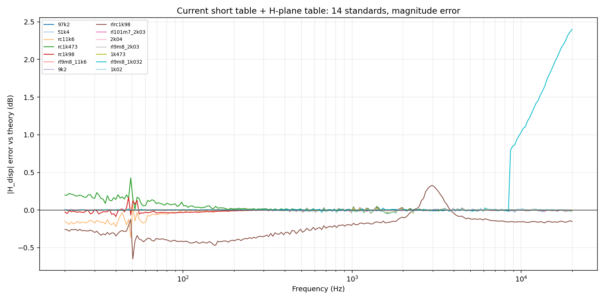
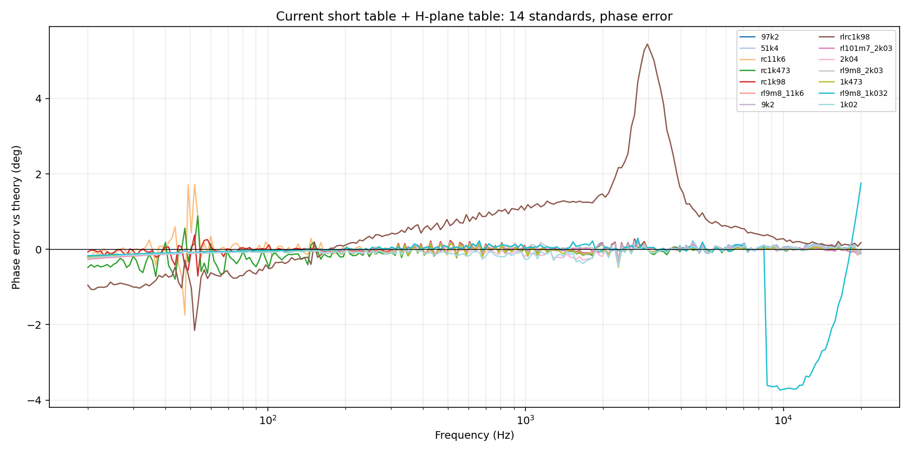
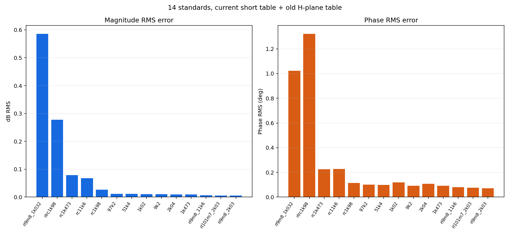
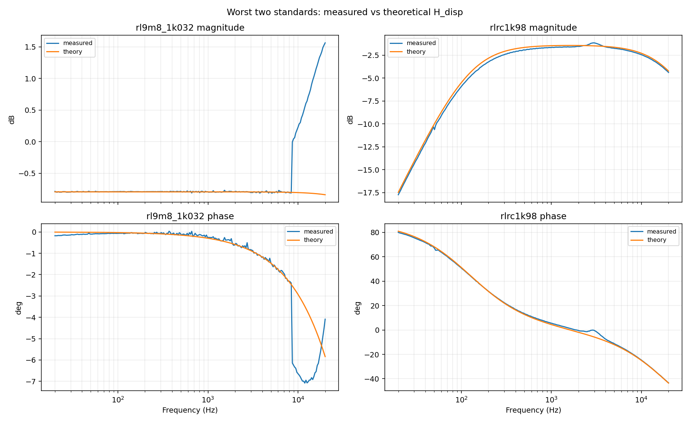

# 当前短接表 + H 平面表的 14 组标准件误差分析（2026-11-02）

## 1. 数据与口径

- 短接表：`data/calibration_table.json`
  - `created = 2026-10-29T02:28:39`
  - `repeat = 5`
  - `source = dashboard one-click short calibration`
  - 240 个 `direct` 频点
- H 平面表：`data/input_network.json`，14 行，`R_ref = 10986 Ω`
- 标准件：`tools/hplane_standards.example.json`
- 原始扫频：`data/history.csv` 中这 14 个标准件对应的 sweep
- 理论模型：

```text
Z(f) = R + jωL + 1/(jωC)
H_model(f) = R_ref / (Z(f) + R_ref)
```

计算流程：

```text
history 原始 (mag_v_raw, phase_deg_raw)
  → 当前短接表插值并复数校准 H = H_raw · S
  → 旧 H 平面表 deembed 得到 H_disp
  → 与 H_model 比较 dB / phase 误差
```

> 这是 **in-sample 检查**：H 平面表本身由同一批标准件建立；同时短接表是当前 persistent session，而标准件 sweep 来自 10/27–10/28 的旧 session，因此误差包含 session 不一致，不是独立验证。

## 2. 总体结果

| 指标 | 数值 |
|---|---:|
| dB RMS 均值 | 0.080 dB |
| dB RMS 中位数 | 0.011 dB |
| dB RMS 最大 | 0.586 dB（`rl9m8_1k032`） |
| 相位 RMS 均值 | 0.268° |
| 相位 RMS 中位数 | 0.104° |
| 相位 RMS 最大 | 1.322°（`rlrc1k98`） |
| dB RMS < 0.1 dB 且相位 RMS < 1° | 12 / 14 |
| 排除 `rl9m8_1k032` 后 dB / 相位 RMS 均值 | 0.041 dB / 0.210° |

分频段均值：

| 频段 | dB RMS 均值 | 相位 RMS 均值 |
|---|---:|---:|
| 20–200 Hz | 0.050 dB | 0.194° |
| 200–2000 Hz | 0.031 dB | 0.145° |
| 2–20 kHz | 0.091 dB | 0.329° |

高频均值主要被 `rl9m8_1k032` 拉高。

## 3. 逐标准件结果

按 dB RMS 从大到小：

| 标准件 | 拓扑 | dB RMS | dB max | 相位 RMS | 相位 max | max\|H\| | \|H\|≥1 点数 |
|---|---|---:|---:|---:|---:|---:|---:|
| `rl9m8_1k032` | series_rl | 0.586 | 2.401 | 1.022 | 3.734 | 1.197 | 29 |
| `rlrc1k98` | series_rlc | 0.278 | 0.649 | 1.322 | 5.444 | 0.964 | 0 |
| `rc1k473` | series_rc | 0.079 | 0.428 | 0.224 | 0.885 | 0.646 | 0 |
| `rc11k6` | series_rc | 0.068 | 0.365 | 0.228 | 1.742 | 0.411 | 0 |
| `rc1k98` | series_rc | 0.027 | 0.168 | 0.114 | 0.711 | 0.633 | 0 |
| `97k2` | resistor | 0.012 | 0.037 | 0.100 | 0.334 | 0.104 | 0 |
| `51k4` | resistor | 0.011 | 0.036 | 0.099 | 0.327 | 0.178 | 0 |
| `1k02` | resistor | 0.011 | 0.042 | 0.119 | 0.441 | 0.920 | 0 |
| `9k2` | resistor | 0.011 | 0.036 | 0.093 | 0.293 | 0.545 | 0 |
| `2k04` | resistor | 0.010 | 0.037 | 0.108 | 0.433 | 0.847 | 0 |
| `1k473` | resistor | 0.009 | 0.043 | 0.092 | 0.473 | 0.885 | 0 |
| `rl9m8_11k6` | series_rl | 0.006 | 0.020 | 0.080 | 0.272 | 0.500 | 0 |
| `rl101m7_2k03` | series_rl | 0.006 | 0.020 | 0.076 | 0.252 | 0.973 | 0 |
| `rl9m8_2k03` | series_rl | 0.005 | 0.023 | 0.071 | 0.262 | 0.857 | 0 |

完整数据：[`hplane_current_short_summary.csv`](hplane_current_short_summary.csv)。

## 4. 曲线

### 4.1 幅频误差



绝大多数曲线在 0 dB 附近：电阻和纯 RL 基本压在 ±0.02 dB 内；RC 在低频有 0.1–0.4 dB 的起伏。

### 4.2 相频误差



- RC 在 47–53 Hz 附近有尖峰，最大约 1.7°；
- `rlrc1k98` 在 2.8–3.1 kHz 附近有约 5° 的相位峰；
- `rl9m8_1k032` 在 8.9 kHz 以上相位误差突然变大。

### 4.3 RMS 排序



### 4.4 最差两只的实测 vs 理论



## 5. 关键问题

### 5.1 `rl9m8_1k032`：|H| ≥ 1，短接表与 sweep 不是同一 session

- `max|H| = 1.197`，29 个频点 `|H| ≥ 1`；
- 从约 **8.9 kHz** 开始出现；
- `input_network.deembed_complex()` 对 `|H| > 0.999` 直接返回原 H，不再做去嵌入；
- 因此 20 kHz 处实测 1.56 dB，而理论是 −0.84 dB，误差 2.40 dB；相位误差也有 3.7°。

这不是 H 平面插值误差，而是**当前短接表 × 旧标准件 sweep** 的 session 不一致。旧 H 平面表建立时用的是 `cal_board` 短接表，当前表是 persistent session 的 5 轮短接表；`rl9m8_1k032` 的 H 正好跨过 1，导致去嵌入被旁路。

### 5.2 `rlrc1k98`：近谐振区相位敏感

`rlrc1k98` 是 1.98 kΩ + 98.7 mH + 98.11 nF 的串联 RLC：

- 幅频 RMS 只有 0.278 dB，但相位 RMS 1.322°，最大 5.44°；
- 最大相位误差出现在 2.8–3.1 kHz；
- 该区域 H 的相位变化快，H 平面 IDW 插值和旧表 session 误差都会被放大；
- 没有 `|H| ≥ 1`，所以不是旁路问题，更像旧 H 平面表在谐振区的插值/模型误差。

### 5.3 RC 低频 50 Hz 尖峰

`rc11k6` 在 47.6 Hz 相位误差 1.74°，`rc1k473` 在 53.4 Hz 误差 0.89°，同时有 0.2–0.4 dB 的幅值起伏。频率正好在 50 Hz 工频附近，属于低频干扰/短时漂移，不是 H 平面表本身能消除的。

### 5.4 电阻和纯 RL 很好

所有纯电阻和纯 RL 的 dB RMS ≤ 0.012 dB、相位 RMS ≤ 0.12°，说明：

- 当前短接表在大部分频段与旧 H 平面表兼容；
- H 平面表的 IDW/去嵌入主路径没有问题；
- 主要误差集中在 **RLC 谐振区** 和 **|H| ≥ 1 的 session 不一致点**。

## 6. 结论

1. **12/14 标准件通过** `<0.1 dB` 且 `<1°` 的 RMS 门限；中位数只有 0.011 dB / 0.104°。
2. 最差的 `rl9m8_1k032` 不是 H 平面表算法问题，而是 **当前短接表与旧 sweep 不同 session**，且 29 个点 `|H| ≥ 1` 被去嵌入逻辑旁路。
3. `rlrc1k98` 的相位误差集中在近谐振区，幅频仍很好；需要对谐振区增加频点/周期数，或重新采当前 session 的标准件。
4. RC 的 50 Hz 尖峰是低频干扰，建议平均/避开 50 Hz 或加陷波。
5. 这批标准件是旧 session 数据，不能作为“当前短接表 + 当前 H 平面表”的独立验证。要做严格验证，应在当前 persistent session 下重新扫 14 只标准件，再用新 sweep 重建/校验 H 平面表。

## 7. 产物

- [`hplane_current_short_summary.csv`](hplane_current_short_summary.csv)：逐标准件 RMS/max/分频段统计
- `hplane_current_short_db_error.png`：幅频误差曲线
- `hplane_current_short_phase_error.png`：相频误差曲线
- `hplane_current_short_rms_bar.png`：RMS 排序
- `hplane_current_short_worst_curves.png`：最差两只的实测 vs 理论
- 原始逐点曲线在分析目录 `curves.csv`（未放入仓库）
