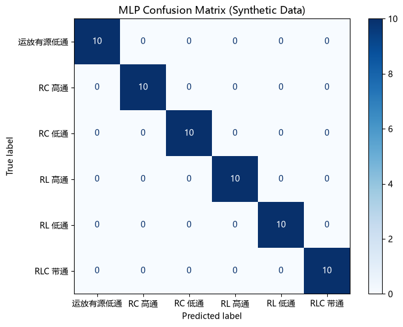

# ML 训练报告 (实测检验)

## 1. 数据来源与训练策略
- **训练集**: 100% 纯合成数据 (通过 `gen_mock.py` 物理公式生成)。
- **测试集**: 从合成数据中划分的 20% 数据。
- **域外测试 (OOD)**: 必须显式传入 `--real` 且文件存在，才认定为真实硬件采集的 CSV，防止用仿真数据伪造实测。

## 2. 模型性能 (基于合成数据)
- **决策树 (DT) 准确率**: 100.00%
- **神经网络 (MLP) 准确率**: 100.00%
> *注：由于训练集和测试集均来自高度理想的合成数据，模型极易达到极高准确率。该数字仅反映算法在合成数据上的可分性，不代表真实硬件环境下的泛化表现。真实表现请参考下文的域外测试结果。*

### 混淆矩阵

## 3. 外部数据测试结果
真实数据 `dataset_rc_lpf.csv` 被模型判定为: **RC 低通**，置信度: **94.98%**。

> 注：此数据**未参与训练**，仅用于检验合成模型在真实硬件上的泛化能力。
