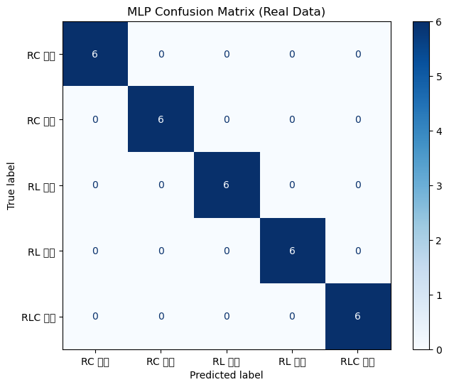

# ML 训练报告 (实测数据训练)

## 1. 数据来源与训练策略
- **训练集**: 真实硬件采集，共 150 条曲线（rc_highpass 30 条、rc_lowpass 30 条、rl_highpass 30 条、rl_lowpass 30 条、rlc_bandpass 30 条）。
- **划分**: 每条曲线一个样本，按类别分层抽取 20% 作为测试集。
- **数据来源**: `tools/collect_dut.py` 通过网页后端采集，已应用校准表与输入网络去嵌入。

## 2. 模型性能 (实测数据)
- **决策树 (DT) 准确率**: 100.00%
- **神经网络 (MLP) 准确率**: 100.00%
### 混淆矩阵

## 3. 外部数据测试结果
本次训练集为真实采集数据，未执行额外的域外测试；模型泛化能力请看上面的测试集指标。
