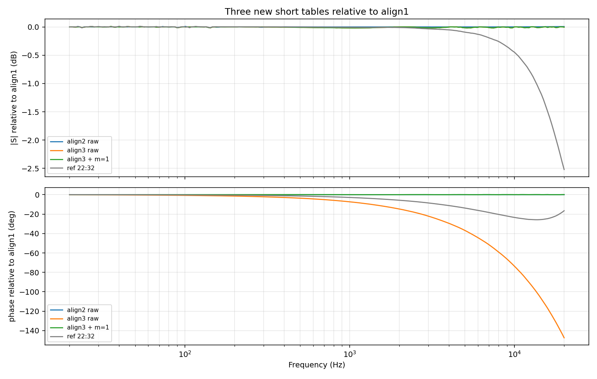

# 短接表软件对齐测试（2026-11-02）

## 1. 软件方案

新增两个**非侵入式**工具：

- `python_model/short_alignment.py`：估计两张短接表之间的整数/分数采样偏移；
- `tools/short_compare.py`：多表对比 CLI，可输出 Markdown/CSV/JSON，并可选写出对齐后的表。

约定：

```text
S_new(f) · exp(+j2π f m/fs) ≈ S_ref(f)
```

`m` 是带符号的采样偏移；`m>0` 表示新表需要相位超前 `m` 个采样才能对齐参考表。该工具只用于离线/诊断，不修改 `data/calibration_table.json`，也不进入 dashboard 的 live 测量路径，因此不会和当前短接校准冲突。

用法：

```bash
python3 tools/short_compare.py \
  --reference /tmp/hplane_eval/align_ref.json \
  --cal /tmp/hplane_eval/align1.json \
        /tmp/hplane_eval/align2.json \
        /tmp/hplane_eval/align3.json \
  --output /tmp/hplane_eval/align_compare.md \
  --corrected-dir /tmp/hplane_eval/aligned
```

## 2. 三次重启 + 参考扫频

实验前当前表（reference）created=`2026-10-28T22:32:35`，已备份。之后执行 3 次：

1. `start_dashboard.sh` 重启；
2. `/api/start_reference` 做 240 点短接参考扫频；
3. 保存 `align1/2/3`。

| 表 | 板端 created | 20 kHz \|S\| | 20 kHz 相位 |
|---|---|---:|---:|
| `reference` | 22:32:35 | 5.344e-5 | −86.04° |
| `align1` | 22:59:40 | 7.144e-5 | −69.48° |
| `align2` | 23:00:54 | 7.149e-5 | −69.46° |
| `align3` | 23:04:29 | 7.141e-5 | +143.14° |

> 第 3 次首次启动失败：系统 numpy 的 `linalg.cpython-310.pyc` 损坏（`bad marshal data`）。清理该 pyc 后重启成功；失败那次不计入数据，`align3` 是修复后的结果。

## 3. 三份新表两两对比

| A | B | m_int | m_frac | 原始 dB rms | 原始相位 rms | int 校正后相位 rms |
|---|---|---:|---:|---:|---:|---:|
| `align1` | `align2` | 0 | −0.0002 | 0.002 | 0.007° | 0.007° |
| `align1` | `align3` | 1 | 1.0000 | 0.008 | 40.156° | **0.034°** |
| `align2` | `align3` | 1 | 1.0001 | 0.009 | 40.163° | **0.034°** |



结论：

- `align1` 与 `align2` **同状态**：0.002 dB / 0.007° rms，`m_int=0`。
- `align3` 与 `align1/2` 的差异是**纯整数采样延迟**：`m_int=1`，原始相位 40.16° rms；对齐后降到 **0.034° rms**，幅度残差仍只有 0.008 dB。
- 软件方案成功地把“差一个采样”从 40° 量级压到 0.03° 量级。

## 4. 与实验前 reference 的对比

| 表 | m_int | m_frac | 原始 dB rms | 原始相位 rms | int 校正 dB rms | int 校正相位 rms | frac 校正相位 rms |
|---|---:|---:|---:|---:|---:|---:|---:|
| `align1` | 0 | −0.2049 | 0.458 | 10.383° | 0.458 | 10.383° | 3.701° |
| `align2` | 0 | −0.2050 | 0.460 | 10.390° | 0.460 | 10.390° | 3.702° |
| `align3` | 1 | 0.7951 | 0.457 | 30.506° | 0.457 | 10.390° | 3.705° |

- 三份新表相对旧 reference 都有约 **0.46 dB** 的高频增益差，且 `m_int` 为 0 或 1；这不属于纯延迟，整数校正无法消除。
- 分数校正可以把相位从 10.4° 降到约 3.7°，但 0.46 dB 幅度差仍在，说明还存在 Codec/模拟高频状态差异。
- 也就是说：**软件方案能解决“一采样”问题，但不能解决增益状态变化**；这与上一轮结论一致。

## 5. 对齐表验证

用 `--corrected-dir` 写出 `align3` 的对齐表（`m=1`），再与 `align1` 比较：

```text
align3.aligned vs align1:
  m_int = 0
  dB rms = 0.008
  phase rms = 0.034°
```

说明对齐操作是有效的，且没有引入额外幅度变化。

## 6. 当前状态

- 线上 `data/calibration_table.json` 保留为 `align3`（created `23:04:29`）；
- dashboard 仍在运行，reference done=true；
- `data/input_network.json` 未改；
- 实验前 reference 备份在 `/tmp/hplane_eval/align_ref.json`，三次新表在 `/tmp/hplane_eval/align1/2/3.json`；
- 软件工具和测试已加入仓库：
  - `python_model/short_alignment.py`
  - `tools/short_compare.py`
  - `tests/test_short_alignment.py`

## 7. 建议

1. **保留当前软件工具**作为诊断/legacy 数据对齐手段；不要把 `m` 固定硬编码进 live 测量。
2. 当前三份新表共享一个新的高频增益状态（相对旧 reference +0.46 dB）；如果这个状态不是预期的，应该优先检查 Codec/模拟前端状态，或按 RTL 启动方案复位后重测，而不是继续用延迟校正。
3. 若后续实现 RTL `i2s_en`/Codec 复位，重复本实验；正常情况下三份新表的 `m_int` 应都为 0，`m_frac` 应接近 0，软件对齐退化为 no-op。
