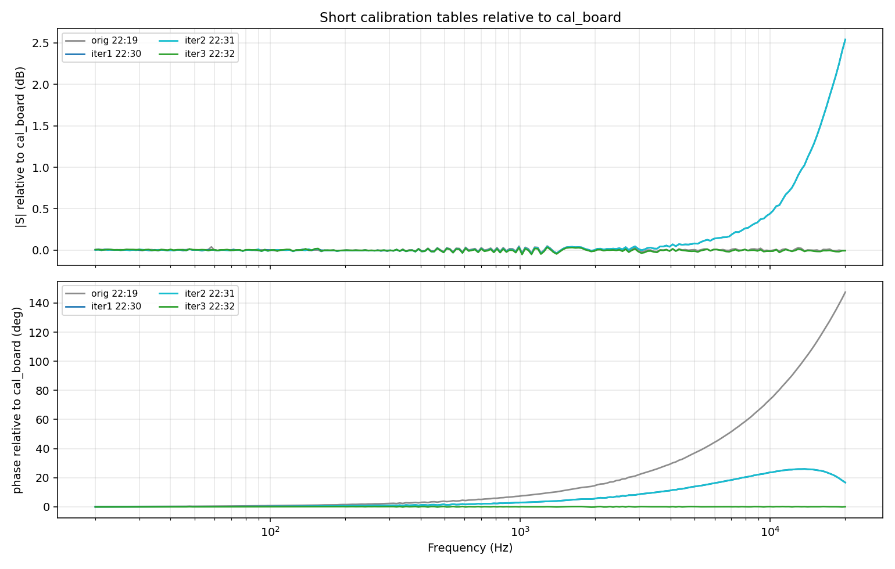
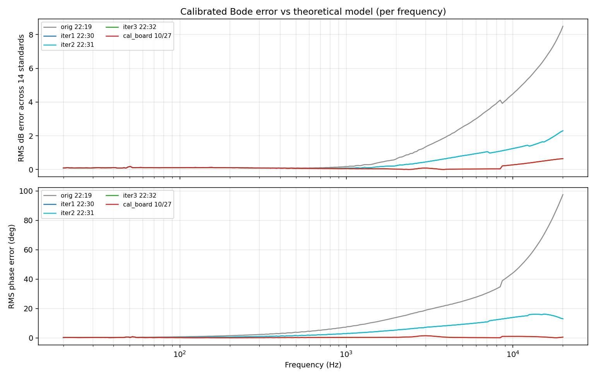
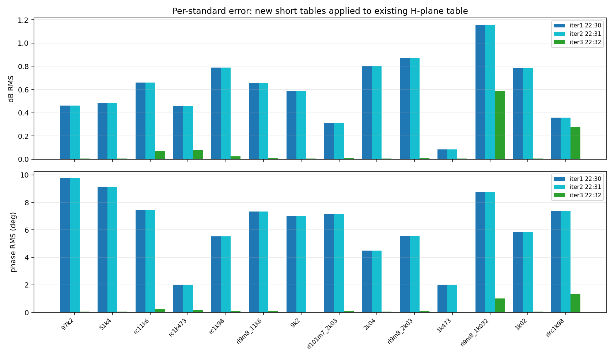

# 短接参考扫频重复性与 14 组标准件误差实验（2026-11-02）

## 1. 实验目的与操作

当前夹具处于**短接**状态。按以下流程重复 3 次：

1. `start_dashboard.sh` 重启 dashboard（重新加载 Codec/PL）；
2. 调用 `/api/start_reference` 做一轮 240 点短接参考扫频；
3. 保存新生成的 `data/calibration_table.json`；
4. 把新短接表套到现有 H 平面表的 14 组标准件原始扫频上，比较校准后的幅频/相频与理论模型。

> 时间说明：板端时钟为 `2026-10-28 22:28–22:33 UTC`，主机时间为 `2026-11-02 12:40–12:52 +08`；板端时钟未同步，文中 `created` 均用板端时间。

> **本次只接了短接，没有重新逐只接 14 组标准件测量。** 误差分析是把 `data/history.csv` 里这些标准件的旧 raw 扫频套上新短接表，再用现有 H 平面表去嵌入；因此它衡量的是**短接表跨 session 迁移误差**，不是“在新 session 下重测 14 组标准件”的误差。

每轮 dashboard 启动耗时约 23/31/36 s，参考扫频约 20 s，三次均返回：

```text
reference = {done: true, error: null, message: "相位对齐完成", progress: 240}
```

实验前原始短接表已备份到板端 `/tmp/hplane_eval/cal_original.json`，H 平面表 `data/input_network.json` 未改动。实验结束后 dashboard 保留在第三次（iter3）的短接表上运行。

## 2. 三次新短接表

| 表 | 板端 created | 20 kHz \|S\| | 20 kHz 相位 | 相对 `cal_board` 幅度 rms/max | 相对 `cal_board` 相位 rms/max |
|---|---|---:|---:|---:|---:|
| `cal_board`（建 H 平面表时用） | 2026-10-27 20:16:31 | 5.348e-5 | −86.06° | 0 / 0 | 0 / 0 |
| `orig`（实验前 22:19 表） | 2026-10-28 22:19:16 | 5.344e-5 | +61.43° | 0.014 / 0.050 dB | 40.18 / 147.49° |
| `iter1`（第 1 次重启） | 2026-10-28 22:30:06 | 7.164e-5 | −69.40° | 0.461 / 2.540 dB | 10.43 / 25.98° |
| `iter2`（第 2 次重启） | 2026-10-28 22:31:18 | 7.166e-5 | −69.40° | 0.461 / 2.541 dB | 10.43 / 25.98° |
| `iter3`（第 3 次重启） | 2026-10-28 22:32:35 | 5.344e-5 | −86.04° | 0.014 / 0.052 dB | 0.09 / 0.25° |



关键观察：

- `iter1` 与 `iter2` **几乎完全一致**：幅度 0.003 dB rms / 0.015 dB max，相位 0.004° rms / 0.022° max；说明参考扫频本身在“同一状态”内重复性很好。
- `iter3` 与建表短接 `cal_board` **几乎一致**：幅度 0.014 dB rms / 0.052 dB max，相位 0.09° rms / 0.25° max。
- `iter1/2` 与 `iter3` 的差异是**系统性状态差**，不是随机噪声：高频幅度高约 2.54 dB（20 kHz），相位差约 16.6°（20 kHz），10 kHz–20 kHz 频段相位差约 24° rms。
- `orig` 22:19 表与 `cal_board` 的幅度几乎相同，但相位整体旋转约 **147.5° @ 20 kHz**（约一个采样 20.48 µs），属于跨进程帧相位差。

## 3. 14 组标准件的误差

把每张新短接表乘到 14 组标准件的**原始未校准扫频**上，再用现有 14 行 H 平面表去嵌入，和理论 `R_ref/(Z_dut+R_ref)` 比较。每组 240 点，14 组共 3360 点。

### 3.1 总体误差

| 短接表 | 幅度 rms | 幅度 max | 相位 rms | 相位 max | \|H\|≥1 点数 |
|---|---:|---:|---:|---:|---:|
| `orig` 22:19 | 2.383 dB | 14.016 dB | 25.551° | 149.286° | 30 |
| `iter1` | 0.660 dB | 4.955 dB | 6.780° | 24.147° | 62 |
| `iter2` | 0.660 dB | 4.957 dB | 6.780° | 24.149° | 62 |
| `iter3` | **0.176 dB** | **2.409 dB** | **0.459°** | **5.478°** | 29 |
| `cal_board` | 0.177 dB | 2.415 dB | 0.456° | 5.443° | 29 |

- `iter3` 与 `cal_board` 的总体误差几乎相同。
- 误差最大值主要由近短路的 `rl9m8_1k032`（1.051 kΩ + 9.8 mH）贡献：它本身 |H| 已接近 1，3360 点中有 29–35 点进入 `|H|≥1` 的区域。
- 去掉 `rl9m8_1k032` 后：

| 短接表 | 幅度 rms | 幅度 max | 相位 rms | 相位 max |
|---|---:|---:|---:|---:|
| `iter1/2` | 0.605 dB | 2.735 dB | 6.605° | 24.147° |
| `iter3` | 0.083 dB | 0.647 dB | 0.383° | 5.478° |
| `orig` | 2.427 dB | 14.016 dB | 24.474° | 144.422° |

### 3.2 分频段误差

单位：幅度 dB rms / 相位 °rms。

| 短接表 | 20–100 Hz | 100 Hz–1 kHz | 1–10 kHz | 10–20 kHz |
|---|---:|---:|---:|---:|
| `orig` | 0.109 / 0.440 | 0.111 / 3.470 | 2.216 / 22.755 | 6.351 / 69.009 |
| `iter1` | 0.109 / 0.276 | 0.095 / 1.391 | 0.664 / 8.201 | 1.679 / 15.129 |
| `iter2` | 0.109 / 0.275 | 0.095 / 1.392 | 0.665 / 8.201 | 1.680 / 15.130 |
| `iter3` | 0.109 / 0.267 | 0.092 / 0.184 | 0.079 / 0.631 | 0.482 / 0.709 |
| `cal_board` | 0.109 / 0.257 | 0.092 / 0.178 | 0.080 / 0.626 | 0.484 / 0.719 |

低频段（20 Hz–1 kHz）三组新表都只有约 0.1 dB / 0.3° 的差别；**差异集中在 1 kHz 以上**，10–20 kHz 最明显。



### 3.3 逐标准件误差（dB rms / 相位 °rms）

| 标准件 | `iter1` | `iter2` | `iter3` |
|---|---:|---:|---:|
| `97k2` | 0.463 / 9.778 | 0.463 / 9.779 | 0.005 / 0.044 |
| `51k4` | 0.485 / 9.137 | 0.485 / 9.137 | 0.005 / 0.042 |
| `rc11k6` | 0.659 / 7.455 | 0.659 / 7.455 | 0.069 / 0.243 |
| `rc1k473` | 0.457 / 1.983 | 0.457 / 1.983 | 0.077 / 0.181 |
| `rc1k98` | 0.789 / 5.535 | 0.789 / 5.535 | 0.025 / 0.093 |
| `rl9m8_11k6` | 0.656 / 7.332 | 0.657 / 7.332 | 0.013 / 0.086 |
| `9k2` | 0.587 / 6.996 | 0.587 / 6.996 | 0.005 / 0.035 |
| `rl101m7_2k03` | 0.315 / 7.154 | 0.315 / 7.155 | 0.012 / 0.091 |
| `2k04` | 0.804 / 4.504 | 0.804 / 4.504 | 0.006 / 0.045 |
| `rl9m8_2k03` | 0.873 / 5.562 | 0.873 / 5.562 | 0.009 / 0.104 |
| `1k473` | 0.083 / 2.001 | 0.083 / 2.000 | 0.004 / 0.023 |
| `rl9m8_1k032` | 1.157 / 8.749 | 1.157 / 8.749 | 0.586 / 1.022 |
| `1k02` | 0.787 / 5.836 | 0.787 / 5.836 | 0.006 / 0.042 |
| `rlrc1k98` | 0.358 / 7.393 | 0.358 / 7.394 | 0.278 / 1.332 |



`iter3` 下除近短路的 `rl9m8_1k032`（0.586 dB / 1.022°）和 `rlrc1k98`（0.278 dB / 1.332°）外，其余 12 组均 <0.08 dB / <0.25° rms。

## 4. 结论与解释

### 4.1 结论

1. **三次重启参考扫频得到两个不同的短接状态**：`iter1`/`iter2` 高度一致，但与 `iter3`/`cal_board` 相差约 2.5 dB（20 kHz）和 16.6°；`iter3` 与建表短接几乎重合。
2. **把新短接表套到旧标准件 raw 上，误差与“短接表是否和建表 session 接近”强相关**：
   - `iter3`（≈`cal_board`）：0.176 dB / 0.459° rms；
   - `iter1/2`（不同状态）：0.660 dB / 6.78° rms，10–20 kHz 达 1.68 dB / 15.1° rms；
   - `orig` 22:19（一个采样相位旋转）：2.38 dB / 25.55° rms，10–20 kHz 达 6.35 dB / 69° rms。
3. **误差集中在高频**。20 Hz–1 kHz 三组新表都只有约 0.1 dB / 0.3° 的差别；1 kHz 以上开始分化，10–20 kHz 最明显。因此，低频短接检测通过，并不代表高频短接状态正确。

### 4.2 这不是“iter1/2 的短接表坏了”

需要区分两种用法：

- **当前 DUT + 同一进程的参考扫频**：短接和 DUT 共享同一环路响应 `S_new`，`H_cal = raw · S_new^-1` 中的 `S_new` 会抵消，H 平面表仍应按设计工作；
- **旧标准件 raw + 新短接表**：旧 raw 里带的是旧 session 的 `S_old`，套上 `S_new` 后残余 `S_old/S_new`。本实验做的正是后者，所以它衡量的是**短接表跨 session 的迁移误差**，不是新短接表本身“坏了”。

`iter1/2` 与 `iter3` 的 2.5 dB/16.6° 差异说明环路状态发生了系统性变化（Codec/帧对齐/夹具接触等），而不是随机噪声；具体原因仅凭现有数据不能唯一确定。能确定的是：**旧标准件数据不能跨 session 复用**；如果要用它们验证/重建 H 平面表，必须使用同一 session 的短接表，或在当前 session 重新测 14 组标准件。

### 4.3 对参考扫频检查的建议

当前 `startup_reference` 只用前 5 个频点（20–22.5 Hz）做短接判据，三次都能通过，但它在高频状态不一致时没有告警。建议至少记录并在网页/日志中显示：

- 20 kHz 的 `|S|` 与相位（本次良好状态约 `5.35e-5 / −86°`；`iter1/2` 为 `7.16e-5 / −69.4°`）；
- 短接表与上一次/建表短接的幅度、相位差异（注意跨进程可能有整采样相位旋转，不能只看绝对相位）。

但不要简单把“20 kHz 相位不等于 −86°”判为失败：跨进程帧对齐可能整体旋转一个采样（`orig` 22:19 就是这种情况）。更稳妥的做法是**同一 session 重测一只标准件**或比较短接表的幅度形状，而不是仅凭单点相位。

## 5. 产物

- `short_repeat_summary.csv`：每次运行的总体误差；
- `short_repeat_per_standard.csv`：14 组标准件逐项误差；
- `short_repeat_band_results.json`：分频段误差；
- 三张图：短接表差异、逐频误差、逐标准件柱状图；
- 板端原始短接表备份：`/tmp/hplane_eval/cal_original.json`；
- 三次新表：`/tmp/hplane_eval/cal_iter{1,2,3}.json`（板端），工作区副本在 `tmp/short_repeat/`。

> 实验后线上 `data/calibration_table.json` 保留为 `iter3`（与 `cal_board` 最接近）；`data/input_network.json` 未改动。
